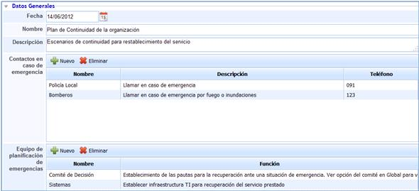
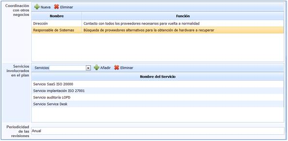
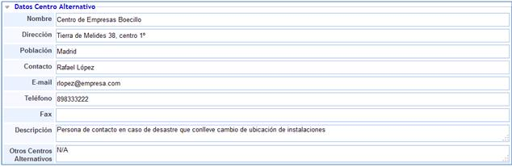
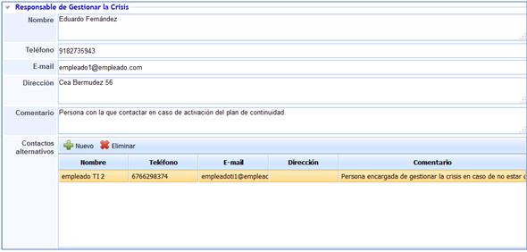
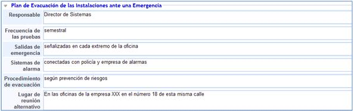
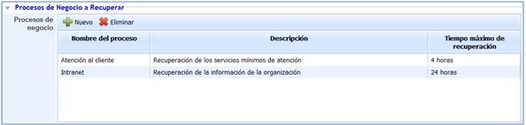
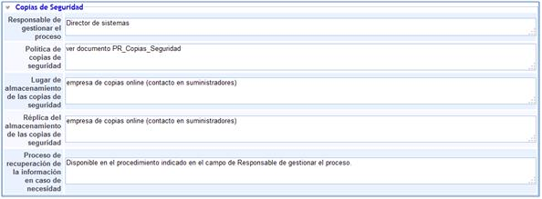
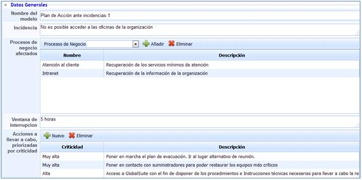

# Continuidad

La presente opción permite establecer el Plan de Continuidad dentro de la solución.

En la pantalla principal se podrá identificar todos aquellos planes de continuidad que se hayan definido.

* **Nuevo:** Permite generar un nuevo Plan de Continuidad.
* **Eliminar:** Permite eliminar uno de los Planes de Continuidad definidos.
* **Descarga:** Permite obtener un listado de todos los planes de continuidad definidos.

## Datos Generales

Esta parte del Plan de continuidad permite establecer todos los datos generales que son necesarios para una adecuada definición del mismo.

Las opciones proporcionadas por GlobalSuite son las mostradas a continuación:

* **Fecha:** Establece la fecha en la que se define el Plan de Continuidad.
* **Nombre:** Permite definir el nombre concreto del Plan de Continuidad.
* **Descripción:** Permite determinar en qué consiste el Plan definido en la presente opción.
* **Contactos en caso de emergencia:** Establece todos aquellos contactos que puedan ser necesarios en caso de precisar de ellos ante una situación de emergencia.
* **Equipo de planificación de emergencias:** Permite determinar qué personas se encargarán de gestionar las emergencias.

* **Coordinación con otros negocios:** Permite establecer el empleado encargado de coordinar las acciones con otros negocios.
* **Servicios involucrados en el plan:** Establece los servicios que cubre el Plan de Continuidad definido.
* **Periodicidad de las revisiones:** Establece cada cuánto tiempo se procederá a revisar el Plan de Continuidad definido.

## Datos del Centro Alternativo

A través de la presente opción, GlobalSuite permite establecer los datos necesarios para definir adecuadamente el centro alternativo disponible en caso de incidencia grave.

La solución proporciona los siguientes campos poder definir los datos del centro alternativo:

* **Nombre:** Permite establecer el nombre del centro alternativo.
* **Dirección:** Permite determinar la ubicación donde se encuentra el centro alternativo.
* **Población:** Permite establecer la población en la que se encuentra el centro alternativo.
* **Contacto:** Permite definir la persona de contacto con la que gestionar cualquier acción con respecto al centro alternativo.
* **E-mail:** Permite registrar el e-mail de la persona de contacto.
* **Teléfono:** Permite establecer el teléfono donde gestionar cualquier acción con respecto al centro alternativo.
* **Fax:** Permite determinar el fax donde gestionar cualquier acción con respecto al centro alternativo.
* **Descripción:** Permite establecer cualquier otra información que pueda ser interesante con respecto al centro alternativo.
* **Otros Centros Alternativos:** Permite determinar otro posibles centros alternativo a parte del definido en la presente opción.

## Responsable de gestionar la crisis

En esta opción GlobalSuite le permitirá definir los datos necesarios para determinar toda la información de contacto necesaria del responsable encargado de gestionar la crisis.

* **Nombre:** Permite determinar el nombre de la persona que se encarga de gestionar la crisis.
* **Teléfono:** Permite definir el teléfono de contacto en caso de crisis.
* **E-mail:** Permite definir el e-mail de contacto en caso de crisis.
* **Dirección:** Permite determinar la dirección donde se podrá encontrar la persona encargada de gestionar la crisis.
* **Comentario:** Permite establecer cualquier tipo de información o comentario necesario para poder ponerse en contacto con la persona encargada de la gestión de la crisis.
* **Contactos Alternativos:** Permitirá definir todos aquellos contactos disponibles y alternativos al responsable.

## Plan de Evacuación de las Instalaciones ante una Emergencia

Las opciones presentadas por el Plan de Evacuación de las Instalaciones ante una Emergencia permiten establecer toda la información necesaria que determina las características de los complementos de estos planes.

GlobalSuite proporciona las siguientes opciones para determinar el Plan de Evacuación:

* **Responsable:** La persona encargada de gestionar el plan de evacuación.
* **Frecuencia de las pruebas:** Permite establecer cada cuanto tiempo se realizarán pruebas de evacuación.
* **Salidas de emergencia:** Permite establecer dónde se encuentra o en qué condiciones se encuentran las salidas de emergencia.
* **Sistemas de alarma:** Permite establecer qué sistemas de alarma se dispone y en qué condiciones se encutran.
* **Procedimiento de evacuación:** Permite hacer referencia al procedimiento de actuación para evacuación o definir cómo actuar en este caso.
* **Lugar de reunión alternativo**: Define el lugar donde realizar reunión del personal en caso de evacuación.

## Procesos a Negocio a Recuperar

La presente opción permite definir los procesos necesarios a recuperar así como el tiempo máximo de recuperación.

* **Nuevo**: Permite generar todos aquellos procesos que se deben recuperar.
* **Eliminar:** Permite borrar los procesos generados.

Una vez generados los procesos a recuperar, la solución permite definir los siguientes campos:

* **Nombre del Proceso:** Permite determinar el proceso a recuperar.
* **Descripción:** Permite detallar cualquier información que se considere necesaria para una adecuada definición del proceso.
* **Tiempo máximo de recuperación:** Establece el tiempo máximo que se dispone para recuperar el proceso en concreto.

## Suministradores

La opción suministradores lanza de forma directa un mensaje en el que te envía a la opción suministradores de la solución.

## Copias de Seguridad

La opción Copias de Seguridad permite hacer referencia a toda la información necesaria para una adecuada gestión de cualquier copia de seguridad cuando sea necesaria de utilizar en caso de emergencia.

Los siguientes campos son los proporcionados por GlobalSuite para realizar el registro de toda la información necesaria para gestionar las copias de seguridad en caso de desastre:

* **Responsable de gestionar el proceso:** Permite establecer quién es la persona encargada de gestionar el proceso de copias de seguridad.
* **Política de Copias de Seguridad:** Permite determinar o hacer referencia de cuál es la política a seguir las copias de seguridad.
* **Lugar de almacenamiento de las copias de seguridad:** Permite establecer el lugar donde se encuentran las copias de seguridad.
* **Réplica del almacenamiento de las copias de seguridad:** Permite determinar el lugar donde se encuentran las réplicas de las copias de seguridad de la información.
* **Proceso de recuperación de la información en caso de necesidad:** Permite establecer o hacer referencia a la forma de proceder con respecto a la recuperación de la información.

## Modelos del Plan de acción ante incidencias

Permite establecer varios planes de acción donde se definen los pasos a seguir en caso de ocurrencia de desastre.

La solución permite:

* **Nuevo:** Generar todos aquellos modelos de actuación necesarios para actuar ante las incidencias o emergencias acontecidas.
* **Eliminar:** Permite eliminar los planes de acción generados previamente.

Para acceder a cada uno de los Planes de Acción definidos es preciso pulsar sobre el nombre del modelo. Una vez se realiza el acceso, GloblaSUITE presenta las siguientes opciones que permiten definir cada uno de los Planes de Acción.

* **Nombre del modelo:** Permite detallar el nombre del conjunto de tareas definidas para la restauración.
* **Incidencia:** Permite establecer las causas que han provocado la realización de las acciones de restauración.
* **Procesos de negocio afectados:** Permite establecer todos aquellos procesos de negocio que pueden ser recuperados en caso de activación del modelo.
* **Ventana de interrupción:** Establece el tiempo máximo de recuperación.
* **Acciones a llevar a cabo, priorizadas por criticidad:** Permite establecer todas aquellas tareas que son necesarias para poder llevar a cabo la restauración ante una situación de emergencia.

**NOTA 1:** Para poder añadir cualquier tipo de proceso de negocio que permitirá ser restaurado mediante el modelo, estos deben estar definidos de antemano en la opción Procesos de Negocio.

**NOTA 2:** La opción Continuidad presentada a lo largo del presente punto corresponde con las licencias GlobalSGSI, Global20000 y GlobalSGPIC. Para el resto de licencias esta opción no estará disponible.
