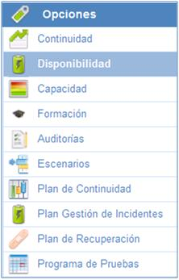
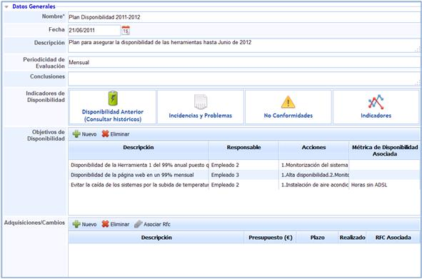
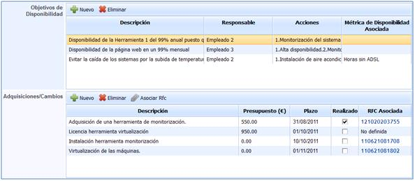
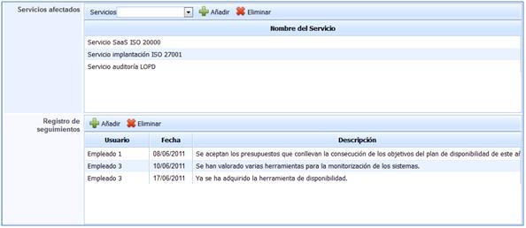

# Disponibilidad

La opción Disponibilidad de GlobalSuite permite definir los Planes de Disponibilidad que se consideren necesarios para la organización.

En la pantalla principal se dispone de todos los planes de disponibilidad que se hayan generado en la solución.

A parte del listado de planes de disponibilidad, la solución proporciona las siguientes herramientas:

* **Nuevo:** Permite generar planes de disponibilidad.
* **Eliminar**: Permite eliminar los planes de disponibilidad definidos. Para realizar esta eliminación es necesario seleccionarlo de forma previa.
* **Descarga:** Permite descargar el listado de planes de disponibilidad generados.

## Datos Generales

En la presente opción, GlobalSUITE permite definir toda la información necesaria para establecer de forma completa un plan de disponibilidad.

* **Nombre:** Permite determinar el nombre del plan de disponibilidad definido.
* **Fecha:** Permite determinar la fecha en la cuál se aprueba y pone en funcionamiento el Plan de Disponibilidad.
* **Descripción:** Permite determinar cualquier detalle que se considere necesario del Plan de Disponibilidad.
* **Periodicidad de Evaluación:** Establece cada cuánto tiempo debe ser revisado el Plan de Disponibilidad.
* **Conclusiones:** Permite definir cualquier conclusión con respecto a la disponibilidad.
* **Indicadores de Disponibilidad:** La herramienta proporciona diferentes opciones que permiten medir la disponibilidad a través de diferentes opciones de GlobalSUITE.

* **Disponibilidad Anterior (Consultar históricos):** Representa y proporciona acceso a planes de disponibilidad que han sido definidos con anterioridad a través de un histórico de Planes de Disponibilidad.
* **Incidencias y Problemas:** Permite identificar, de forma automática, todas aquellas incidencias y problemas relacionados con disponibilidad.
* **No conformidades:** Permite identificar, de forma automática, todos aquellas no conformidades relacionados con disponibilidad.
* **Indicadores:** Permite identificar, de forma automática, todos aquellos indicadores que permite medir los objetivos de disponibilidad definidos.
* **Objetivos de Disponibilidad:** Permite establecer los diferentes objetivos que se quieren conseguir con respecto a la disponibilidad.

Dentro de esta opción, GloblaSUITE permite definir los siguientes campos:

* **Descripción:** Permite establecer el objetivo de disponibilidad que se quiere conseguir.
* **Responsable:** Establece la persona encargada de gestionar y revisar el cumplimiento del objetivo de disponibilidad.
* **Acciones:** Permite establecer las acciones o la metodología a seguir para cumplir con el objetivo definido.
* **Métrica de Disponibilidad Asociada:** Define si existe alguna métrica que permita realizar el seguimiento del objetivo de disponibilidad.
* **Adquisiciones/Cambios:** Determina, en función a los objetivos definidos, todas aquellas adquisiciones y cambios que se consideran necesarios para cumplir con dichos objetivos definidos.

Dentro de esta opción, GlobalSuite permite definir los siguientes campos:

* **Descripción:** Permite establecer la definición de las acciones a realizar con el fin de cumplir con el objetivo de disponibilidad determinado.
* **Presupuesto:** Corresponde con el coste asociado de la adquisición o cambio que a llevar a cabo.
* **Plazo:** Establece la fecha en la cual se debe haber implantado la adquisición o cambio correspondiente.
* **Realizado:** Permite establecer si se ha llevado a cabo dicha adquisición o cambio.
* **RFC Asociada:** Permite asociar el registro del cambio si dicha adquisición se ha llevado a cabo.

Por defecto el campo de Adquisiciones/Cambios aparecerá vacío.

Las adquisiciones y cambios aparecen una vez se ha seleccionado el objetivo de disponibilidad planteado. La forma por tanto de proceder es la presentada a continuación:

1.Selección del objetivo concreto. Una vez seleccionado aparecerá en color naranja por defecto.

2.Una vez seleccionado aparecen de forma automática todas aquellas adquisiciones y cambios que se consideran necesarias para el cumplimiento de objetivo de disponibilidad.

3.Habrá diferentes adquisiciones y cambios en función de cada uno de los objetivos de disponibilidad determinados.

* **Servicios afectados:** Permite determinar los servicios que se ven afectados en caso de no cumplimiento de los objetivos de disponibilidad definidos.

Al igual que ocurre con el campo Adquisiciones/Cambios, los servicios afectados son diferentes en función de los objetivos de disponibilidad definidos. Seleccionando cada uno de los objetivos se podrán mostrar dichos servicios.

* **Registros de seguimientos:** Permite determinar todas aquellas acciones de seguimiento que se han realizado a lo largo del periodo en el que el plan tiene vigencia.

