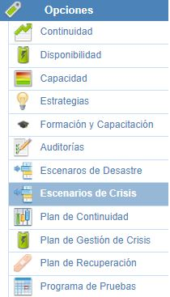
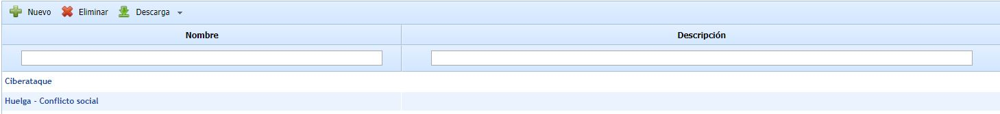
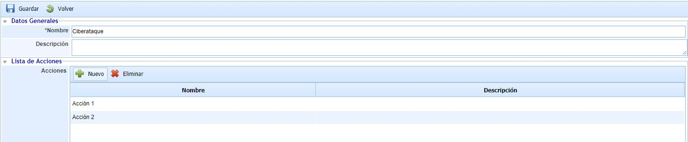
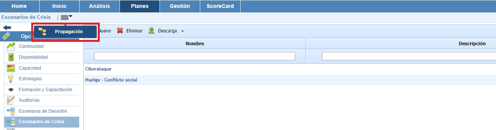
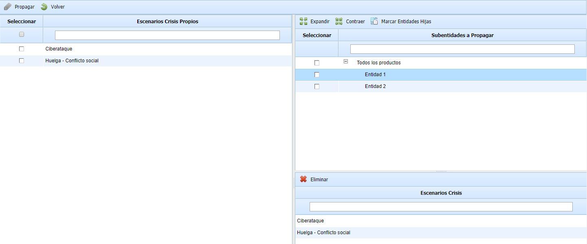

# Escenarios de Crisis

La opción Escenarios de Crisis permite establecer todas aquellas posibles situaciones de crisis que puedan suceder.

En la pantalla principal de Escenarios de Crisis podrá identificar todas aquellas situaciones en las que se pueda ver afectado el servicio ofrecido por la organización.

Dentro de cada uno de los escenarios, GlobalSUITE le permitirá establecer toda la información que se considere necesaria, organizada en los siguientes apartados:

## Datos Generales

* **Nombre:** Permite establecer el nombre del escenario de crisis.

* **Descripción:** Permite establecer cualquier tipo de información adicional que sea necesaria para definir adecuadamente el escenario.

## Lista de Acciones

En el presente apartado permiten definirse todos aquellas acciones que sería necesario llevar a cabo en caso de que tuviera lugar el escenario de crisis. Puede rellenarse tanto el nombre como la descripción de dicha acción.

## Propagación de Escenarios de Crisis

La presente opción permite la propagar los escenarios de crisis definidos en la empresa matriz a las subentidades que dependen de esta.

Una vez se ha accedido a la opción, se muestran las siguientes tablas:

**Tabla izquierda:** Muestra el listado de escenarios de crisis que se han definido en la empresa matriz. Las opciones que permite la tabla son:

* **Propagar:** Una vez seleccionados los escenarios de crisis deseados permite propagar los mismos a las subentidades seleccionadas.
* **Volver:** Ofrece la posibilidad de volver a la pantalla inicial de escenarios de crisis.

**Tabla superior derecha:** Muestra el listado de subentidades a las que se pueden asociar escenarios de crisis de la empresa matriz. Las opciones que permite la tabla son la de expandir o contraer el listado de subentidades.

**Tabla inferior derecha:** Una vez seleccionada la subentidad en la tabla superior, muestra los escenarios de crisis que se han asociado a la misma. La herramienta ofrece la posibilidad de eliminar escenarios asociados, para ello se ha de seleccionar la fila deseada y pulsar sobre el botón 'Eliminar'.
