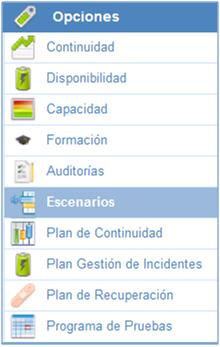
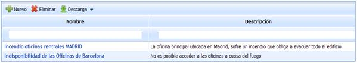
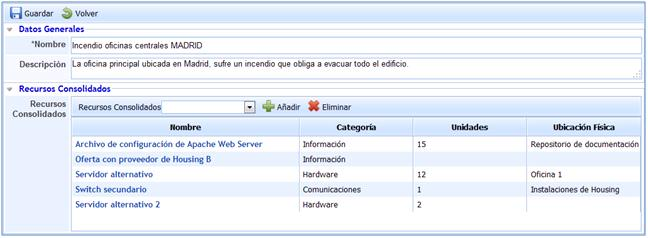
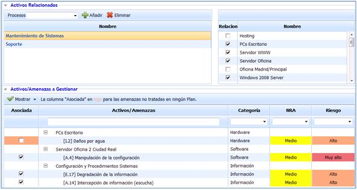

# Escenarios de Desastre

La opción Escenarios de Desastre permite establecer todas aquellas posibles situaciones de emergencia en las que sea necesario activar el Plan de Continuidad.

En la pantalla principal de Escenarios podrá identificar todas aquellas situaciones en las que se pueda ver afectado el servicio ofrecido por la organización.

Dentro de cada uno de los escenarios, GlobalSUITE le permitirá establecer toda la información que se considere necesaria, organizada en los siguientes apartados:

## Datos Generales

* **Nombre:** Permite establecer el nombre del escenario de emergencia.

* **Descripción:** Permite establecer cualquier tipo de información adicional que sea necesaria para definir adecuadamente el escenario.

## Recursos Consolidados

En el presente apartado permiten definirse todos aquellos recursos que son necesarios en caso de ocurrencia del escenario establecido.

Todos estos recursos son definidos con anterioridad en la opción Recursos Consolidados.

## Activos Relacionados

Permite definir todos aquellos procesos que se ven afectados en caso de ocurrencia del escenario. A su vez es posible determinar todos aquellos activos asociados a los procesos que también se ven afectados en caso de ocurrencia del escenario.

## Activos/Amenazas a Gestionar

El presente apartado muestra los activos y amenazas asociadas al escenario que tienen un nivel de riesgo por encima del nivel de riesgo aceptable. Este listado incluye también la lista de amenazas de los procesos seleccionados, así como la de los activos seleccionados y asociados a los procesos. De la misma forma es posible identificar tanto la categoría a la que pertenecen, el nivel de riesgo aceptable aprobado por la organización, como el nivel de riesgo de las amenazas asociadas a cada uno de los activos. el Análisis de Riesgos.

Mediante esta opción se puede evidenciar aquellas amenazas que no están asociadas a ningún escenario de los definidos, identificadas a través de la columna asociadas que aparece en color rojo, tal y como indica la leyenda de la cabecera del presente apartado.

Todas aquellas amenazas asociadas al escenario definido serán marcadas en la columna asociada. Todas las que no sean tenidas en cuenta mediante este escenario no aparecerán marcadas, identificándose en color rojo todas aquellas que no pertenecen o se hayan tenido en cuenta en ninguno de los escenarios definidos.

Por defecto GlobalSUITE muestra tan sólo aquellas amenazas que superan el Nivel de Riesgo Aceptable (NRA), pero es posible representar todas mediante el desplegable 'Mostrar', seleccionando la opción 'Mostrar Todas'.

**NOTA:** La presente opción esta sólo disponible para licencias del producto GlobalSUITE® Business Continuity.
