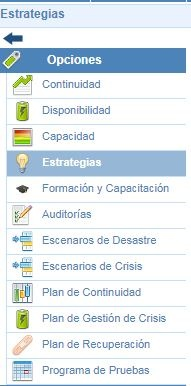
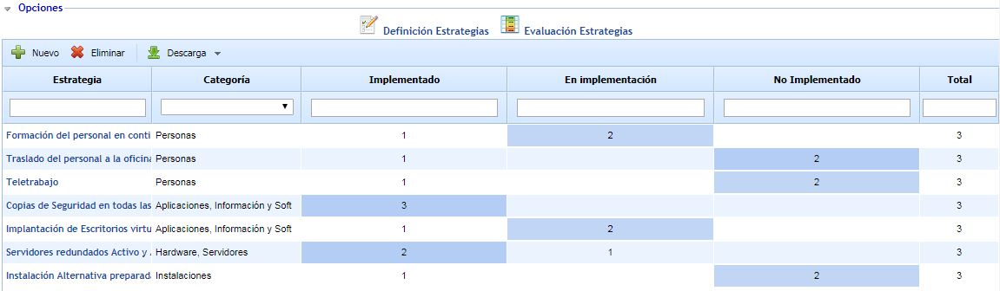

# Estrategias

La opción 'Estrategias de GlobalSUITE® permite definir las estrategias de continuidad que la organización va a adoptar una vez que se ha realizado el análisis de riesgos.

En la pantalla principal aparece un submenú superior con dos opciones. En la opción Definición de Estrategias (opción por defecto) se mostrará todo el listado de estrategias definidas. Además del listado de estrategias, en esta pantalla permite las siguientes funciones:

* **Nuevo:** Permite generar una nueva estrategia.

* **Eliminar:** Permite eliminar las estrategias definidas. Para realizar esta eliminación es necesario seleccionar el que se pretenda eliminar previamente.

* **Descarga:** Permite descargar el listado de estrategias generadas y definidas en GloblaSUITE.

Además de las opciones indicadas anteriormente, en esta pantalla se muestra información adicional que se corresponde con la madurez de cada estrategia en los distintos procesos de la organización. De esta forma se puede comprobar estrategia por estrategia, el estado de esta estrategia en los distintos procesos relacionados. El número corresponde con las veces que se ha determinado la madurez de esta estrategia.

Por tanto, las columnas que se pueden ver son:

* Categoría: Categoría definida por la estrategia. (Estas categorías se configuran en Ajustes).
* Niveles Configurados: Tantas columnas como niveles configurados en Ajustes. En estas columnas se mostrará el número de veces que la estrategia ha sido contestada en el nivel de madurez.
* Total: Muestra el número de procesos donde ha sido contestada la estrategia.

Para poder acceder a la configuración de la estrategia hay que pulsar sobre el nombre de dicha estrategia.

* [Evaluación de Estrategias](evaluacion-de-estrategias.md)
* [Definición de la Estrategia](definicion-de-la-estrategia.md)
