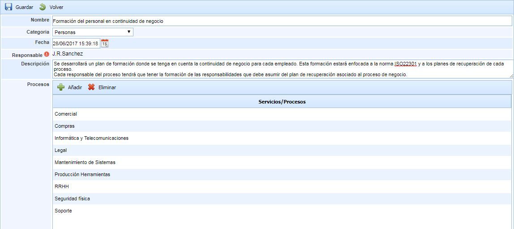
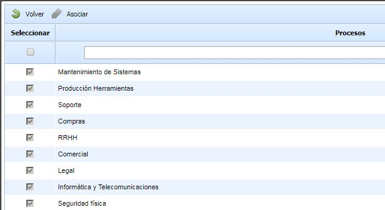

# Definición de la Estrategia

En esta opción se permite definir los datos generales de la estrategia.

Para registrar los cambios en los siguientes campos se tiene que pulsar el botón guardar una vez definidos los campos.

* **Nombre:** Establece el nombre de la estrategia a desarrollar.
* **Categoría:** Permite determinar el tipo de estrategia a definir. Estos tipos se configurarán en el apartado de Ajustes.
* **Fecha:** Indica la fecha de definición de la estrategia.
* **Responsable:** Define el responsable de la compañía para llevar el seguimiento de implantación de esta estrategia en los diferentes procesos. Al pulsar el botón rojo saldrá una ventana emergente con los empleados (definidos en Gestión - Empleados)
* **Descripción:** Permite aportar cualquier tipo de información adicional que clarifique en qué consiste la estrategia.
* **Procesos:** Permite definir en que procesos de la compañía se va a implantar esta estrategia.

Para poder elegir los procesos, se tiene que pulsar en el botón Añadir y saldrá una ventana emergente con los procesos definidos en Inicio - Procesos.

