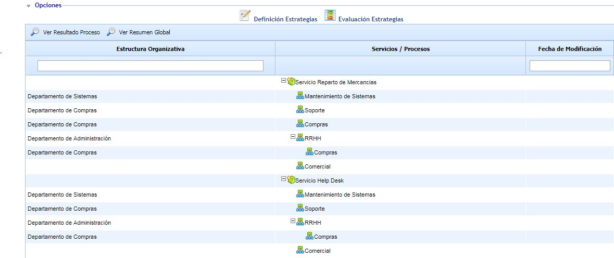
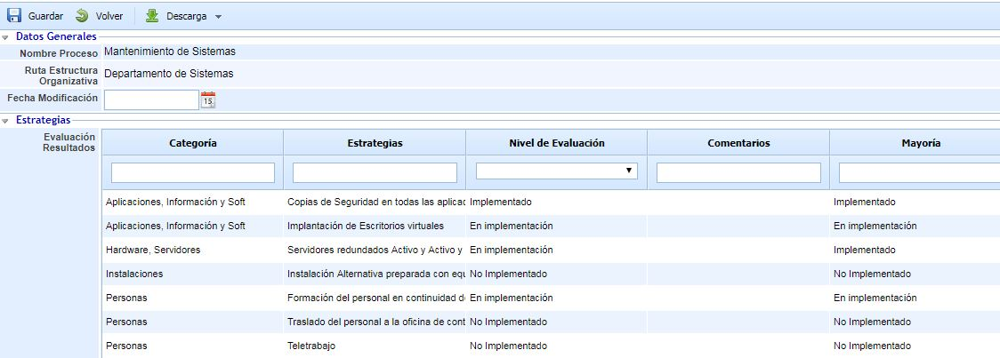
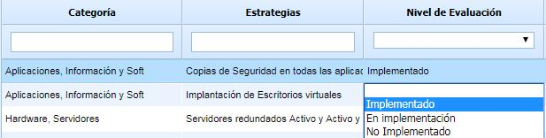
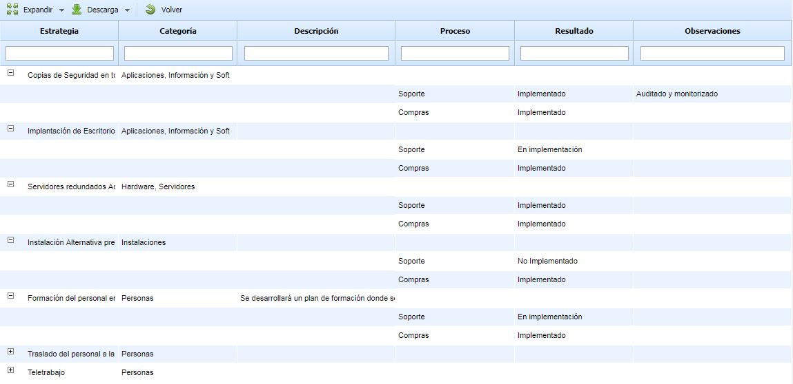
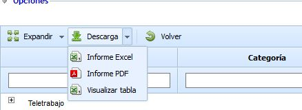

# Evaluación de Estrategias

Si pulsamos la segunda opción del submenú superior, en primer lugar se muestra el árbol de Servicios y Procesos definidos en Inicio - Procesos.

Dentro de esta pantalla, hay dos posibles opciones:

* **Ver Resultado Proceso:** Dependiendo del proceso seleccionado en el árbol, se podrá evaluar las estrategias que se han definido para este proceso.
* **Ver Resultado Global:** Dependiendo de la estructura organizativa seleccionada, se mostrará un resumen de los procesos de negocio que pertenecen a la estructura organizativa selecciona y las estrategias del conjunto de procesos de negocio.

### Ver Resultado por Proceso

Al seleccionar en la tabla el proceso y pulsar el botón Ver Resultado Proceso saldría la vista donde se puede contestar la evaluación de las estrategias en el proceso.

* **Nombre Proceso:** Proceso al que hace referencia. No se puede modificar.
* **Ruta Estructura Organizativa:** Área al que pertenece el proceso
* **Fecha de Modificación:** Fecha de la última modificación en algunas de las estrategias del proceso
* **Evaluación de Resultados:** Listado de las estrategias que afectan al proceso seleccionado. Se pueden ver las siguientes columnas:

  * Categoría: Categoría de la estrategia
  * Estrategia: Nombre de la estrategia
  * Nivel de Evaluación: Madurez de la estrategia en el proceso de negocio. Al pulsar dos veces en la celda, saldrá un listado con los niveles definidos en el apartado de 'Ajustes'.
  * Comentarios: Cualquier información adicional relacionada con la estrategia.
  * Mayoría: Nivel de madurez mayoritario de esa estrategia en el resto de procesos de la compañía.

### Ver Resultado Global

Al seleccionar la estructura organizativa en la tabla y pulsar el botón Ver Resultado Global aparece una vista resumen donde se puede ver agrupadas por estrategias, el nivel de madurez del proceso de negocio en dicha estrategia.

La información es mostrada en forma de árbol, donde la raíz será las estrategias de alguno de los procesos del área seleccionada y los hijos los procesos donde está relacionado esa estrategia La información mostrada en esta pantalla es la siguiente:

* Estrategia: Nombre de las estrategias que afectan a algún proceso de negocio del área seleccionada.
* Categoría: Categoría de las estrategias.
* Descripción: Descripción definida en la estrategia.
* Proceso: Una fila por cada proceso donde se implemente la estrategia.
* Resultado: Grado de Madure de la implantación de la estrategia en el proceso.
* Observaciones: Cualquier aspecto adicional de la estrategia en el proceso.

Esta vista se puede descargar en un excel o pdf como resumen del área seleccionada. También se puede utilizar la opción "Visualizar tabla" que nos permite descargarnos la vista global de estrategias por estructura organizativa.

