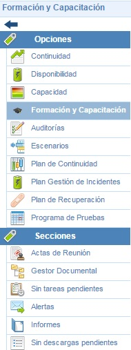
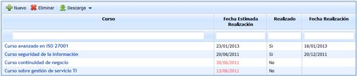
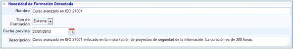
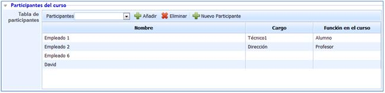
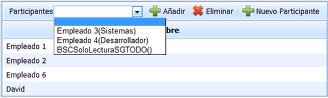
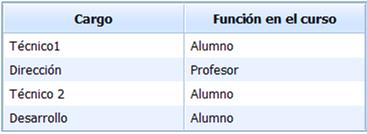
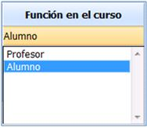
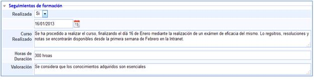
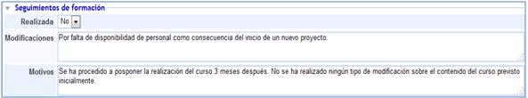

# Formación y Capacitación

La opción 'Formación y Capacitación' de GlobalSUITE® permite determinar el programa de formación y capacitación de la organización.

En la pantalla principal aparece toda la formación planificada, tanto si esta se ha llevado a cabo como si no. A parte del listado de cursos realizados o a realizar, GlobalSUITE proporciona las siguientes herramientas:

* **Nuevo:** Permite generar un nuevo curso.

* **Eliminar:** Permite eliminar los cursos definidos. Para realizar esta eliminación es necesario seleccionar el que se pretenda eliminar previamente.

* **Descarga:** Permite descargar el listado de cursos generados o gestionados desde GloblaSUITE.

A parte de las opciones anteriormente indicadas, en la pantalla principal se muestra información adicional que muestra la situación en la que se encuentran los diferentes cursos.

* Fecha estimada Realización: Fija la ficha en la que se encontraba prevista la realización del curso.

*NOTA:* En caso de que la fecha actual supere la fecha estimada de realización y no se haya realizado el curso, la fecha de los mismos aparecerá en color rojo.

* Realizado: Determina si se ha procedido a realizar o no cada uno de los cursos.
* Fecha de Realización: En caso de haberlo realizado, en la presente columna se podrá identificar dicha fecha. Para el caso contrario esta aparecerá vacía.

Para proceder a acceder a uno de los cursos dados de alta es necesario pulsar sobre el curso del que se quiera ver la información.

Una vez se haya procedido a acceder se dispone de las siguientes opciones que permiten completar toda la información necesaria del curso:

## Necesidad de Formación Detectada

* **Nombre:** Establece la denominación del curso a realizar o realizado.
* **Tipo de Formación:** Permite determinar si el curso se realiza de forma interna o externa.
* **Fecha prevista:** Indica la fecha en la que se tiene previsión para la realización del curso.
* **Descripción:** Permite aportar cualquier tipo de información adicional que clarifique en qué consiste el curso.

## Participantes del curso

* **Tabla de participantes:** Permite determinar qué empleados han realizado o van a ser partícipes del curso seleccionado.

GloblaSUITE proporciona las siguientes herramientas para poder determinar qué empleados van a participar en el curso:

1. **Participantes:** Permite seleccionar a todos aquellos empleados que han sido dado de alta y están siendo gestionados desde la opción Empleados de GlobalSUITE.
2. **Añadir:** Permite incluir un nuevo empleado o participante que ha sido previamente seleccionado en las opciones mostradas a través del desplegable de participantes.
3. **Eliminar:** Procederá a borrar alguno de los empleados que han sido dados de alta como participantes del curso.
4. **Nuevo Participante:** A través de esta opción es posible incluir un nuevo empleado al curso que no está siendo gestionado desde la opción 'Empleados' de GlobalSUITE.

Una vez incluido un nuevo participante es necesario fijar su carga y el rol que ocupa dentro del curso:

* **Cargo:** Establece qué posición ocupa el participante del curso dentro de la organización. Este campo es editable.

* **Función del curso:** Permite definir el rol dentro del curso. Para esta opción GlobalSUITE proporciona dos opciones mediante un desplegable, Alumno y Profesor.

**NOTA:** Para fijar la función que cada participante ocupa en el curso, es preciso realizar doble click sobre la columna Función en el curso.

## Documentación

Permite incluir cualuier documentación que tenga relación al plan de prueba. Para ello se ha de pulsar sobre el botón 'Adjuntar' y seleccionar el archivo deseado. En caso de querer eliminar un archivo, se ha de seleccionar la fila deseada y pulsar sobre el botón 'Eliminar'. Por último pulsando sobre el botón 'Descarga' la herramienta ofrece la posibilidad de descargar el archivo.

## Seguimientos de formación

El presente apartado permite definir las características del curso si se ha realizado, o en su defecto, cualquier aclaración que justifique la no realización del mismo.

* **Realizada:** Permite determinar si se ha realizado o no el curso.

En caso de haberse realizado permite determinar la fecha de la finalización del mismo.

* **Curso Realizado:** Permite incluir cualquier tipo de información adicional que especifique o aclare cómo se ha procedido a la hora de realizar el curso en cuestión.

* **Horas de Duración:** Fija el tiempo de duración del curso.

* **Valoración:** Establece un registro sobre cómo ha resultado y qué apreciación se ha tenido del curso realizado.

Para el caso en el que el curso no se haya realizado, las opciones mostradas por GlobalSUITE son diferentes a las anteriormente expuestas, proporcionando las siguientes herramientas que permiten clarificar qué razones son el origen de la desviación de fecha de realización.

* **Modificaciones:** Establece si debido al retraso de la fecha de realización del curso se ha procedido a modificar el contenido o las características del mismo.

* **Motivos:** Permite determinar por qué causas no se ha procedido a realizar el curso en la fecha estimada.

**NOTA:** La presencia de estos campos está destinada a especificar las causas ante una desviación o retraso de la fecha estimada de realización. En caso de que el curso no se haya realizado porque la fecha indicada aun no ha llegado, estos campos no se deberían proceder a completar.
