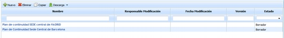

# Plan de Continuidad

La presente opción de GlobalSUITE permite asociar un Plan de Continuidad a cada uno de los escenarios establecidos en la opción Escenarios de Desastre, así como determinar los objetivos a cumplir en caso de activar el Plan de Continuidad o cualquier otra información relevante ante el escenario asociado.

*NOTA:'* La presente opción esta sólo disponible para licencias del producto GlobalSUITE® Business Continuity.

En la pantalla principal de la opción del Plan de Continuidad, tendrá disponible el acceso a todos los Planes de Continuidad que haya definido en GlobalSUITE.

Las opciones que se pueden realizar en la tabla son las siguientes:

* **Nuevo:** Permite generar una nueva entrada en la tabla de planes de continuidad.
* **Eliminar:** Ofrece la posibilidad de eliminar una entrada de la tabla. Para ello se ha de seleccionar la fila deseada y pulsar el botón 'Eliminar'.
* **Copiar:** Permite copiar un plan de continuidad ya generado en la tabla.
* **Descarga:** Posibilita la descarga del listado de planes en formato editable (.xlsx) o en PDF.

Una vez seleccionado un Plan de Continuidad, el usuario dispondrá de las siguientes opciones:

* [Información General (PCN)](informacion-general-pcn.md)
* [Secciones (PCN)](secciones-pcn.md)
* [Vista Previa (PCN)](vista-previa-pcn.md)
