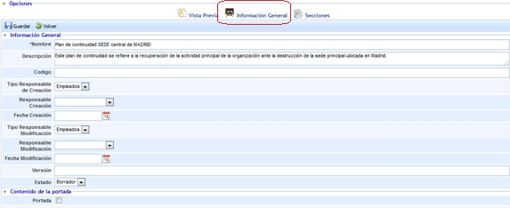
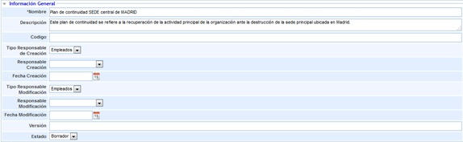
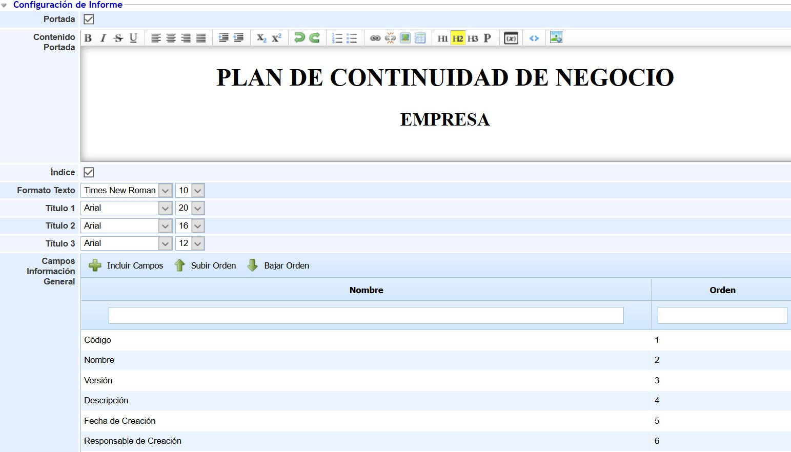
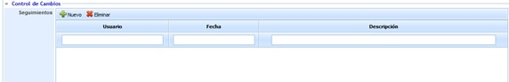
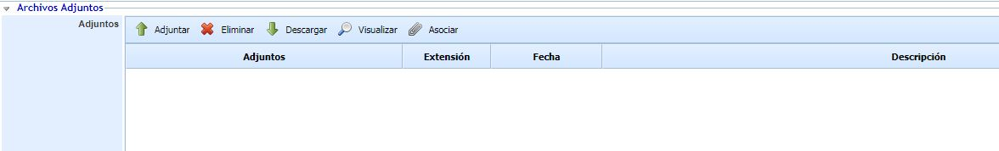
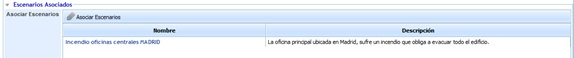
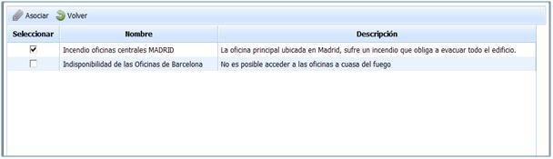
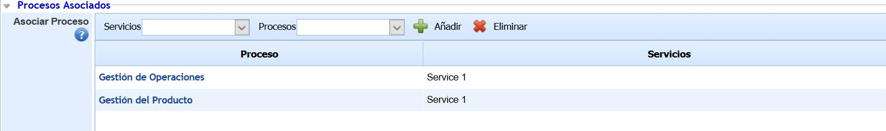
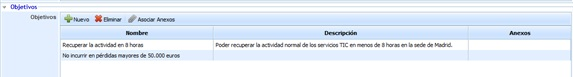

# Información General (PCN)

Permite al usuario definir los datos generales de los que va a estar compuesto el Plan de Continuidad.

**Información General**

* **Nombre:** Permite definir el nombre asociado al Plan de Continuidad.
* **Descripción:** Permite incluir cualquier tipo de información que se considere necesaria para una adecuada definición del Plan de Continuidad.
* **Código:** Campo texto que permite al usuario asignar un código al plan de continuidad
* **Tipo de responsable de creación:** Ofrece la posibilidad de insertar usuarios de manera manual o automática.
* **Responsable de creación:** Permite definir el responsable de la definición del plan de continuidad
* **Fecha de creación:** Posibilita definir la fecha de creación del plan de continuidad.
* **Tipo de responsable de modificación:** Ofrece la posibilidad de insertar usuarios de manera manual o automática.
* **Responsable de modificación:** Permite definir el responsable de modificación del plan de continuidad
* **Fecha de modificación:** Posibilita definir la fecha de modificación del plan de continuidad.
* **Versión:** Ofrece la posibilidad de establecer un versionado al Plan de Continuidad
* **Estado:** Permite definir el estado de vigencia en el que se encuentra el Plan, pudiendo optar entre Borrador, Vigente o Histórico

**NOTA:** El seleccionar el estado 'Histórico' los datos del Plan de Continuidad quedarán almacenados sin posibilidad de modificar sus datos.

**Configuración de Informe**

Esta sección permite al usuario configurar aspectos generales del Plan de Continuidad, tales como la portada, el tipo de letra o la información general que se desea mostrar en el mismo.

* **Portada:** Permite indicar si se desea configurar una portada para el Plan de Continuidad. Si se marca el check, se habilita un editor de texto que permite configurar la portada (incluyendo tanto texto como imágenes). Si el campo no está habilitado, el Plan de Continuidad se generará sin portada.
* **Índice:** Permite indicar si se desea mostrar el índice en el Plan de Continuidad.
* **Formato Texto:** Permite seleccionar el tipo de letra y el tamaño deseado para el texto del Plan de Continuidad.
* **Título 1:** Permite seleccionar el tipo de letra y el tamaño deseado para los títulos de nivel 1 del Plan de Continuidad.
* **Título 2:** Permite seleccionar el tipo de letra y el tamaño deseado para los títulos de nivel 2 del Plan de Continuidad.
* **Título 3:** Permite seleccionar el tipo de letra y el tamaño deseado para los títulos de nivel 3 del Plan de Continuidad.

*Nota: Los títulos 1, 2 y 3 se establecen en los editores de texto a través de los botones 'H1', 'H2' y 'H3' disponibles en los mismos.*

* **Campos Información General:** Esta tabla permite indicar qué campos de información general del Plan de Continuidad se desea que estén visibles en el Plan. Por defecto, al crear un Plan de Continuidad se encuentran todos los campos incluidos, pero a través del botón 'Incluir Campos' se permite seleccionar qué campos se desean incluir (a través de su selección en la ventana emergente que aparece). Los botones 'Subir Orden' y 'Bajar Orden' permiten establecer el orden deseado para que los campos se muestren en el Plan de Continuidad.

*Nota: En la sección 'Vista Previa' de un Plan de Continuidad se permite la visualización del Plan de Continuidad para comprobar cómo se muestran estos campos, así como la descarga del propio Plan.*

**Control de cambios**

La opción de control de cambios permite al usuario registrar diferentes modificaciones realizadas sobre el Plan de Continuidad pulsando sobre el botón 'Nuevo'.

**Archivos adjuntos**

Se ofrece la posibilidad al usuario de adjuntar cualquier documentos anexo, que ayude a completar el Plan de Continuidad pulsando sobre el botón 'Adjuntar'. Además de subir archivos nuevos, se puede asociar archivos que ya estén subidos al Gestor Documental pulsando en el botón Asociar se abrirá una ventana emergente donde se podrá seleccionar los archivos ya subidos. Una vez subidos, los documentos pueden ser descargados pulsando sobre el botón 'Descarga'.

**Escenarios Asociados**

A través de esta opción podrá asociar escenarios al Plan de Continuidad definido. Los escenarios que se pueden asociar han sido definidos en la opción Escenarios de Desastre.

A través del botón Asociar Escenarios podrá establecer qué escenarios son aquellos por los que puede activarse el Plan de Continuidad definido.

Seleccionando dicha opción se desplegará la siguiente pantalla, desde la cual se pueden seleccionar los escenarios asociados al Plan de Continuidad definido.

Una vez seleccionado el escenario, es necesario pulsar el botón 'Asociar', formando parte de esta forma del Plan de Continuidad que está siendo definido.

**Procesos Asociados**

Esta sección permite asociar los procesos de negocio al Plan de Continuidad. Los procesos que se pueden asociar deben estar incluidos en los escenarios asociados previamente al Plan, no apareciendo los procesos de negocio que no se encuentren en los escenarios añadidos en la sección anterior.

Para asociar un proceso de negocio al Plan de Continuidad se debe seleccionar, en primer lugar, un servicio de la lista desplegable 'Servicios' y, posteriormente, seleccionar el proceso deseado en la lista desplegable 'Procesos'. Una vez seleccionado el proceso, se debe pulsar sobre el botón 'Añadir". Para eliminar un proceso del Plan, se debe seleccionar el proceso de la tabla y pulsar sobre el botón 'Eliminar'.

**Objetivos**

Esta pestaña permite establecer los objetivos a cumplir en caso de activación del Plan de Continuidad.

Dentro de estos objetivos se permite establecer:

* **Nombre:** Corresponde con la descripción del objetivo a cumplir en caso de activación.

* **Descripción:** Permite definir qué se quiere conseguir con el objetivo propuesto.

* **Anexos:** Permite asociar documentación de apoyo que permita facilitar la consecución del objetivo propuesto.

Para poder asociar cualquier anexo a los objetivos es preciso seleccionar el objetivo correspondiente y pulsar la opción “Asociar Anexos”, seleccionando el documento correspondiente del Gestor documental de GlobalSUITE.
