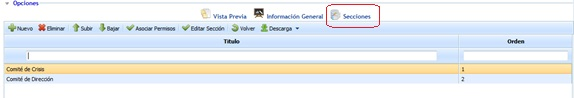

# Secciones (PCN)

La opción de secciones permite al usuario definir los apartados de los que estará compuesto el Plan de Continuidad, pudiendo realizar las siguientes opciones dentro de la tabla.

* **Nuevo:** Permite insertar una nueva sección en la tabla.
* **Eliminar:** Ofrece la posibilidad de eliminar una entrada de la tabla. Para ello se ha de seleccionar la fila deseada y pulsar sobre el botón 'Eliminar'.
* **Subir:** Permite posicionar la sección seleccionada a una posición superior.
* **Bajar:** Permite posicionar la sección seleccionada a una posición inferior.
* **Asociar permisos:** Permite al usuario definir el/los roles que tendrán acceso a esta sección del plan de continuidad.

Al pulsar sobre el botón, se muestra la siguiente pantalla sobre la que podemos definir los siguientes hitos:

* **Añadir:** Una vez seleccionado el rol deseado en el desplegable, permite asociar el mismo a la sección.
* **Eliminar:** Permite eliminar una asociación creada. Para ello se ha de seleccionar la fila deseada y pulsar sobre el botón 'Eliminar'.

* **Editar Sección:** Permite al usuario definir el contenido de la sección. Para ello, se debe seleccionar la sección que se quiere modificar y pulsar sobre el botón, de forma que se visualiza un formulario que permite la edición del contenido.

Las opciones que permite la herramienta son las siguientes:

* **Guardar:** Permite almacenar todas las modificaciones realizadas sobre la sección.
* **Volver:** Al pulsar sobre el botón la herramienta devuelve al usuario al listado de secciones del Plan de Continuidad.
* **Elementos:** Permite definir qué elementos va a contener la sección, pudiendo utilizar los siguientes:

  * **Texto:** Campo de texto libre donde poder incorporar la información deseada por el usuario.
  * **Orientación de la página:** Permite definir la orientación en la que se creará la sección, pudiendo optar entre Vertical u Horizontal.
  * **Gráfica:** Permite incorporar a la sección diferentes gráficas existentes en la plataforma, tal como se muestra en la imagen.

* **Salto de Página:** Permite insertar un salto de página en la sección.
* **Tabla:** Permite incorporar a la sección una tabla existente en la plataforma, pudiendo optar entre diferentes modelos de tabla (Continuidad, Disponibilidad, etc.). Para cada tabla insertada se permite configurar la información que se quiere mostrar, añadir filtros y ordenar la información bajo diferentes criterios.
* **Añadir:** Una vez seleccionado el elemento deseado, permite añadir a la estructura de la sección pulsando sobre el botón ‘Añadir’.

**NOTA:** Se pueden incorporar tantos elementos como se desee. Los elementos mostrados se generan en el orden añadido. Para modificar el orden de los elementos se debe arrastrar a la posición deseada.

* **Importar:** Permite importar los elementos existentes en otros informes ya construidos.
* **Vista previa:** Permite generar una vista previa de la sección para comprobar el resultado según los elementos añadidos.
* **Volver:** Al pulsar sobre el botón se muestra el listado de planes de continuidad definidos.
* **Descarga:** Ofrece la posibilidad de descargar el listado de secciones en formato editable (.xlsx) o en PDF
