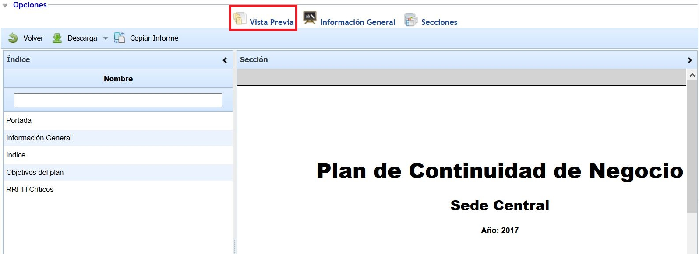

# Vista Previa (PCN)

Esta opción permite al usuario visualizar la composición documental del Plan de Continuidad y su estructura definida, mostrando la composición de la portada, la información general y las diferentes secciones definidas.

El Plan de Continuidad se puede descargar en formato editable (.docx).

A través del botón 'Copiar Informe' se permite copiar la estructura del Plan de Continuidad actual en otros Planes existentes en la herramienta. Para ello, al pulsar el botón se muestra una ventana emergente que contiene el listado del resto de Planes de Continuidad, permitiendo la selección de uno o varios Planes. Una vez seleccionados, al pulsar sobre el botón 'Copiar' se establecen en los Planes seleccionados la Portada, la Información General y las Secciones del Plan de Continuidad actual, eliminando las secciones, si hubiera, de los Planes seleccionados.
