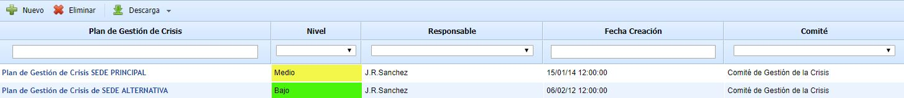
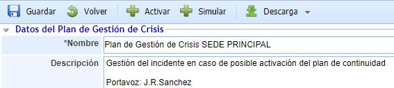
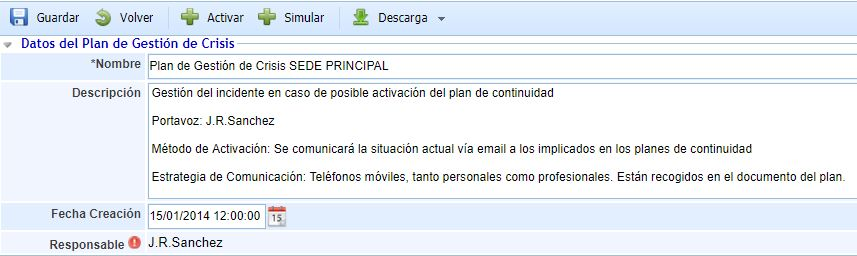
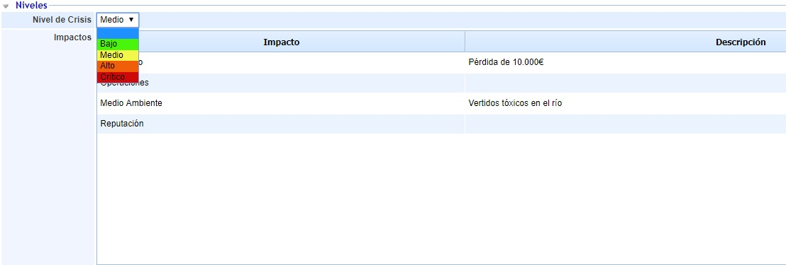
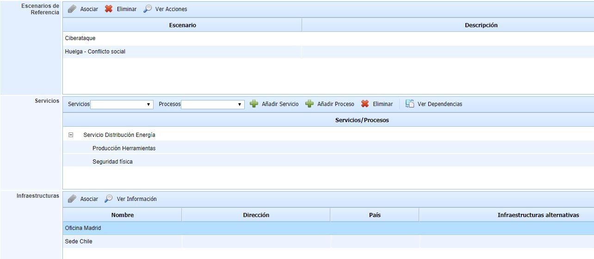
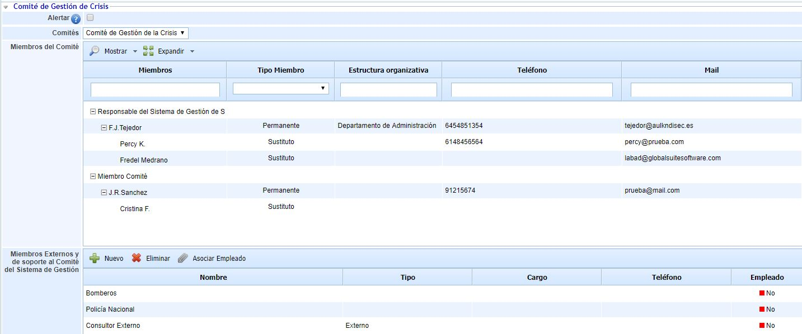
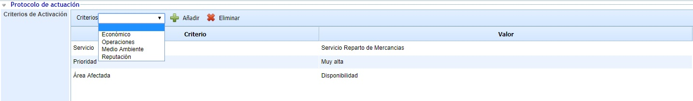
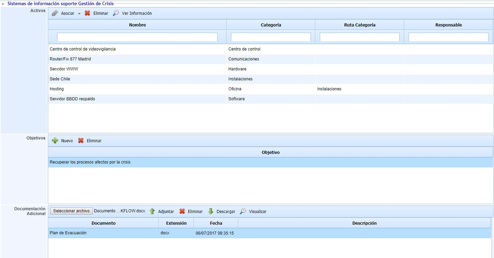
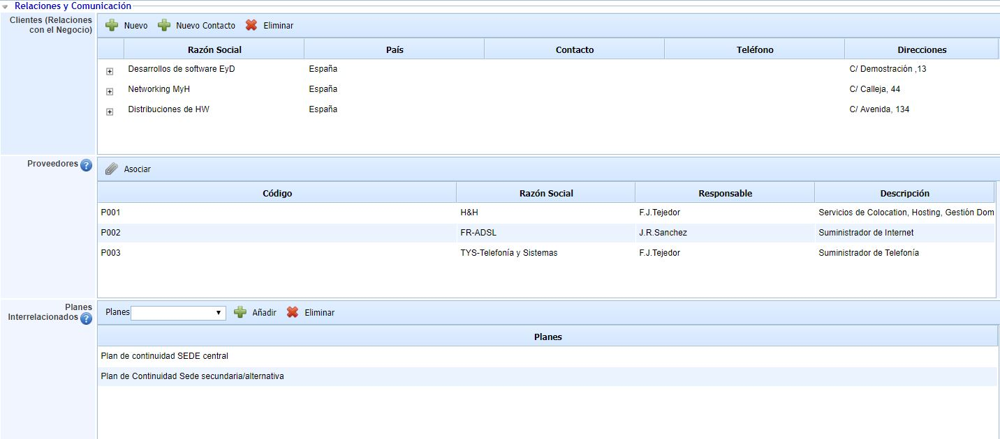
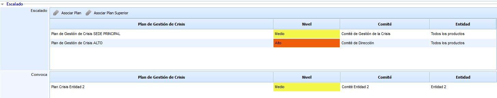

# Plan de Gestión de Crisis

Desde la opción Plan de Gestión de Crisis se permite establecer los planes de acción ante este crisis que pueda sufrir una organización, miembros del comité que lo deben tratar, planes de evacuación si corresponde, la asignación de criterios que establecen el nivel de dicha crisis, así como otro tipo de información necesaria para establecer el tipo de suceso ocurrido.

En la pantalla principal aparecen todos los Planes de Gestión de Crisis definidos en GlobalSUITE.

* **Nuevo:** Permite generar un nuevo Plan de Gestión de la Crisis.

* **Eliminar:** Permite eliminar uno que ha sido creado previamente.

* **Descarga:** Permite descargar el listado de todos los planes de gestión de crisis que se han generado.

En la cabecera de cada uno de los Planes de Gestión de Crisis definidos nos aparecen las siguientes opciones:

* **Guardar:** Permite guardar la definición del Plan de Gestión de Crisis o cualquier modificación que se haya realizado en el mismo.

* **Volver:** Permite volver a la pantalla principal donde aparece el listado de todos los Planes de Gestión de Crisis definidos.

* **Activar:** Permite poner en marcha o activar un Plan de Gestión de la Crisis, debido a que se considera que la incidencia reúne las condiciones suficientes como para poder suponer un problema de continuidad.

* **Simular:** Permite realizar una **simulación** de activación de un Plan de Gestión de la Crisis, para realizar pruebas sobre dicho Plan.

* **Descarga:** Permite descargar el Plan de Gestión de Crisis en formato de texto (.docx).

## Datos del Plan de Gestión de Crisis

* **Nombre:** Permite asignar el nombre al Plan de Gestión de Crisis.

* **Descripción:** Permite proporcionar cualquier información complementaria que permita clarificar el tipo de plan de gestión de crisis que se está definiendo.

* **Fecha de creación:** Establece la fecha en la cual quedó definido el plan de gestión de crisis.

* **Responsable:** Permite establecer la persona responsable de gestionar el plan de gestión de la crisis.

## Niveles

* **Nivel de Crisis** Permite indicar el nivel que tendrá la crisis originada al activar dicho plan de gestión de crisis. Estos niveles se configuran en el apartado de Ajustes.

* **Impactos:** Permite indicar el estado bajo el cual, cada tipo de impacto se encontraría en el momento de activar un plan de gestión de crisis.

* **Escenarios de Referencia:** En esta tabla se asocian los escenarios de crisis en los que se plantearía la activación del plan de gestión de crisis. Estos escenarios se configuran en la opción "Escenarios de Crisis".

* **Servicios:** En esta tabla se asocian los servicios y procesos a los que se dará soporte en el plan de gestión de crisis concreto.

* **Infraestructuras:** En esta tabla se asocian las infraestructuras críticas que se ven afectadas o pueden tener relevancia en el plan de gestión de crisis.

## Comité de Gestión de Crisis

* **Alertar:** Si está marcado este campo, cuando se active un plan de gestión de crisis se avisará automáticamente a los miembros del comité por correo electrónico.

* **Comités:** Permite seleccionar el comité encargado de gestionar la crisis ocurrida relacionada con el plan de gestión de crisis.

* **Miembros del Comité:** Esta tabla muestra de forma automática los empleados que pertenecen al comité asignado al plan de gestión de crisis. A través del botón 'Mostrar Sustitutos' se muestran los empleados sustitutos definidos en el comité.

* **Miembros Externos y de soporte al Comité del Sistema de Gestión:** Esta tabla muestra los miembros externos del comité de gestión de crisis, que pueden tener relevancia en el plan, pero que no pertenecen al sistema de gestión.

## Protocolo de actuación

* **Criterios de Activación:** Permite establecer qué condiciones tiene que cumplir una incidencia gestionada en la Opción "Incidencias y Problemas" del menú "Gestión". Asignando estas condiciones a las incidencias, se generará el aviso en la misma haciendo referencia a que cumple las condiciones establecidas para ser gestionada dentro de un plan de gestión de crisis.

Los criterios de activación que la herramienta propone por defecto son "Área Afectada", "Servicio" y "Prioridad", además de los tipos de Impactos configurados en el aparado 'Ajustes'.

## Sistemas de información soporte Gestión de Crisis

* **Activos:** En esta tabla se asocian los activos del Inventario que intervienen en el plan de gestión de crisis.

* **Objetivos:** En esta tabla se indican los objetivos a conseguir por el plan de gestión de crisis.

* **Documentación Adicional:** GlobalSUITE permite enlazar al plan de gestión de crisis cualquier tipo de documentación asociada relativa al plan.

## Relaciones y Comunicación

* **Clientes (Relaciones con el Negocio):** En esta tabla se asocian los clientes (relaciones con el negocio) que pueden verse afectados por el plan de gestión de crisis.

* **Proveedores:** En esta tabla se asocian los proveedores que pueden verse afectados por el plan de gestión de crisis. Estos proveedores se configuran en la opción "Proveedores" del menú Inicio.

* **Planes Interrelacionados:** Permite asignar los planes de continuidad definidos que se utilizarán para tratar el incidente. Para asignar un plan de continuidad al plan de gestión de incidentes es necesario desplegar la barra de la opción 'PCN', seleccionar el Plan de Continuidad y añadirlo a esta opción a través del botón 'Añadir'.

## Escalado

* **Escalado:** Esta tabla permite indicar que otros planes de gestión de crisis de mi entidad, u otras entidades, voy a escalar una crisis. El botón de "Asociar Plan" permite asociar planes de la misma entidad del plan. El botón "Asociar Plan Superior" permite asociar planes de entidades superiores.

* **Convoca:** Esta tabla permite conocer que planes de otras subentidades pueden escalar una crisis al plan de gestión de crisis actual. Sería la tabla inversa a la de Escalado.
