# Plan de Recuperación

En la pantalla principal de la opción se dispone del listado de todos los Planes de recuperación generados para el tratamiento y recuperación ante una situación de crisis.

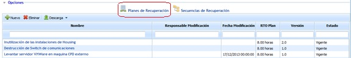

* **Nuevo:** Permite generar un nuevo Plan de Recuperación.
* **Eliminar:** Permite eliminar uno que ha sido creado previamente.
* **Descarga:** Permite descargar el listado de todos los planes de Recuperación que se han generado, tanto en formato Excel como en PDF.

La información que muestra la tabla de planes de recuperación es la siguiente:

* **Nombre:** Muestra el nombre asociado al plan de recuperación.
* **Responsable modificación:** Muestra el responsable de modificación del plan.
* **Fecha de modificación:** Muestra la fecha de modificación del Plan.
* **RTO Plan:** Ofrece el RTO asociado al plan de recuperación.
* **Versión:** Muestra la versión del Plan.
* **Estado:** Ofrece información sobre el estado de vigencia del plan de recuperación, puediendo optar entre Borrador, Vigente o Historico.

Al pulsar sobre un plan de recuperación se accede a la siguiente pantalla, sobre la que podemos definir los siguientes campos:

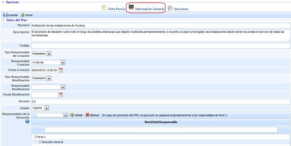

### Información General

**Datos del Plan**

* **Nombre:** Permite definir el nombre asociado al Plan de recuperación.
* **Descripción:** Permite incluir cualquier tipo de información que se considere necesaria para una adecuada definición del Plan de Recuperación.
* **Código:** Campo texto que permite al usuario asignar un código al plan de recuperación
* **Tipo de responsable de creación:** Ofrece la posibilidad de insertar usuarios de manera manual o automática.
* **Responsable de creación:** Permite definir el responsable de la definición del plan de recuperación.
* **Fecha de creación:** Posibilita definir la fecha de creación del plan de recuperación.
* **Tipo de responsable de modificación:** Ofrece la posibilidad de insertar usuarios de manera manual o automática.
* **Responsable de modificación:** Permite definir el responsable de momdificación del plan de recuperación
* **Fecha de modificación:** Posibilita definir la fecha de modificación del plan de recuperación.
* **Versión:** Ofrece la posibilidad de establecer un versionado al Plan de Recuperación
* **Estado:** Permite definir el estado de vigencia en el que se encuentra el Plan, puediendo optar entre Borrador, Vigente o Historico

**NOTA:** El seleccionar el estado 'Historico' los datos del Plan de Recuperación quedarán almacenados sin posibilidad de modificar sus datos.

* **Responsable de la ejecución:** Permite determinar a través de diferentes niveles, los roles y responsables encargados de gestionar la recuperación ante una crisis.

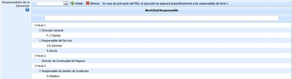

Los pasos a seguir para la definición de los roles y responsables encargados de dicha gestión es la siguiente:

1. Por defecto se establecen tres niveles diferentes encargados de realizar la gestión de la recuperación ante una incidencia o crisis.
2. Para asignar un rol determinado a cada nivel, es preciso seleccionar el nivel que corresponda y en el desplegable seleccionar el rol encargado de la recuperación en dicho nivel.
3. Una vez asignado el rol, se debe proceder a seleccionar el mismo y asociar a este los responsables de dicha gestión.

Estos niveles son establecidos para determinar el personal encargado de la gestión de la recuperación ante situaciones de crisis o incidencias graves.

El orden de gestión queda establecido por los niveles, siendo el encargado de realizarlo en Nivel 1 inicialmente. En caso que el nivel 1 no tenga disponibilidad para tratar la recuperación, sería el Nivel 2 el encargado. En caso que ninguno de los dos tenga disponibilidad sería el tercer y último nivel el que gestionaría la recuperación.

Es a través de la presente opción disponible donde se especifica cómo proceder para la asignación, condiciones y orden a seguir para el establecimiento de dichos roles y responsables del plan de recuperación.

* **Árbol de llamadas:** Esta tabla permite elaborar un árbol de llamadas asociado al Plan de Recuperación. En la tabla se muestra de manera jerárquica los empleados responsables de realizar la comunicación, de forma que cada empleado debe avisar a los responsables que se encuentran en un nivel inferior al que se encuentran. Junto a cada empleado, se indica el número de empleados a contactar, el cargo del empleado, su email principal y alternativo, así como sus teléfonos (todos estos datos corresponden a los indicados en la opción 'Empleados' del menú Gestión).

*NOTA: La visibilidad de esta tabla en los Planes de Recuperación es configurable en la opción denominada "Continuidad de Negocio" ubicada en el apartado de 'Ajustes'. Por defecto, la tabla de Árbol de llamadas se encuentra deshabilitada.*

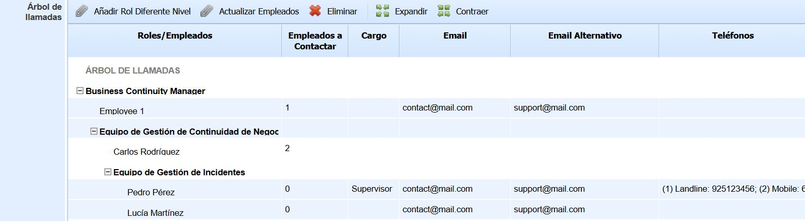

* **Añadir Rol Diferente Nivel:** Permite asociar los roles y empleados que debe avisar un determinado rol. Para ello, se debe seleccionar un rol y pulsar sobre el botón (para definir el rol que será el primer nivel del árbol de llamadas, se debe seleccionar la fila denominada 'ÁRBOL DE LLAMADAS' ubicada en la primera posición de la tabla). Al pulsar la opción se muestra una ventana emergente con el listado de roles y empleados de la organización para seleccionar los que correspondan.
* **Actualizar Empleados:** Permite añadir empleados a un rol determinado. Para ello, se debe seleccionar el rol deseado y pulsar sobre el botón, de forma que aparece una ventana emergente que contiene los empleados de ese rol que aún no han sido añadidos.
* **Eliminar:** Permite eliminar un rol y/o un empleado del árbol de llamadas. Para ello, se debe seleccionar el rol o empleado deseado, y pulsar sobre el botón.
* **Expandir/Contraer:** Permite mostrar u ocultar el árbol de llamadas, respectivamente.

* **Criterios de Activación:** Permite Asociar documentación que contenga los criterios de activación del plan de recuperación. Para ello se ha de pulsar sobre el botón 'Adjuntar' y seleccionar el archivo deseado. En caso de querer eliminar un archivo, se ha de seleccionar la fila deseada y pulsar sobre el botón 'Eliminar'. Por último pulsando sobre el botón 'Descarga' la herramienta ofrece la posibilidad de descargar el archivo.
* **Adjuntos:** Permite Asociar cualquier documentación que tenga relación al plan de recuperación. Para ello se ha de pulsar sobre el botón 'Adjuntar' y seleccionar el archivo deseado. En caso de querer eliminar un archivo, se ha de seleccionar la fila deseada y pulsar sobre el botón 'Eliminar'. Por último pulsando sobre el botón 'Descarga' la herramienta ofrece la posibilidad de descargar el archivo. Además de adjuntar nuevos archivos, se puede asociar archivos guardados en el Gestor Documental, para ello, se tiene que pulsar el botón asociar, se abrirá una ventana emergente con la documentación del Gestor Documental.

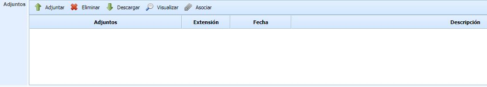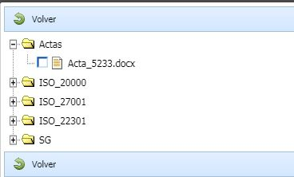

* **Planes de Continuidad:** Se ofrece la posibilidad de asociar diferentes planes de continuidad al plan de recuperación. Para ello se ha de seleccionar un plan de continuidad del desplegable y pulsar sobre el botón 'Añadir'. En caso de querer eliminar una asociación, se ha de seleccionar la fila deseada y pulsar sobre el botón 'Eliminar'.
* **Escenarios:** Se ofrece la posibilidad de asociar diferentes escenario al plan de recuperación. Para ello se ha de seleccionar un escenario del desplegable y pulsar sobre el botón 'Añadir'. En caso de querer eliminar una asociación, se ha de seleccionar la fila deseada y pulsar sobre el botón 'Eliminar'.
* **Procesos de Negocio:** Se ofrece la posibilidad de asociar diferentes procesos de negocio al plan de recuperación. Para ello se ha de seleccionar un proceso del desplegable y pulsar sobre el botón 'Añadir'. En caso de querer eliminar una asociación, se ha de seleccionar la fila deseada y pulsar sobre el botón 'Eliminar'.
* **RTO Plan:** En este campo se permite definir el RTO del Plan de Recuperación, el cual se tendrá en cuenta en las tareas asociadas al Plan para indicar qué tareas están fuera del tiempo definido. Se recomienda que el RTO establecido sea inferior al RTO de los procesos de negocio asociados en la tabla anterior, pero la herramienta no obliga a ello.
* **Clientes (Relaciones con el Negocio):** Esta tabla permite asociar clientes a los Planes de Recuperación. En función de si el entorno dispone de la funcionalidad 'Relaciones con el Negocio' habilitada o no, las opciones disponibles sobre la tabla son diferentes. Esta funcionalidad está disponible únicamente para algunos módulos de GlobalSUITE.

*NOTA: La visibilidad de esta tabla en los Planes de Recuperación es configurable en la opción denominada "Continuidad de Negocio" ubicada en el apartado de 'Ajustes'. Por defecto, la tabla de Clientes se encuentra deshabilitada.*

Si el entorno dispone de la funcionalidad 'Relaciones con el Negocio', la tabla tiene la siguiente apariencia:

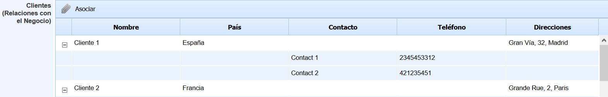

* A través del botón 'Asociar' se permite agregar clientes al Plan de Recuperación. Al pulsar el botón, se muestra una ventana emergente con el listado de clientes que se encuentran registrados en la herramienta, de forma que se permite seleccionar los que se deseen agregar al Plan. La información que se muestra de los clientes es su nombre, país y direcciones, así como los contactos que posee cada cliente junto a su teléfono.

Si el entorno no dispone de la funcionalidad 'Relaciones con el Negocio', la tabla tiene la siguiente apariencia:

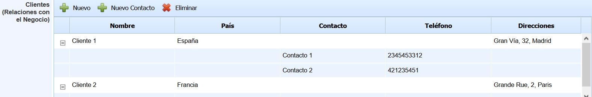

* A través del botón 'Nuevo' se permite crear clientes en el Plan de Recuperación. El nombre, país y direcciones del cliente se pueden editar directamente en la tabla haciendo doble click en la columna correspondiente.
* A través del botón 'Nuevo Contacto' se permite crear contactos de cada cliente. Para ello, se debe seleccionar un cliente de la tabla y pulsar sobre el botón. El nombre del contacto y su teléfono se puede editar directamente en la tabla haciendo doble click en la columna correspondiente.
* El botón 'Eliminar' permite eliminar los clientes y/o contactos deseados, seleccionando las filas correspondientes y pulsando el botón.

* **Activos:** Esta tabla permite asociar activos registrados en la opción 'Inventario' (menú 'Análisis') al Plan de Recuperación. La información que se muestra de cada activo es el nombre, categoría y responsable asignado.

*NOTA: La visibilidad de esta tabla en los Planes de Recuperación es configurable en la opción denominada "Continuidad de Negocio" ubicada en el apartado de 'Ajustes'. Por defecto, la tabla de Activos se encuentra deshabilitada.*

Las opciones que se pueden realizar en esta tabla son las siguientes:

* **Asociar - Listado:** Al pulsar este botón, se muestra una ventana emergente que contiene el listado de todos los activos registrados en el Inventario. Para asociar los activos al Plan de Recuperación, se deben seleccionar los activos deseados a través del check situado a la izquierda y pulsar sobre el botón 'Asociar'.
* **Asociar - Árbol de Dependencias:** Al pulsar este botón, se muestra una ventana emergente que contiene el árbol de dependencias de activos. Los activos que aparecen son aquellos que se encuentran asociados a los procesos de negocio incluidos en el Plan de Recuperación. Para asociar los activos al Plan, se deben seleccionar los activos deseados a través del check situado a la izquierda de activo y pulsar sobre el botón 'Seleccionar Activos'. El botón 'Marcar Dependientes' ubicado en la ventana permite seleccionar automáticamente todos los activos que se encuentran por debajo del activo seleccionado en el árbol de dependencias.
* **Eliminar:** Este botón permite eliminar activos de la tabla. Para ello, se deben seleccionar los activos que se desean eliminar y pulsar sobre el botón.
* **Ver Información:** Esta opción permite visualizar las propiedades de un activo determinado. Para ello, se debe seleccionar un activo de la tabla y pulsar el botón, apareciendo una ventana emergente que contiene todas las características del activo registradas en el Inventario.

**Configuración de Informe**

Esta sección permite al usuario configurar aspectos generales del Plan de Recuperación, tales como la portada, el tipo de letra o la información general que se desea mostrar en el mismo.

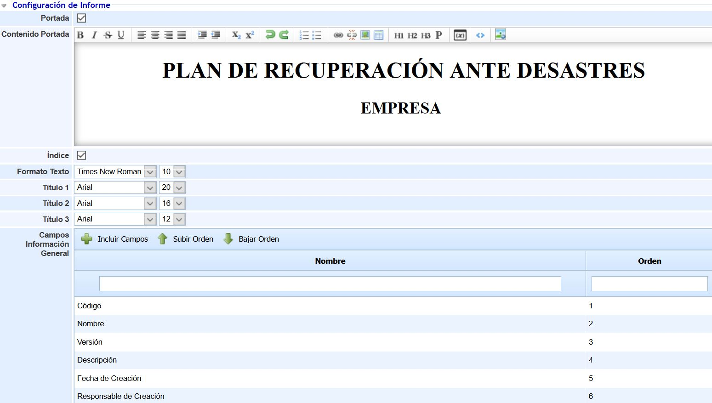

* **Portada:** Permite indicar si se desea configurar una portada para el Plan de Recuperación. Si se marca el check, se habilita un editor de texto que permite configurar la portada (incluyendo tanto texto como imágenes). Si el campo no está habilitado, el Plan de Recuperación se generará sin portada.
* **Índice:** Permite indicar si se desea mostrar el índice en el Plan de Recuperación.
* **Formato Texto:** Permite seleccionar el tipo de letra y el tamaño deseado para el texto del Plan de Recuperación.
* **Título 1:** Permite seleccionar el tipo de letra y el tamaño deseado para los títulos de nivel 1 del Plan de Recuperación.
* **Título 2:** Permite seleccionar el tipo de letra y el tamaño deseado para los títulos de nivel 2 del Plan de Recuperación.
* **Título 3:** Permite seleccionar el tipo de letra y el tamaño deseado para los títulos de nivel 3 del Plan de Recuperación.

*Nota: Los títulos 1, 2 y 3 se establecen en los editores de texto a través de los botones 'H1', 'H2' y 'H3' disponibles en los mismos.*

* **Campos Información General:** Esta tabla permite indicar qué campos de información general del Plan de Recuperación se desea que estén visibles en el Plan. Por defecto, al crear un Plan de Recuperación se encuentran todos los campos incluidos, pero a través del botón 'Incluir Campos' se permite seleccionar qué campos se desean incluir (a través de su selección en la ventana emergente que aparece). Los botones 'Subir Orden' y 'Bajar Orden' permiten establecer el orden deseado para que los campos se muestren en el Plan de Recuperación.

*Nota: En la sección 'Vista Previa' de un Plan de Recuperación se permite la visualización del Plan de Recuperación para comprobar cómo se muestran estos campos, así como la descarga del propio Plan.*

**Control de Cambios**

La sección de Control de Cambios permite al usuario registrar las diferentes modificaciones realizadas sobre el Plan de Recuperación. Para registrar un cambio se debe pulsar el botón 'Nuevo' y editar la fila que se genera (Usuario, Fecha y Descripción). Si se desea eliminar un cambio, se debe seleccionar las filas deseadas y pulsar el botón 'Eliminar'.

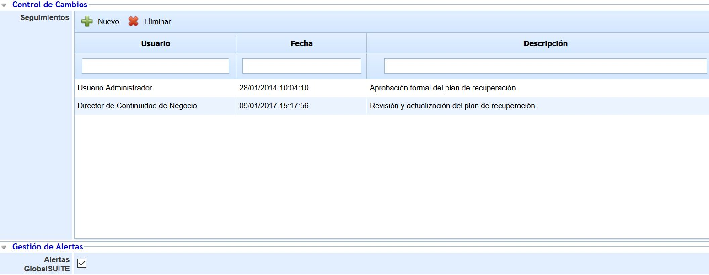

**Gestión de Alertas**

La sección de Gestión de Alertas muestra el tipo de alertas que se pueden utilizar para las notificaciones del Plan de Recuperación en caso de activación. Por defecto, las alertas que ofrece GlobalSUITE son a través de correo electrónico.

**Secuencias de Recuperación y Tareas**

Esta sección permite al usuario establecer la secuencia de actuación del Plan de Recuperación ante un desastre.

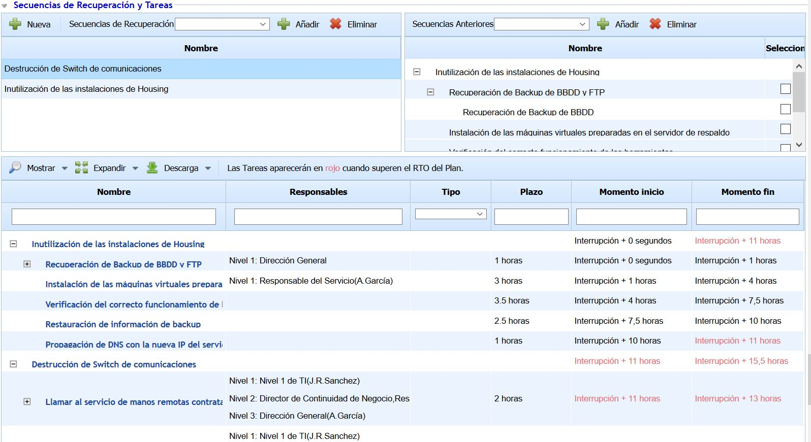

En la tabla superior izquierda se establecen las diferentes Secuencias de Recuperación que van a formar parte del Plan de Recuperación. En la lista desplegable se muestran todas las Secuencias que han sido creadas anteriormente como públicas, pudiéndose añadir al Plan a través del botón 'Añadir'. Si se desea generar una Secuencia de Recuperación para el Plan de Recuperación, se debe pulsar sobre el botón 'Nueva'.

*NOTA: Las Secuencias de Recuperación generadas a través del botón 'Nueva' son Secuencias privadas para el Plan de Recuperación; es decir, sólo estarán disponibles en este Plan de Recuperación. Si se desea generar una Secuencia de Recuperación que se pueda reutilizar para otros Planes de Recuperación (denominada Pública), ésta se debe crear en la opción superior denominada 'Secuencias de Recuperación', accesible al ingresar en la opción 'Plan de Recuperación'. Este tipo de Secuencias, tal como se ha indicado en el párrafo anterior, aparecen en la lista desplegable y se asocian al Plan de Recuperación a través del botón 'Añadir'.*

En la tabla superior derecha se permite establecer dependencias entre las diferentes Secuencias, es decir, que una Secuencia no se pueda ejecutar si la Secuencia anterior no ha finalizado. Para realizar las dependencias entre Secuencias, se debe seleccionar en la tabla izquierda la Secuencia deseada y seleccionar en la tabla derecha la Secuencia dónde va a depender.

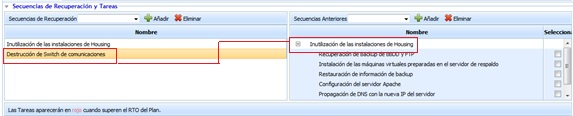

En la tabla derecha, una vez realizada la dependencia, se muestra la Secuencia de Recuperación con todas sus tareas. A través de los checks situados en la parte derecha de cada tarea se permite indicar a partir de qué tarea comenzará la ejecución de la Secuencia de Recuperación dependiente. Si no se selecciona ninguna tarea, la Secuencia de Recuperación comenzará una vez que la Secuencia Anterior termine por completo.

En la tabla inferior se muestra el listado detallado de tareas a realizar, correspondiente a las tareas de las Secuencias de Recuperación añadidas al Plan de Recuperación. En función de las dependencias definidas entre las Secuencias de Recuperación y entre las tareas, se calculan automáticamente los tiempos de inicio y fin de cada tarea.

A través del botón 'Mostrar' se pueden visualizar las tareas del Plan de Recuperación por Rol. Para ello, seleccionando la opción 'Mostrar - Por Rol' se actualiza la vista de la tabla mostrando todos los roles involucrados en alguna de las tareas. Para cada Rol, se muestran los empleados correspondientes con el detalle de las tareas asociadas (nombre de la tarea, secuencia a la que pertenecen, tipo, plazo, tiempo de inicio y tiempo de fin). En caso de que una tarea esté asociada a nivel de Rol y no a nivel de Empleado, aparecerá la tarea sin indicar el nombre de empleado en la primera columna.

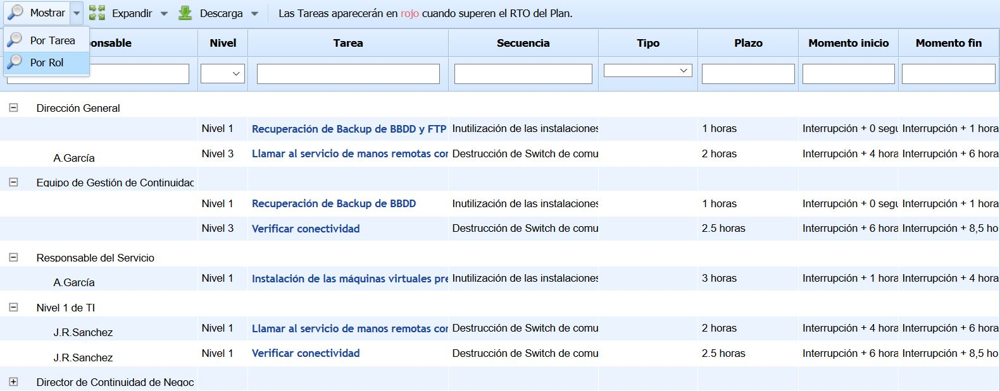

### Secciones

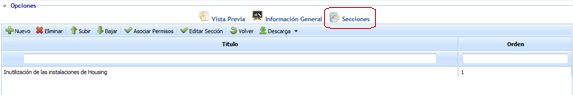

La opción de secciones permite al usuario definir los apartados de los que estará compuesto el Plan de Recuperación, puediendo realizar las siguientes opciones dentro de la tabla.

* **Nuevo:** Permite insertar una nueva sección en la tabla.
* **Eliminar:** Ofrece la posibilidad de eliminar una entrada de la tabla. Para ello se ha de seleccionar la fila deseada y pulsar sobre el botón 'Eliminar'.
* **Subir:** Permite posicionar la sección seleccionada a una posición superior.
* **Bajar:** Permite posicionar la sección seleccionada a una posición inferior.
* **Asociar permisos:** Permite al usuario definir el/los roles que tendrán acceso a esta sección del plan de recuperación.

Al pulsar sobre el botón, se muestra la siguiente pantalla sobre la que podemos definir los siguientes hitos:

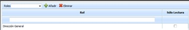

* **Añadir:** Una vez seleccionado el rol deseado en el desplegable, permite asociar el mismo a la sección.
* **Eliminar:** Permite eliminar una asociación creada. Para ello se ha de seleccionar la fila deseada y pulsar sobre el botón 'Eliminar'.
* **Editar Sección:** Permite al usuario definir el contenido de la sección. Para ello, se debe seleccionar la sección que se quiere modificar y pulsar sobre el botón, de forma que se visualiza un formulario que permite la edición del contenido.

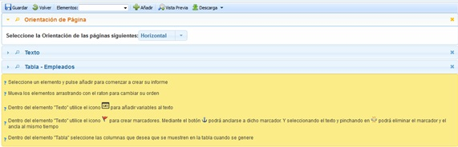

Las opciones que permite la herramienta son las siguientes:

* **Guardar:** Permite almacenar todas las modificaciones realizadas sobre la sección.
* **Volver:** Al pulsar sobre el botón la herramienta devuelve al usuario al listado de secciones del Plan de Recuperación.
* **Elementos:** Permite definir qué elementos va a contener la sección, pudiendo utilizar los siguientes:
* **Texto:** Campo de texto libre donde poder incorporar la información deseada por el usuario.
* **Orientación de la página:** Permite definir la orientación en la que se creará la sección, pudiendo optar entre Vertical u Horizontal.
* **Gráfica:** Permite incorporar a la sección diferentes gráficas existentes en la plataforma, tal como se muestra en la imagen.

* **Salto de Página:** Permite insertar un salto de página en la sección.
* **Tabla:** Permite incorporar a la sección una tabla existente en la plataforma, pudiendo optar entre diferentes modelos de tabla (Continuidad, Disponibilidad, etc.). Para cada tabla insertada se permite configurar la información que se quiere mostrar, añadir filtros y ordenar la información bajo diferentes criterios.

* **Añadir:** Una vez seleccionado el elemento deseado, permite añadir a la estructura de la sección pulsando sobre el botón ‘Añadir’.

**NOTA:** Se pueden incorporar tantos elementos como se desee. Los elementos mostrados se generan en el orden añadido. Para modificar el orden de los elementos se debe arrastrar a la posición deseada.

* **Importar:** Permite importar los elementos existentes en otros informes ya construidos.
* **Vista previa:** Permite generar una vista previa de la sección para comprobar el resultado según los elementos añadidos.
* **Volver:** Al pulsar sobre el botón se muestra el listado de planes de continuidad definidos.
* **Descarga:** Ofrece la posibilidad de descargar el listado de secciones en formato editable (.xlsx) o en PDF

### Vista Previa

Esta opción permite al usuario visualizar la composición documental del Plan de Recuperación y su estructura definida, mostrando la composición de la portada, la información general y las diferentes secciones definidas.

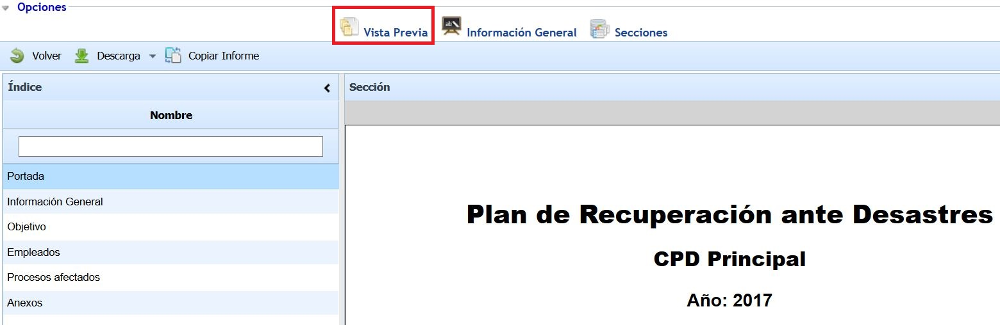

El Plan de Recuperación se puede descargar en formato editable (.docx).

A través del botón 'Copiar Informe' se permite copiar la estructura del Plan de Recuperación actual en otros Planes existentes en la herramienta. Para ello, al pulsar el botón se muestra una ventana emergente que contiene el listado del resto de Planes de Recuperación, permitiendo la selección de uno o varios Planes. Una vez seleccionados, al pulsar sobre el botón 'Copiar' se establecen en los Planes seleccionados la Portada, la Información General y las Secciones del Plan de Recuperación actual, eliminando las secciones, si hubiera, de los Planes seleccionados.
