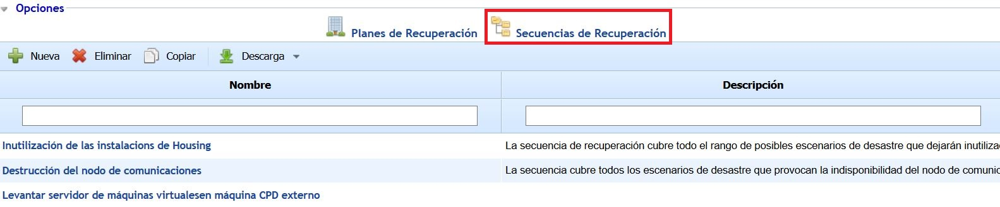
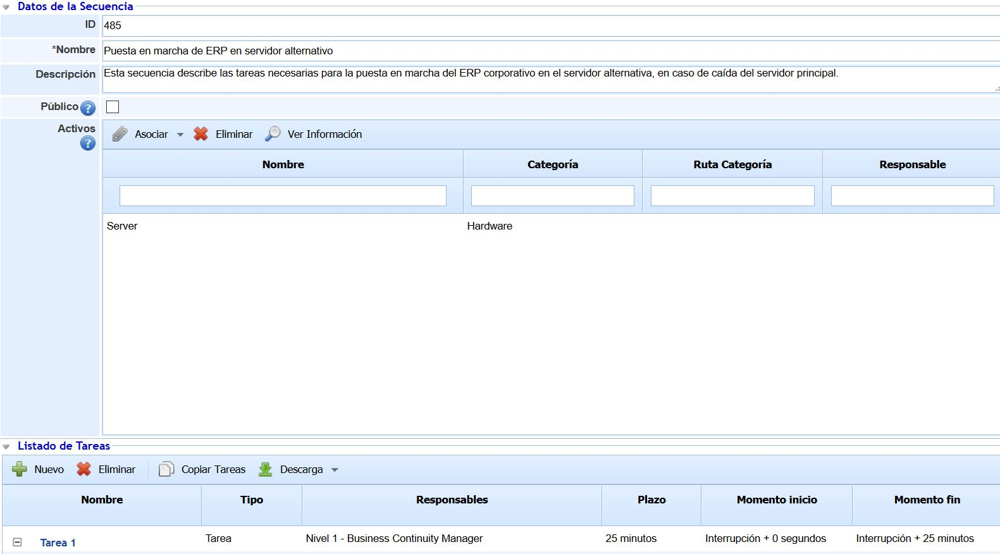
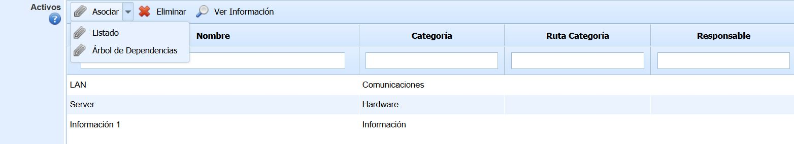
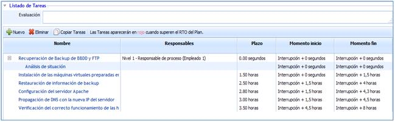
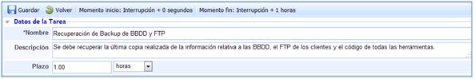
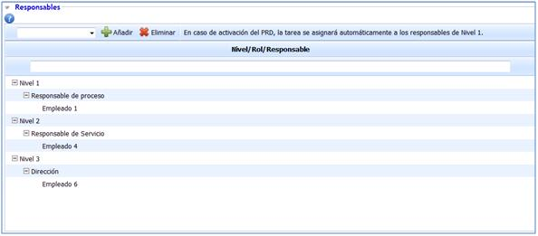

# Secuencia de Recuperación

En la tabla principal que se muestra al acceder a la opción se encuentra el listado de todas las Secuencias de Recuperación generadas para el tratamiento y recuperación ante una situación de crisis. Cada una las Secuencias que aparecen en la tabla corresponden a Secuencias de Recuperación definidas como "públicas" que, por tanto, se pueden asociar a uno o varios Planes de Recuperación.

*Las Secuencias de Recuperación definidas como "privadas" pertenecen únicamente a un Plan de Recuperación, por lo que son accesibles desde el Plan en el que se encuentran asociadas.*

Las opciones que se pueden realizar sobre la tabla son las siguientes:

* **Nueva:** Permite generar una nueva Secuencia de Recuperación.
* **Eliminar:** Permite eliminar una Secuencia existente en la tabla. Para ello, se debe seleccionar la fila dónde se encuentra la Secuencia que se quiere eliminar y pulsar sobre el botón.
* **Copiar:** Permite copiar una Secuencia. Para ello, se debe seleccionar la fila dónde se encuentra la Secuencia que se quiere copiar y pulsar sobre el botón.
* **Descarga:** Permite descargar el listado de todas las Secuencias de Recuperación que se muestra en la tabla, tanto en formato Excel como en PDF.

Al ingresar en una Secuencia de Recuperación, se muestra un formulario con dos secciones y que contiene las siguientes características:

**Datos de la Secuencia**

* **ID:** Número identificativo de la Secuencia de Recuperación. El número se asigna automáticamente, no pudiéndose modificar por el usuario.
* **Nombre:** Permite indicar el nombre de la Secuencia de Recuperación.
* **Descripción:** Permite realizar una descripción detallada de la Secuencia.
* **Público:** Permite configurar si la Secuencia de Recuperación está disponible para cualquier Plan de Recuperación. Si se desmarca el check, la Secuencia sólo estará disponible en los Planes de Recuperación dónde ya esté asociado.
* **Activos:** Esta tabla permite asociar activos registrados en la opción 'Inventario' (menú 'Análisis') a la Secuencia de Recuperación. La información que se muestra de cada activo es el nombre, categoría y responsable asignado.

*NOTA: La visibilidad de esta tabla en las Secuencias de Recuperación es configurable en la opción denominada "Continuidad de Negocio" ubicada en el apartado de 'Ajustes. Por defecto, la tabla de Activos se encuentra deshabilitada.*

*NOTA 2: La tabla de Activos sólo es visible en las Secuencias de Recuperación privadas (es decir, las Secuencias que sólo pertenecen a un Plan de Recuperación). Por tanto, si la Secuencia tiene el check 'Público' marcado, la tabla de Activos no aparece.*

Las opciones que se pueden realizar en esta tabla son las siguientes:

* **Asociar - Listado:** Al pulsar este botón, se muestra una ventana emergente que contiene el listado de todos los activos registrados en el Inventario. Para asociar los activos al Plan de Recuperación, se deben seleccionar los activos deseados a través del check situado a la izquierda y pulsar sobre el botón 'Asociar'.
* **Asociar - Árbol de Dependencias:** Al pulsar este botón, se muestra una ventana emergente que contiene el árbol de dependencias de activos. Los activos que aparecen son aquellos que se encuentran asociados a los procesos de negocio incluidos en el Plan de Recuperación. Para asociar los activos al Plan, se deben seleccionar los activos deseados a través del check situado a la izquierda de activo y pulsar sobre el botón 'Seleccionar Activos'. El botón 'Marcar Dependientes' ubicado en la ventana permite seleccionar automáticamente todos los activos que se encuentran por debajo del activo seleccionado en el árbol de dependencias.
* **Eliminar:** Este botón permite eliminar activos de la tabla. Para ello, se deben seleccionar los activos que se desean eliminar y pulsar sobre el botón.
* **Ver Información:** Esta opción permite visualizar las propiedades de un activo determinado. Para ello, se debe seleccionar un activo de la tabla y pulsar el botón, apareciendo una ventana emergente que contiene todas las características del activo registradas en el Inventario.

**Listado de Tareas**

El apartado de listado de tareas permite establecer los pasos a realizar para conseguir la recuperación ante un estado de crisis, así como los plazos o tiempos para desarrollar la tarea en concreto y los responsables de su realización.

Para la generación de tareas y subtareas a realizar, GlobalSUITE proporciona las siguientes opciones:

* **Nuevo:** Permite generar una nueva tarea.
* **Eliminar:** Permite eliminar una tarea generada previamente.
* **Copiar Tareas:** Permite generar una nueva tarea copiada de una que ha sido generada previamente.

Si el usuario pulsa sobre el enlace de la tarea se desplegará una nueva pantalla donde se dispone de las siguientes opciones:

**Datos de la tarea**

* **Nombre:** Permite determinar el nombre de la tarea a realizar.
* **Descripción:** Permite establecer un mayor detalle a la tarea definida.
* **Plazo:** Permite establecer el tiempo estipulado para la realización de la tarea definida.
* **Tipo:** Ofrece la posibilidad de definir el tipo de tarea que se va a realizar.

**Responsables**

Permite al usuario determinar a través de diferentes niveles, los roles y responsables encargados de gestionar cada una de las tareas.

Los pasos a seguir para la definición de los roles y responsables encargados de dicha gestión es la siguiente:

1.Por defecto se establecen tres niveles diferentes encargados de realizar la tarea.

2.Para asignar un rol determinado a cada nivel, es preciso seleccionar el nivel que corresponda y en el desplegable seleccionar el rol encargado de la tarea.

3.Una vez asignado el rol, se debe proceder a seleccionar el mismo y asociar a este los responsables de dicha gestión.

Estos niveles son establecidos para determinar el personal encargado de la realización de cada una de las tareas del Plan de Recuperación.

El orden de gestión queda establecido por los niveles, siendo el encargado de realizarlo en Nivel 1 inicialmente. En caso que el nivel 1 no tenga disponibilidad para realizar la tarea, sería el Nivel 2 el encargado. En caso que ninguno de los dos tenga disponibilidad sería el tercer y último nivel el encargado de gestionarla.

**Recursos Consolidados**

La opción permite al usuario asociar aquellos recursos consolidados resultantes del establecimiento del BIA. Para ello se ha de pulsar sobre le botón 'Asociar' y seleccionar el checkbox de aquellos recursos que deseamos formen parte del plan de recuperación. En caso de querer elimnar una entrada de la tabla, se ha de seleccionar la fila deseada y pulsar sobre el botón 'Eliminar'.

**Archivos Adjuntos**

Permite Asociar cualquier documentación que tenga relación al plan de recuperación. Para ello se ha de pulsar sobre el botón 'Adjuntar' y seleccionar el archivo deseado. En caso de querer eliminar un archivo, se ha de seleccionar la fila deseada y pulsar sobre el botón 'Eliminar'. Además de adjuntar nuevos archivos, se pueden asociar archivos que estén subidos a la opción Gestor Documental, para ello, se ha de pulsar el botón Asociar y seleccionar la documentación necesaria en la tarea del plan de recuperación. Por último, pulsando sobre el botón 'Descarga' la herramienta ofrece la posibilidad de descargar el archivo.

**Tareas anteriores**

Esta opción permite al usuario establecer la secuencia de realización de las tareas. Para ello se ha de pulsar sobre el botón 'Asociar' y seleccionar la/las tareas que deben realizarse con anterioridad. En caso de querer eliminar una asociación, se ha de seleccionarla fila deseada y pulsar el botón 'Eliminar'.

**Tareas posteriores**

Esta opción permite al usuario establecer la secuencia de realización de las tareas. Para ello se ha de pulsar sobre el botón 'Asociar' y seleccionar la/las tareas que deben realizarse con postrioridad. En caso de querer eliminar una asociación, se ha de seleccionarla fila deseada y pulsar el botón 'Eliminar'.

**Subtareas**

La presente opción permite definir subtareas a una tarea establecida. Para ello se ha de pulsar sobre el botón 'Nuevo' lo que genera una nueva entrada en la tabla. En caso de querer eliminar una subtarea, se ha de seleccionarla fila deseada y pulsar el botón 'Eliminar'.
