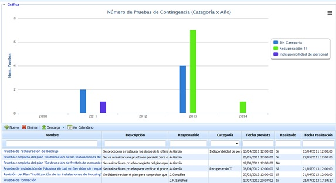

# Programa de Pruebas

A través de la presente opción se pueden gestionar y registrar las pruebas de recuperación realizadas.

Una vez se accede a la opción Programa de Pruebas, GlobalSuite nos representa tanto la gráfica como el listado de las pruebas realizadas.

**NOTA:**La gráfica permite visualizar el número de pruebas realizadas de los últimos 5 periodos.

La tabla situada en la parte inferior muestra el listado de todas las pruebas definidas. Sobre la tabla la herramienta nos permite realizar las siguientes acciones:

* **Nuevo** Permite insertar una nueva entrada en la tabla.
* **Eliminar** Ofrece la posibilidad de eliminar una prueba definida previamente. Para ello se ha de seleccionar la fila deseada y pulsar sobre el botón 'Eliminar'.
* **Descarga** Permite la descarga del listado de pruebas en formato editable (.xlsx) o PDF.
* **Calendario** Posibilita ver el listado de pruebas planificadas o realizadas en un calendario.

Al pulsar sobre el enlace de una prueba el usuario accede al siguiente formulario:

* [Vista Previa (Prueba)](vista-previa-prueba.md)
* [Control y Resumen](control-y-resumen.md)
* [Información Prueba](informacion-prueba.md)
