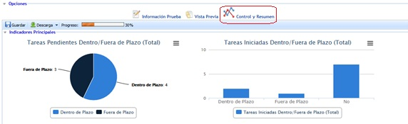
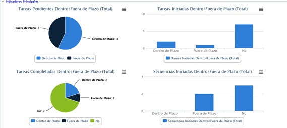
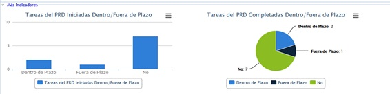
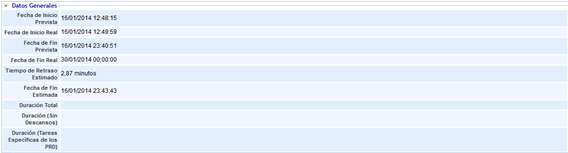
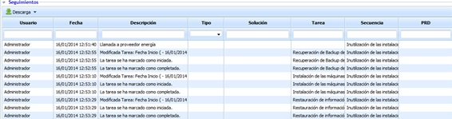
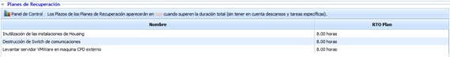
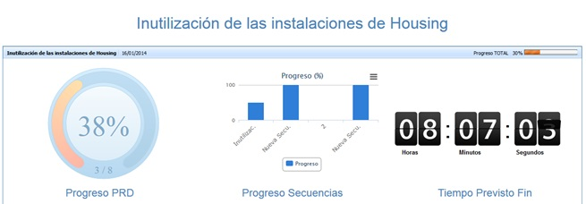
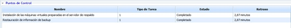
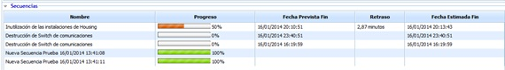
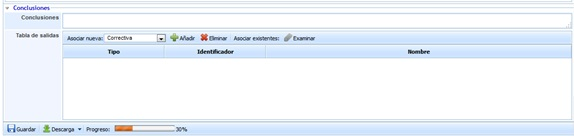

# Control y Resumen

Este apartado ofrece al usuario un resumen de todos los planes de recuperación, secuencias, etc, asociados a la prueba establecida y la posibilidad de establecer las conclusiones oportunas sobre la misma.

El apartado de 'Control y resumen' se divide en varias secciones:

**Indicadores principales**

El presente apartado muestra una serie de gráficas resumen enfocadas a las tareas y secuencias asociadas a la prueba establecida, destacando si se han completado en plazo o no.

**Más Indicadores**

Este apartado muestra una serie de gráficas resumen enfocadas a los planes de recuperación asociados a la prueba establecida, destacando si se han completado en plazo o no.

**Datos Generales**

El apartado de datos generales muestra la información resumida del programa de pruebas, destacando la fecha de inicio prevista, real, así como, la duración total de la prueba, la fecha de fin, etc.

**Seguimientos**

El apartado de seguimientos muestra un resumen de todos aquellos que se han definido en relación a la prueba seleccionada. La herramienta permite la descarga del listado de seguimiento en formato editable (.xlsx) o PDF pulsando sobre el botón 'Descarga'.

**Planes de recuperación**

El presente apartado muestra un listado de aquellos planes de recuperación que han sido asociados a la prueba, destacando de cada uno de ellos el RTO fijado.

Si pulsamos sobre el botón 'Panel de Control' la herramienta ofrece la posibilidad de visualiza de manera gráfica un resumen sobre el progreso de la prueba, de los planes de recuperación y del tiempo previsto hasta el fin de las tareas.

**Puntos de control**

Este apartado muestra un resumen de los puntos de control asociados a la prueba establecida, destacando su estado y si se ha producido algun retraso sobre las mismas.

**Secuencias**

El presente apartado muestra un resumen con aquellas secuencias que han sido asociadas a la prueba. De cada una de ellas permite conocer el porcentaje (%) de progreso de la secuencia, fecha prevista de fin, retraso y fecha estimada de fin.

**Conclusiones**

El apartado permite al usuario establecer las conclusiones a las que se ha llegado tras la realización de la prueba. En caso de no estar conforme con los resultado, la herramienta permite establecer las acciones correctivas que se necesite. Para ello se ha de seleccionar un ticket en el desplegable y pulsar sobre el botón 'Añadir'.

