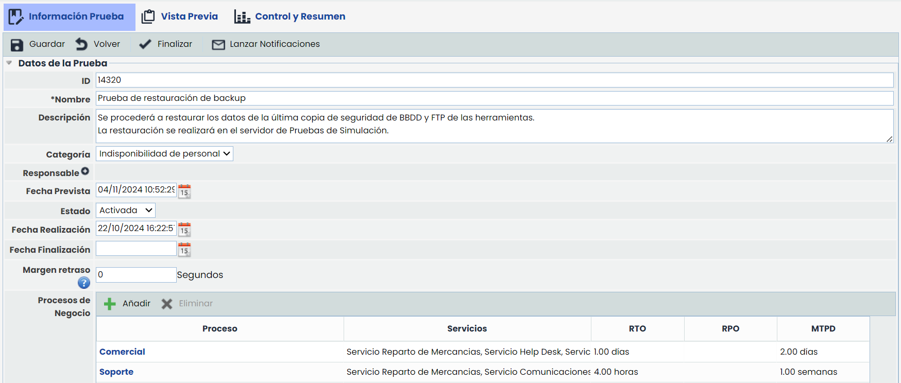
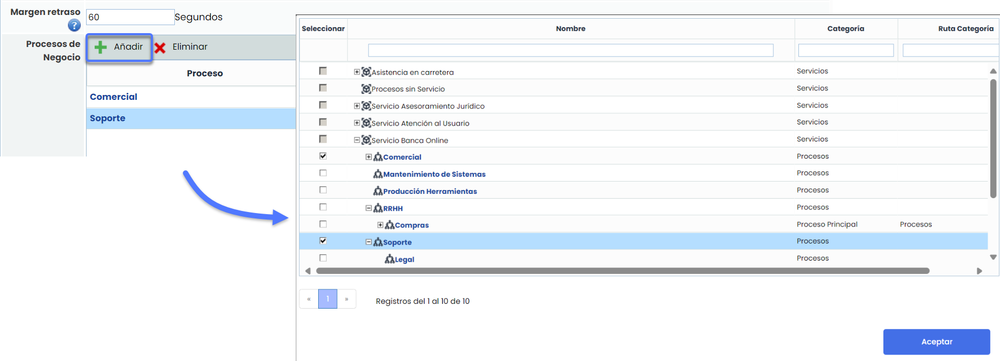
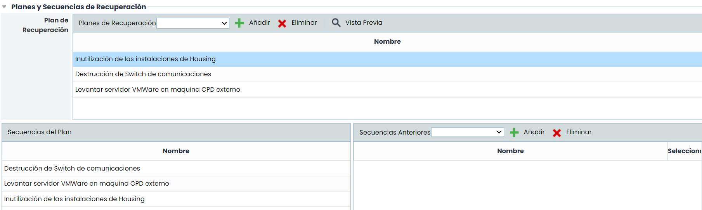
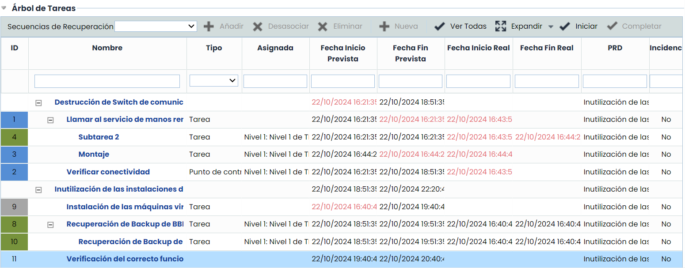
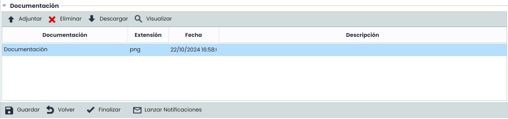

# Información Prueba

Las opciones son las siguientes:

* **Guardar:** Permite realizar el guardado de la información incluida en la prueba.
* **Volver:** Permite regresar a la opción principal donde se muestran todas las pruebas generadas en GlobalSuite.
* **Activar:** Permite indicar que la prueba ha sido ya realizada, determinándose la fecha en la cual se ha realizado la activación.
* **Lanzar Notificaciones:** Permite informar a través de correo electrónico al personal encargado de las tareas a realizar para completar la prueba en cuestión.

La información que se puede definir sobre una prueba es la siguiente:

## Datos de prueba

* **Nombre:** Permite determinar el nombre de la prueba.
* **Descripción:** Permite establecer cualquier información adicional que clarifique en qué consiste la prueba.
* **Categoría:** Permite definir la categoría de prueba a realizar.
* **Responsable:** Permite designar al empleado responsable de la correcta gestión de la prueba.
* **Fecha prevista:** Permite establecer la fecha prevista de realización de la prueba.
* **Estado:** Permite establecer si se ha ejecutado o no la prueba establecida.
* **Fecha de realización:** Permite determinar la fecha en la que se ha realizado la prueba.
* **Fecha de finalización:** Permite definir la fecha en la que se ha finalizado la prueba.
* **Procesos de Negocio:** Permite asociar procesos dentro del ciclo de pruebas.

## Planes y secuencias de recuperación

La opción de planes y secuencias de recuperación permiten asociar los diferentes planes de recuperación establecidos en el apartado 'Planes/Planes de Recuperación' para ejecutar la prueba y las secuencias de ejecución de la misma.

## Árbol de tareas

El árbol de tareas permite al usuario establecer las diferentes tareas a realizar durante la prueba definida.

Las opciones que permite la tabla son las siguientes:

* **Añadir:** Ofrece la posibilidad de insertar una secuencia de recuperación.
* **Desasociar:** Permite desasociar de la tabla una secuencia de recuperación junto con las tareas definidas en ella. Para ello se ha de seleccionar la secuencia deseada y pulsar sobre el botón 'Desasociar'.
* **Eliminar:** Permite eliminar de la tabla una secuencia de recuperación junto con las tareas definidas en ella. Para ello se ha de seleccionar la secuencia deseada y pulsar sobre el botón 'Eliminar'.
* **Nuevo:** Permite insertar una nueva secuencia en la tabla.
* **Ver todas:** Permite ver todas las tareas que se han añadido en la prueba.
* **Expandir/Contraer:** Permite expandir o contraer el árbol de tareas.
* **Iniciar:** Permite iniciar una tarea que se encuentra en el árbol de tareas. Para ello, se selecciona una tarea y se pulsa el botón. De esta forma, no es necesario ingresar dentro de la tarea para iniciar la tarea.

Nota: Sólo se podrán iniciar aquellas tareas que estén permitidas en función de las dependencias definidas en las secuencias de recuperación.

* **Completar:** Permite finalizar una tarea que se encuentra en el árbol de tareas. Para ello, se selecciona una tarea y se pulsa el botón. De esta forma, no es necesario ingresar dentro de la tarea para finalizar la tarea.

Nota: Sólo se podrán finalizar aquellas taras que estén iniciadas previamente.

## Documentación

Permite incluir cualquier documentación que tenga relación al plan de prueba.

Para ello se ha de pulsar sobre el botón “Adjuntar” y seleccionar el archivo deseado. En caso de querer eliminar un archivo, se ha de seleccionar la fila deseada y pulsar sobre el botón “Eliminar”.

Por último pulsando sobre el botón “Descarga” la herramienta ofrece la posibilidad de descargar el archivo.

