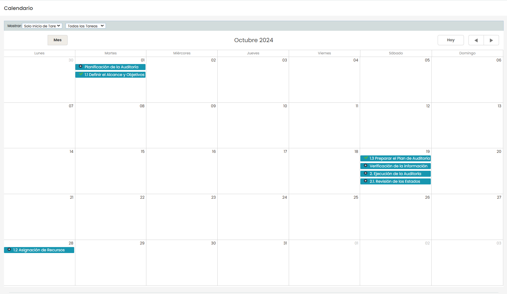
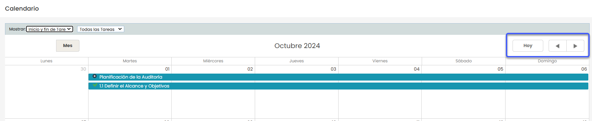
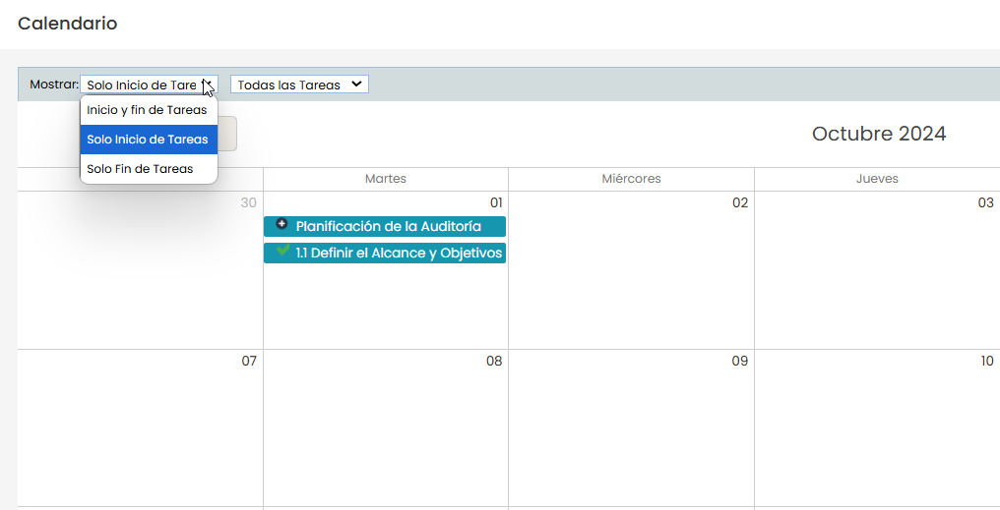
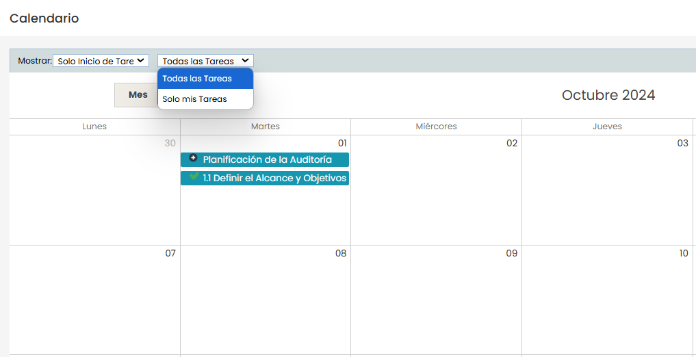
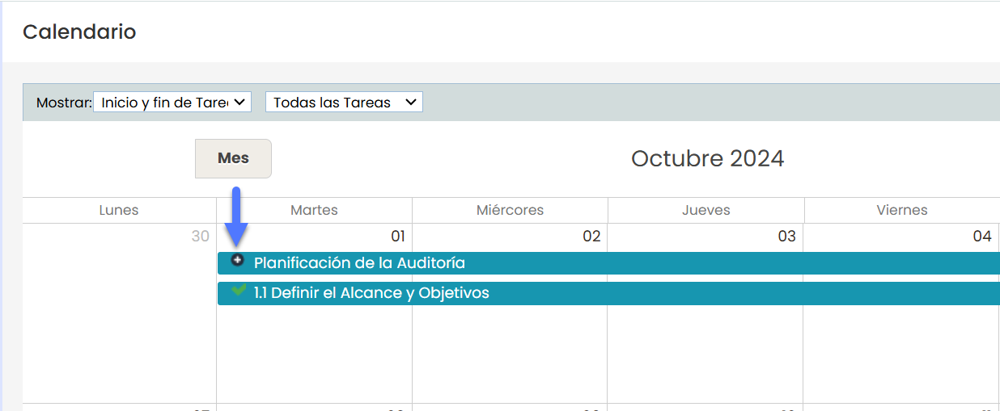
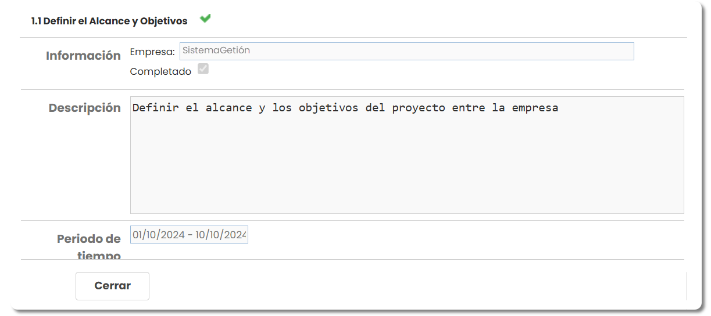

# Calendario

El calendario de proyecto permite al consultor visualizar, de manera gráfica, las tareas asignadas en el proyecto dentro de un calendario. Este facilita la organización y el seguimiento de las tareas programadas.

## Calendario del proyecto

El calendario cuenta con controles para navegar entre los meses y un botón ‘**Hoy'** que permite regresar rápidamente al mes actual.

Además, incluye la opción **‘Mostrar’**, que ofrece dos selectores para personalizar la visualización del calendario:

* Configuración de visualización de tareas

  * **Inicio y fin de tarea**: Muestra una barra que abarca desde el inicio hasta el fin de cada tarea en el calendario.
  * **Inicio de la tarea:** Resalta únicamente el día donde comienza cada tarea.
  * **Fin de la tarea:** Resalta únicamente el día donde finaliza cada tarea.

* Filtrado por asignación

  * **Todas las tareas:** Muestra todas las tareas del proyecto.
  * **Solo mis tareas**: Filtra las tareas, mostrando únicamente aquellas asignadas al consultor que está usando el sistema.

## Tareas

En las tareas se pueden ver iconos que indican el estado de la misma.

Al **hacer doble click** sobre la tarea se abre un resumen de la misma los campos se presentan de la siguiente manera:

* **Título de la Tarea**: En la parte superior aparece el nombre de la tarea (en este caso, "1.1 Definir el Alcance y Objetivos") con un icono de estado al lado (indica si la tarea está completada).
* **Información**

  * **Empresa**: Muestra el nombre del sistema de Gestión
  * **Completado**: Un checkbox que indica si la tarea está marcada como completada. Si está seleccionado, significa que la tarea ha sido finalizada.
* **Descripción**: Un cuadro de texto que contiene una breve explicación o los objetivos de la tarea.
* **Período de Tiempo**: Indica el rango de fechas en que la tarea está programada, desde el inicio hasta la fecha de finalización.
* **Botón de Cierre**: Un botón **"**Cerrar**"** para salir del resumen y volver a la vista anterior.

