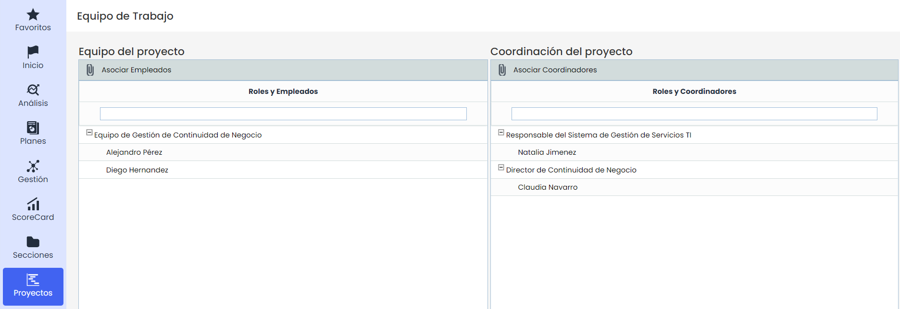

# Equipo de Trabajo

En la opción equipo de trabajo, el gestor podrá seleccionar que usuarios van a formar parte del equipo de trabajo para la implantación del sistema de gestión. A continuación se detallan cada uno de los equipos:

* **Asociar empleados:** Para seleccionarlos, deberá pulsar sobre el botón y una vez seleccionado el usuario, deberá pulsar sobre el botón 'Cargar Roles/empleados' para que el usuario sea añadido en la tabla. Para eliminar cualquier usuario, deberá seleccionar la fila del usuario y pulsar sobre el botón Eliminar.
* **Asociar coordinadores:** Para seleccionarlos, deberá pulsar sobre el botón y una vez seleccionado el coordinador, deberá pulsar sobre el botón 'Cargar Roles/empleados' para que el usuario sea añadido en la tabla.

**Nota:** Sólo los usuarios incluidos en estos equipos de trabajo recibirán las notificaciones de la opción Usuarios/Configurar Notificaciones.
