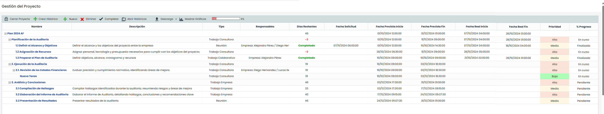
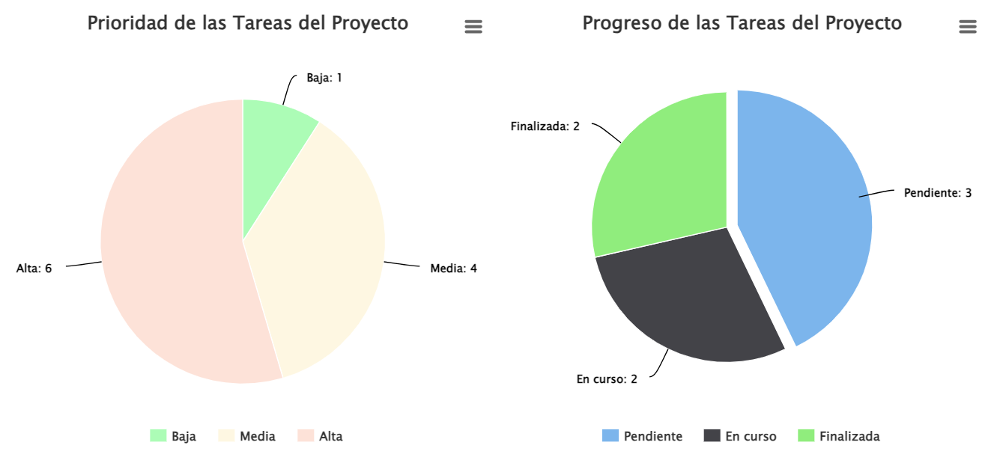
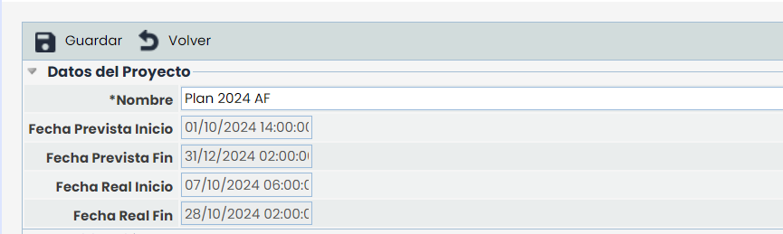
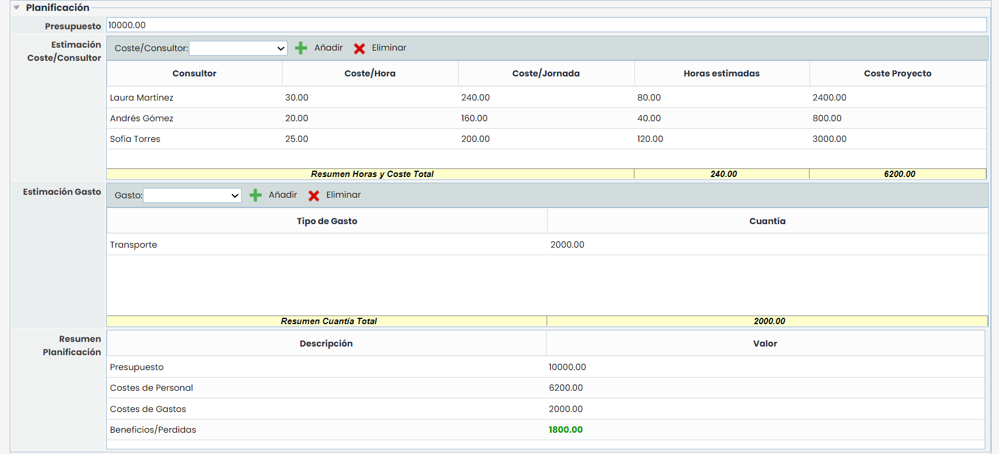
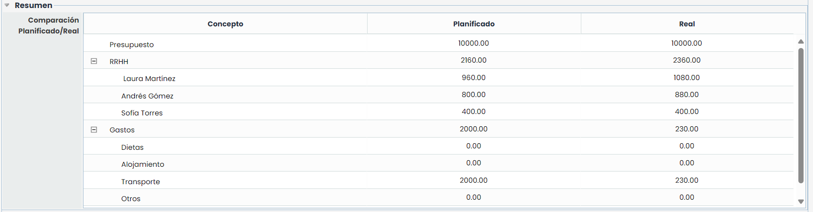
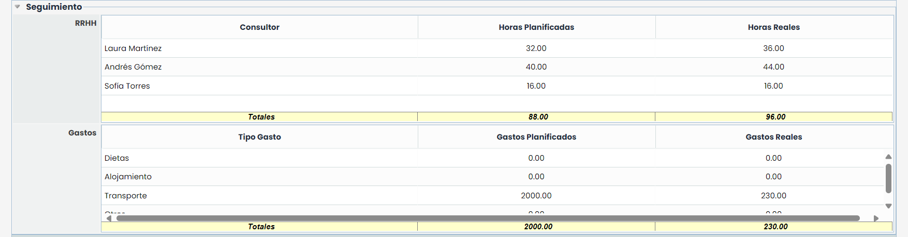
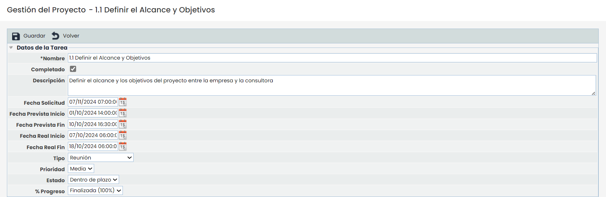
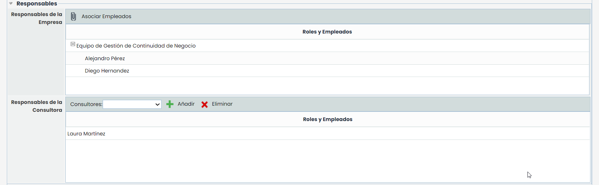
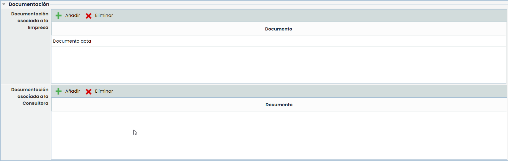
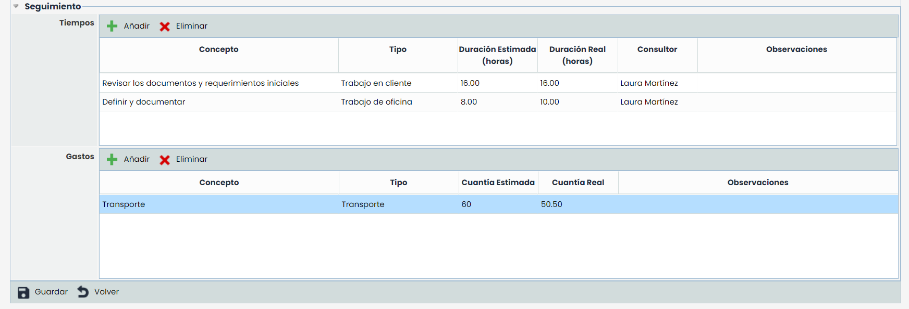

# Gestión del Proyecto

La opción ‘Gestión del proyecto’ de GlobalSuite permite al usuario gestionar el avance en la implantación de un proyecto determinado. Para asociar un proyecto a una empresa se ha de seleccionar en el apartado Ajustes >Gestión de Modelos.

Una vez definido el proyecto se ofrecen las siguientes opciones de inicio:

* **Nuevo:** Permite insertar diferentes tareas al proyecto seleccionado a partir de la primera fila de la tabla.
* **Eliminar:** Permite eliminar diferentes tareas del proyecto. Para ello se ha de seleccionar la fila o filas deseadas y pulsar el botón ‘Eliminar’.
* **Completar:** Permite definir cuando una tarea ha sido finalizada.
* **Crear Histórico:** Permite crear un archivo histórico con el grado de avance del proyecto en el momento de su creación.
* **Abrir Históricos:** Ofrece la posibilidad de abrir los históricos de proyecto almacenados.
* **Descarga:** Permite la descarga del proyecto en un formato editable (.xlsx) o en PDF
* **Mostrar Gráficas:** Ofrece la posibilidad de visualizar diferentes aspectos del proyecto en formato gráfico, tal y como se muestra en la siguiente imagen:

* **Porcentaje avance:** Muestra de manera visual el porcentaje de avance del proyecto en función de la finalización de las tareas.

La tabla del proyecto dispone de una serie de columnas que ofrecen la siguiente información:

* **Nombre:** Identifica el nombre de las distintas tareas generadas, donde el primer nivel identifica el nombre del proyecto y el resto de niveles, con posibilidad de anidación ilimitada, las tareas establecidas para completar el proyecto.
* **Tipo:** Identifica la tipología de la tarea generada.
* **Responsables:** Muestra el responsable asignado a la consecución de la tarea
* **Días restantes:** Identifica los días que faltan para que la tarea se ejecute en los tiempos definidos. El calculo se realiza en base a los valores fecha inicio/fin.
* **Fecha Inicio:** Muestra la fecha de inicio de la tarea
* **Fecha Fin:** Muestra la fecha de finalización de la tarea


\*\*NOTA:\*\* Cada una de las tareas es modificable pulsando sobre el nombre.


## **Proyecto(Primer Nivel):**

Si pulsamos sobre el nombre del proyecto se muestra un formulario sobre el que podemos definir los siguientes puntos

### Datos del Proyecto

Ofrece la posibilidad de establecer el Nombre del proyecto asi como, la fecha de inicio y fin, en base a la cual se van a calcular todas las tareas definidas.

### Planificación

El apartado de planificación permite definir los costes asociados al proyecto, pudiendo definir los siguientes parámetros:

* **Presupuesto:** permite definir el presupuesto asociado el proyecto.
* **Estimación Coste/Consultor:** ofrece la posibilidad de definir el coste del equipo consultor asociado el proyecto, pudiendo definir los costes/Hora y las horas estimadas de trabajo, con lo que la herramienta calcula automaticamente Coste/jornada y Proyecto del consultor.
* **Estimación Gasto:** Permite definir de las tipologías de Gasto que se definen en la opción Ajustes /Proyectos', la cuantía económica que supone el concepto en el proyecto.
* **Resumen planificación:** Ofrece un resumen de la información identificada en este apartado, destacando los beneficios o pérdidas del proyecto.

### Resumen

Esta opción muestra un resumen detallado de la información definida en el apartado anterior, destacando los beneficios o pérdidas del proyecto.

### Seguimiento

Muestra de manera centralizada las horas dedicadas y gastos asociados de las tareas que le han sido imputadas al consultor.

## **Tareas (Niveles):**

Al pulsar una tarea las opciones de modificación son las siguientes:

### Datos de la tarea

* **Nombre:** Permite modificar el nombre de la tarea.
* **Completado:** La opción indica si la tarea ha sido o no completada.
* **Descripción:** Permite realizar una descripción más extensa de la tarea.
* **Fecha Solicitud:** Ofrece la posibilidad de definir la fecha en la que se solicita que la tarea debe estar finalizada
* **Fecha Prevista Inicio:** Permite definir la fecha estimada de inicio de la tarea
* **Fecha Prevista Fin:** Permite definir la fecha estimada de finalización de la tarea
* **Fecha Real Inicio:** Define la fecha definitiva de inicio de la tarea
* **Fecha Real Fin:** Establece la fecha definitiva de fin de la tarea
* **Tipo:** Posibilita indicar la tipología de la tarea.
* **Prioridad:** Permite asignar una prioridad de realización en base a los estados definidos en "Ajustes /Configuración"
* **Estado:** Permite asignar un estado en base a los campos definidos en "Ajustes /Configuración"
* **% Progreso:** Permite asignar el porcentaje de avance de la tarea. En función de los procentajes definidos en "Ajustes /Configuración" el progreso total/global se verá modificado.

### Responsables

Este apartado permite indicar los usuarios responsables de realizar dicha tarea, pudiendo diferenciar entre los siguientes:

* **Responsable de la empresa** Ofrece la posibilidad de identificar quien será el responsable de la empresa para la tarea definida. Para ello se ha de pulsar sobre el botón 'Asociar empleado' y una vez seleccionado, pulsar sobre el botón 'Cargar Roles/Empleados'.
* **Responsable de la consultora** Ofrece la posibilidad de definir el responsable consultor para la tarea definida.Para ello se ha de seleccionar una recurso del desplegable y pulsar sobre el botón 'Añadir'. En caso de querer eliminar un recurso asociado a una tarea, se ha de seleccionar la fila deseada y pulsar sobre el botón 'Eliminar'.


\*\*NOTA:\*\* Los responsables de la consultora se han definido en el apartado 'Ajustes/Consultores Asociados'


### Documentación

Este apartado ofrece la posibilidad de identificar y asociar documentación relacionada con la tarea a realizar. Para ello se ha de pulsar sobre el botón 'Añadir', lo cual genera una nueva entrada en la tabla. Para modificar el nombre del documento se ha de pulsar dos veces sobre la celda deseada. En caso de querer eliminar un documento asociado, se ha de seleccionar la fila deseada y pulsar sobre el botón 'Eliminar'.

**Seguimiento**

Esta opción permite imputar los siguientes conceptos en la tarea seleccionada, como son:

* **Tiempos:** Permite imputar los tiempos dedicados a la realización de la tarea, pudiendo definir el nombre del concepto, la tipología asociada, las horas dedicadas, consultor asociado y observaciones.
* **Gastos:** Ofrece la posibilidad de imputar los gastos asociados a la tarea, pudiendo definir el nombre del concepto, la tipología de gasto asociada, la cuantía económica y observaciones.


\*\*NOTA:\*\* Los tiempos y gastos asociados a una tarea, se verán reflejados en el apartado de Proyecto (Primer Nivel)

