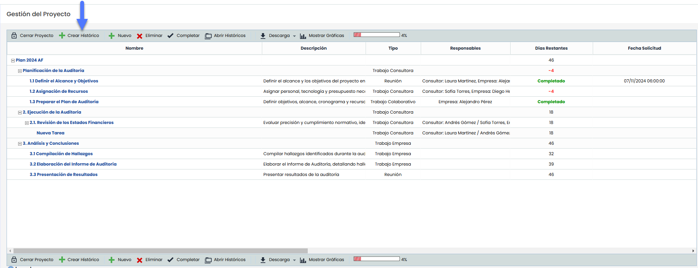
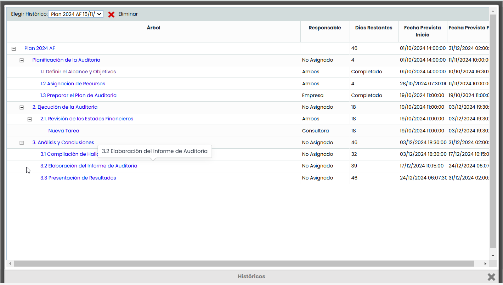
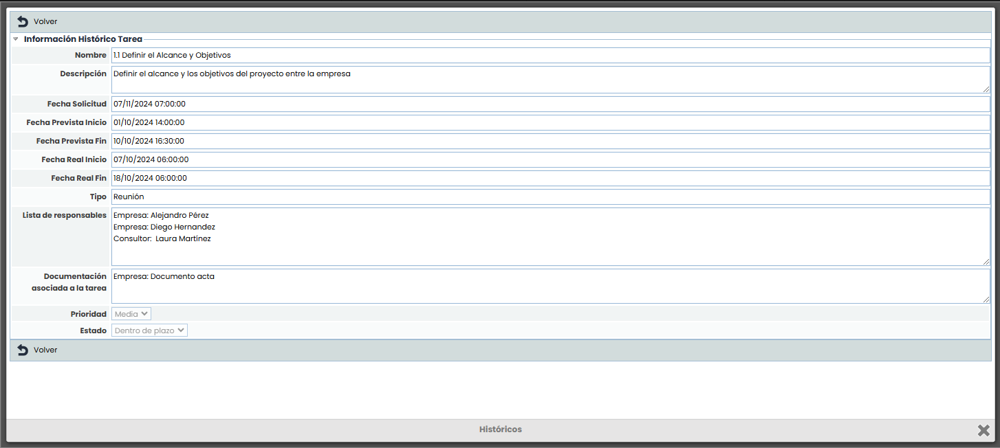
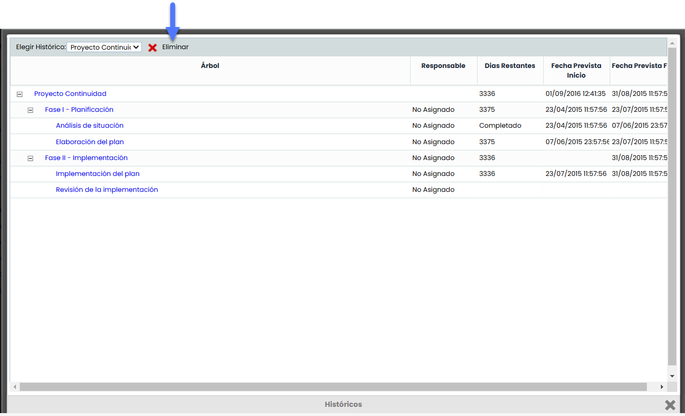

# Históricos proyecto

Posibilita ver los históricos generados y almacenados.

## Crear histórico

La creación de un histórico se realiza desde un proyecto activo. Al generarlo, el sistema guarda automáticamente una copia del proyecto con el formato **Nombre del proyecto + Fecha y hora** de la generación

## Consultar histórico

Para consultar un histórico, es necesario pulsar el botón **"Abrir Históricos"** ubicado en la barra de herramientas del proyecto. Esto abrirá una ventana emergente que incluye el campo **"Elegir histórico"**, donde se encuentra un desplegable con todos los históricos disponibles. En este desplegable, se debe seleccionar el histórico que se desea consultar para acceder a su contenido.

## Consultar tareas

Para consultar las tareas dentro de un histórico, simplemente hay que seleccionar el nombre de la tarea deseada. Al hacerlo, se abrirá una **vista detallada** que muestra toda la información de la tarea tal como estaba al momento de la creación del histórico. Es importante destacar que esta información es solo para consulta, ya que no se pueden editar los datos desde esta vista.

## Eliminar histórico.

Para eliminar un histórico, primero se debe seleccionar el histórico deseado en el campo **"Elegir histórico"**, ubicado en el desplegable. Una vez seleccionado y abierto el histórico, se debe pulsar el botón **"Eliminar"** para proceder con su eliminación.

