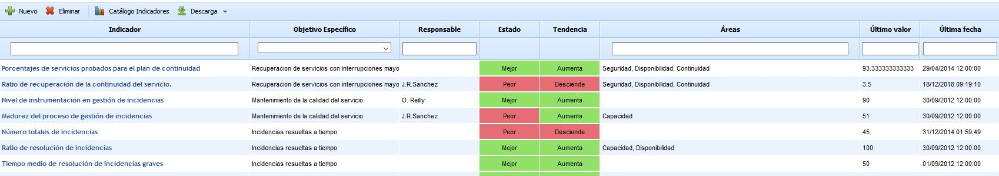
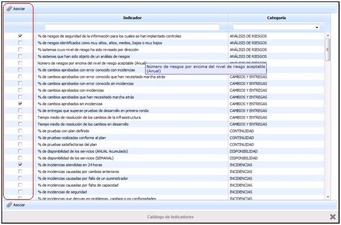
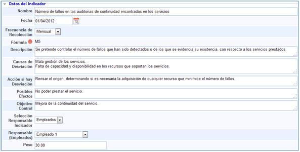
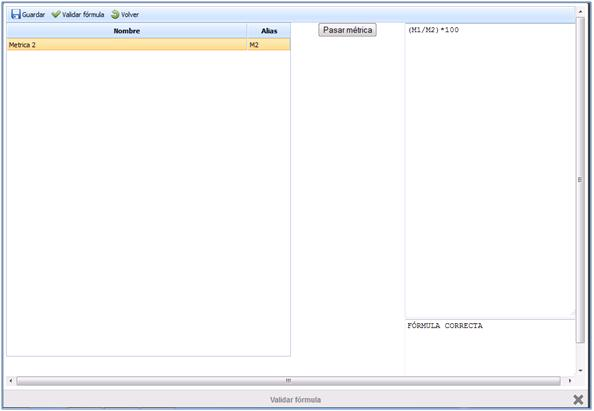
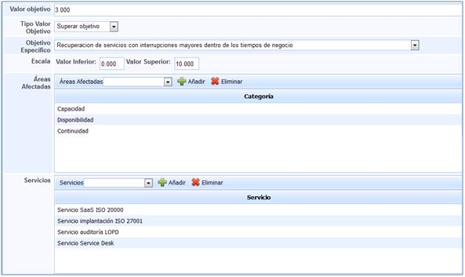
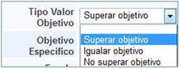
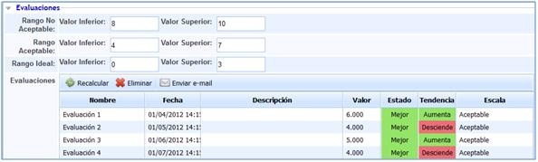

# Indicadores

La opción Indicadores de GlobalSuite permite establecer todas aquellas mediciones de seguimiento que le van a ofrecer información sobre el funcionamiento y desempeño del Sistema de Gestión, así como el soporte de los objetivos específicos definidos.

En la pantalla principal se encuentra el listado de indicadores que han sido definidos.

Los campos Estado y Tendencia indican cual es la evolución de cada uno de los indicadores, y los campos Último valor y Última fecha muestran si los indicadores están siendo actualizados:

-**Estado:** Indica si el último valor obtenido es mejor que el valor objetivo definido para cada indicador, informando sobre si este mejora, empeora o se mantiene.

-**Tendencia:** Establece si el valor obtenido es mejor que el valor inmediatamente anterior.

-**Último valor:** Indica el último valor que se le ha aplicado.

-**Última fecha:** Indica la fecha en la que se ha actualizado el último valor.

A parte, en esta pantalla principal se dispone de las siguientes opciones:

* **Nuevo:** Permite generar un nuevo indicador.

* **Eliminar:** Permite eliminar indicadores que han sido generados previamente.

* **Catálogo de Indicadores:** Permite seleccionar y asociar una serie de indicadores propuestos de forma automática por GlobalSuite.

* **Descarga:** Permite descargar el listado de todos los indicadores que se han definido.

En caso de utilizar la opción del catálogo de indicadores, aparecerá una pantalla emergente con los indicadores organizados por categorías.

Todos aquellos indicadores que sean considerados como útiles para medir la eficiencia del sistema de gestión y los objetivos específicos, deben ser seleccionados en la columna de la izquierda. Una vez seleccionados, se pulsa asociar, en la parte superior izquierda de la ventana, de tal forma que se cargan de forma automática.

Una vez asociados, aparecerá el listado de indicadores en la pantalla principal.

**NOTA:** De cada indicador creado a partir del Catálogo, se genera de forma automática una métrica con el mismo nombre.

Para poder definir o revisar los indicadores establecidos, se debe pulsar sobre el nombre del mismo, mostrando la siguiente gráfica y opciones:

## Gráfica

La gráfica muestra las mediciones realizadas, cada una asociada con la fecha en la que se ha procedido a revisar, así como con el valor objetivo del indicador y la representación gráfica de las mediciones realizadas.

## Datos del indicador

* **Nombre:** Permite determinar la denominación del indicador.

* **Fecha:** Establece la fecha a partir de la cual se recogen mediciones del mismo.

* **Frecuencia de Recolección:** Determina cada cuanto tiempo se deben realizar las mediciones.

* **Fórmula:** Permite determinar a partir de qué métricas se obtiene el valor del indicador.

Para definir la fórmula a partir de la cual se obtienen los datos del indicador, debe pulsarse sobre la imagen circular roja con una exclamación, apareciendo una nueva ventana emergente.

Los pasos a seguir para determinar con qué fórmula se van a obtener los valores del indicador se realizada a partir de los siguientes pasos:

1. Se seleccionan las métricas que proporcionan los datos necesarios para obtener los valores del indicador.
2. Una vez seleccionada la métrica, es necesario pulsar sobre la opción “Pasar métrica”, de tal forma que se ubique la misma sobre la columna de la derecha.
3. Una vez se han seleccionado todas las métricas que proporcionan los valores del indicador, es posible editar dicha columna, generando la fórmula que corresponda.
4. Una vez definida la fórmula es necesario proceder a comprobar si GlobalSuite la reconoce. Para ello se debe pulsar sobre la opción Valida Fórmula.
5. Una vez detectada, sobre la columna de la derecha se genera un texto corroborando que la fórmula empleada es válida.
6. Una vez validad debe procederse a guardar con el fin de que quede definida como fórmula a partir de la cual se obtienen los valores del indicador asociado.

**NOTA:** Para que se pueda asociar una métrica con un indicador determinado es necesario que ambos compartan la misma periodicidad.

* **Descripción:** Permite clarificar o incluir cualquier información que pueda ser útil para realizar las mediciones que correspondan.

* **Causas de la Desviación:** Establece qué puede provocar que no se cumpla con los valores determinados para el indicador.

* **Acción si hay Desviación:** Permite determinar cómo se va a actuar en caso de no cumplimiento de los valores establecidos para el indicador.

* **Posibles efectos:** Establece qué puede ocurrir en caso que haya desviaciones.

* **Objetivo de Control:** Determina qué objetivo se quiere conseguir al controlar la actividad que corresponda con el indicador.

* **Selección Responsable Indicador:** Determina si el empleado corresponde a una persona dada de alta en la gestión de empleados de GlobalSuite o si es alguien externo, donde se seleccionará la opción Manual.

* **Responsable (Empleados):** Establece qué empleado dado de alta en GlobalSuite es el encargado de gestionar y revisar los valores obtenidos a partir del indicador.

* **Peso:** Determina la importancia que tiene el indicador definido sobre la consecución del objetivo específico que lo soporta.

* **Valor objetivo**: Establece el valor a partir del cual se considera que las acciones realizadas con respecto a la actividad que se está midiendo están siendo efectivas.

* **Tipo Valor Objetivo**: Determina cómo deben actuar los resultados de las mediciones objetivos con respecto al valor objetivo definido.

Las opciones proporcionadas por GlobalSuite corresponden con:

-*Superar objetivo.*

-*Igualar objetivo.*

-*No superar objetivo.*

* **Objetivo Específico:** Permite asociar el objetivo específico con el que está relacionado el indicador.

* **Escala:** Establece entre qué valores debe representarse la gráfica del apartado Gráficas.

* **Áreas Afectadas:** Determina qué áreas se ven afectadas o influenciadas por el indicador definido.

* **Servicios:** Determina qué servicios se ven afectados o influenciados por el indicador definido.

## Evaluaciones

A través de la presente opción es posible determinar para qué valores los datos obtenidos son o no aceptables. De la misma forma permite generar registros de las evaluaciones realizadas.

* **Rango No Aceptable:** Determina para qué rango de valores los datos obtenidos no son aceptables.

* **Rango Aceptable:** Determina para qué rango de valores los datos obtenidos son aceptables.

* **Rango Ideal:** Determina entre qué rango de valores se considera como ideal los datos obtenidos.

* **Evaluaciones:** Permite registrar las evaluaciones de los datos realizados.

**NOTA:** Todas las escalas de los rangos proporcionados por GlobalSuite son fijadas y gestionadas desde la pestaña ScoreCard de la opción Configuración.

GlobalSuite dispone de las siguientes opciones en el apartado Evaluaciones:

-Recalcular: Permite generar una evaluación de forma automática.

NOTA: A través de esta opción se puede generar una nueva evaluación siempre y cuando se haya incluido un nuevo valor en el indicador. Si no se ha incluido un nuevo valor esta opción no realiza ningún tipo de cálculo.

-*Eliminar:* Permite eliminar una evaluación generada previamente.

-*Enviar e-mail:* Permite enviar por correo electrónico las evaluaciones realizadas.

Los campos definidos en el presente apartado corresponden:

-*Nombre:* Corresponde con la denominación de la evaluación realizada.

-*Fecha:* Indica la fecha de realización de la evaluación.

-*Descripción:* Permite completar la evaluación con cualquier información complementaria que sea necesaria.

-*Valor:* Corresponde con el valor obtenido del indicador.

-*Estado:* El valor indicado establece si el este es mejor que el valor objetivo definido del indicador.

-*Tendencia:* Establece si el valor obtenido es mejor que el anterior.

-*Escala:* Indica en qué rango de los definidos se encuentra el valor correspondiente del indicador.
