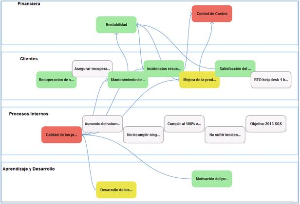

# Mapa Estratégico

La presente opción permite mostrar las relaciones entre los diferentes objetivos específicos definidos asociados a la perspectiva que corresponda.

En la pantalla principal de la opción Mapa Estratégico se muestran gráficamente dichas relaciones.

* GlobalSuite permite acceder de forma directa a cada uno de los objetivos específicos definidos. La forma de realizarlo es haciendo doble click sobre el objetivo que quiera ser abierto.

* De forma complementaria pulsando sobre cada uno de los objetivos específicos con el botón derecho, la solución permite mostrar la gráfica generada de cada uno de ellos.

