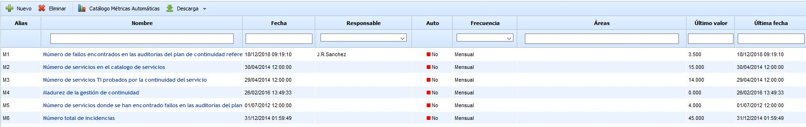
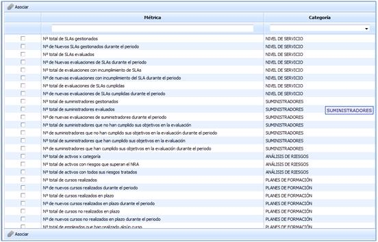
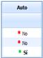
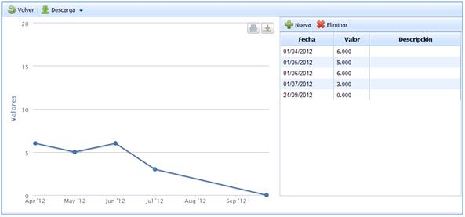
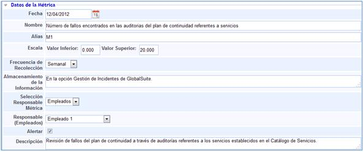
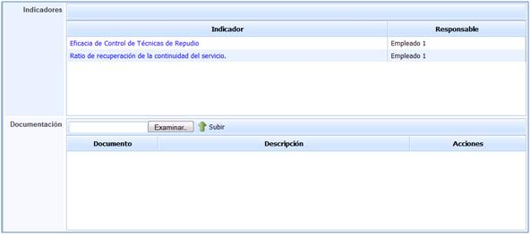
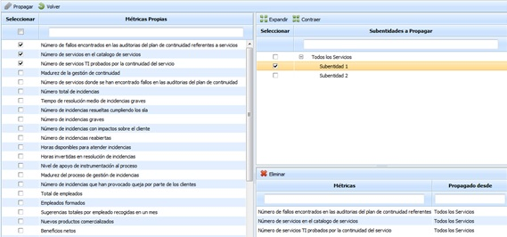
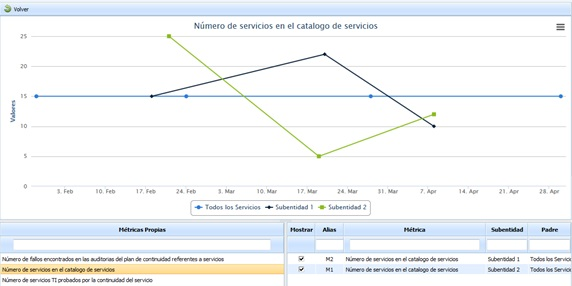

# Métricas

En la opción de **Métricas** permite incluir los valores que generan los indicadores que soportan los objetivos específicos.

En la pantalla principal se puede identificar el listado de todas las métricas que han sido definidas.

Los campos Último valor y Última fecha muestran si las métricas están siendo actualizadas:

-**Fecha:** Fecha de creación de la métrica.

-**Responsable:** Persona responsable de la métrica.

-**Auto:** Indica si la métrica es manual o automática.

-**Frecuencia:** Indica la frecuencia con la que se calcula la métrica.

-**Áreas:** Indica el área al que está asociada la métrica.

-**Último valor:** Indica el último valor que se le ha aplicado.

-**Última fecha:** Indica la fecha en la que se ha actualizado el último valor.

En esta pantalla principal se pueden identificar las siguientes opciones:

* **Nuevo:** Permite generar Métricas.

* **Eliminar:** Permite eliminar Métricas que han sido generadas previamente.

* **Catálogo Métricas Automáticas:** Esta opción permite generar una serie de Métricas propuestas por GlobalSuite. Estas Métricas generan datos de forma automática.

* **Descarga:** Permite descargar de la herramienta el listado de todas las Métricas utilizadas.

Con respecto al Catálogo Métricas Automáticas, aparece una ventana emergente donde se definen todas aquellas Métricas organizadas por categorías.

La característica principal de estas Métricas es que son totalmente automáticas generándose los datos correspondientes a partir de otras opciones de la herramienta.

La forma mediante la cual se debe proceder a utilizarlas es similar a el caso de indicadores, debiendo seleccionar en primer lugar aquellas que se quieran utilizar y asociándolas. De esta forma se incluyen al listado de Métricas.

Se pueden identificar las Métricas asociadas del catálogo mediante la columna Auto ya que aparece “Sí”, indicando que los datos de la misma se generarán automáticamente a partir de la opción correspondiente de GlobalSuite. NOTA:**Para realizar el acceso a cada una de las métricas es preciso pulsar sobre el nombre de cada una de ellas.** Una vez se haya accedido a cada una de las métricas establecidas, se pueden identificar las siguientes pestañas:

## Gráficas

En este apartado se muestran los valores obtenidos en la medición correspondiente, representados a su vez de forma gráfica.

La opción Métricas en el apartado de gráficas proporciona las siguientes opciones:

* **Nueva:** Permite generar o incluir un nuevo valor en la métrica.

* **Eliminar:** Permite eliminar un valor definido previamente.

A su vez en cada uno de los valores registrados es posible indicar información complementaria que se considere necesaria para clarificar el dato incluido.

## Datos de la métrica

* **Fecha:** Establece la fecha en la cual se inicia la recolección de valores.

* **Nombre:** Permite determinar la denominación de la métrica.

* **Alias:** GlobalSuite genera de forma automática una determinación para el alias. Este será utilizado para generar la fórmula de cálculo del indicador que corresponda.

* **Escala:** Permite establecer el rango de valores en los que se representará la gráfica generada.

* **Frecuencia de Recolección:** Establece cada cuanto tiempo se debe realizar la recogida de valores.

* **Almacenamiento de la información:** Permite determinar el lugar donde se almacenan los valores obtenidos.

* **Selección Responsable Métrica:** Permite establecer si el responsable seleccionado se realiza manualmente o en su defecto se establece de forma automática, de tal forma que se identifique como responsable un empleado gestionado a través de GlobalSuite.

* **Responsable (Empleados):** Determina qué empleado es el encargado de gestionar la métrica.

* **Alertar:** Seleccionado este campo GlobalSuite enviará un correo electrónico al responsable establecido.

* **Descripción:** Permite generar o incluir cualquier tipo de descripción que se considere oportuna para clarificar el sentido de la métrica definida.

* **Indicadores:** Establece aquellos indicadores asociados con la métrica definida.

* **Documentación:** Permite asociar documentación que clarifique la métrica definida o bien que sirva como registro de la misma.

## Propagación de Métricas

La presente opción permite la propagar las métricas definidas en la empresa matriz a las subentidades que dependen de esta.

Una vez se ha accedido a la opción, se muestran las siguientes tablas:

**Tabla izquierda:** Muestra el listado de métricas que se han definido en la empresa matriz. Las opciones que permite la tabla son:

* **Propagar:** Una vez seleccionadas las métricas deseadas permite propagar las mismas a las subentidades seleccionadas.
* **Volver:** Ofrece la posibilidad de volver a la pantalla inicial de métricas.

**Tabla superior derecha:** Muestra el listado de subentidades a las que se pueden asociar métricas de la empresa matriz. Las opciones que permite la tabla son la de expandir o contraer el listado de subentidades.

**Tabla inferior derecha:** Una vez seleccionada la subentidad en la tabla superior, muestra las métricas que se han asociado a la misma. La herramienta ofrece la posibilidad de elminiar una métricas asociada, para ello se ha de seleccionar la fila deseada y pulsar sobre el botón 'Eliminar'

## Consolidación de Métricas

La presente opción permite la consolidar las métricas definidas en la empresa matriz con las métricas de las subentidades que dependen de esta.

Una vez se ha accedido a la opción, se muestran la siguiente información:

**Gráfica** Muestra las diferentes valoraciones efectuadas en las métricas de la empresa matriz y las subentidades.

**Tabla métricas propias** Permite visualizar el listado de métricas de la empresa matriz que se han asociado a una o varias subentidades

**Tabla métricas propagadas** Permite visualizar las subentidades a las que se ha asociado la métrica seleccionada. La información que aporta la tabla es la siguiente:

* **Mostrar** Ofrece la posibilidad de visualizar los resultados de la métrica en la gráfica superior.
* **Alias** Indica el alias asignado a la métrica en la subentidad.
* **Métrica** Informa sobre el nombre de la métrica asociada a la subentidad
* **Subentidad** Muestra la subentidad a la que se ha asociado la métrica
* **Padre** Indica la empresa matriz desde la que se ha propagado la métrica
