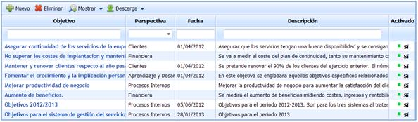
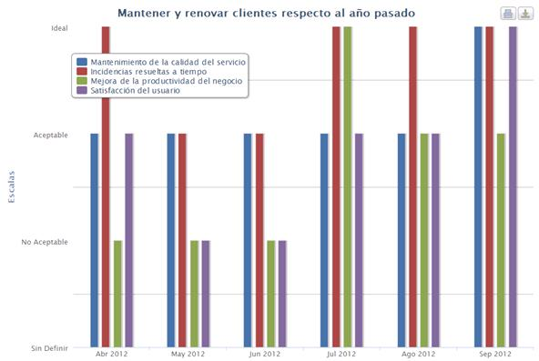
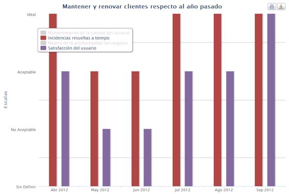
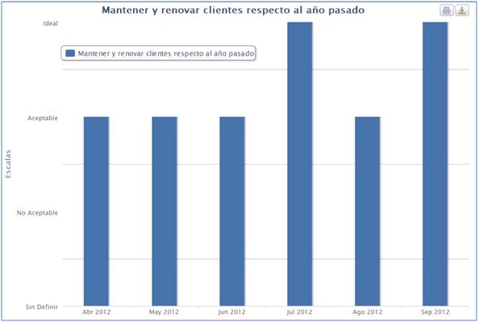
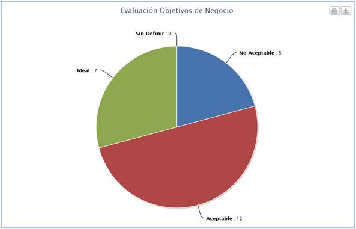
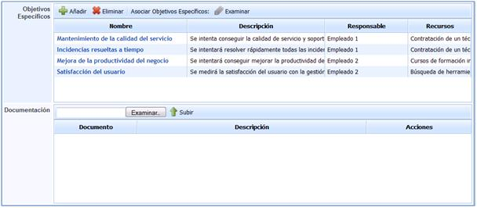
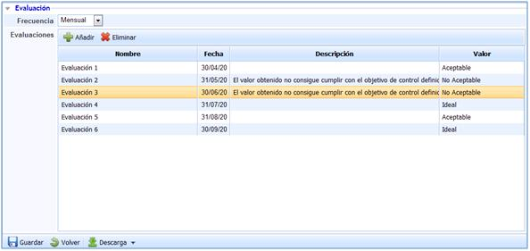
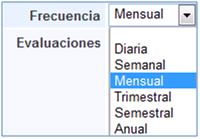
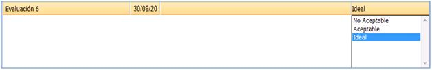

# Objetivos de Negocio

La pantalla principal de la opción objetivos de negocio muestra el listado de todos los objetivos que han sido definidos.

Las opciones proporcionadas por GlobalSuite para la pantalla principal de los Objetivos de Negocio son las siguientes:

* **Nuevo:** Permite generar un nuevo objetivo de negocio.

* **Eliminar:** Permite eliminar un objetivo de negocio que ha sido definido de antemano.

* **Mostrar:** Permite mostrar los objetivos de negocio definidos.

GlobalSuite permite mostrar o bien todos los objetivos o tan sólo aquellos que se encuentran activados.

* **Descarga:** Permite realizar la descarga del listado de objetivos definidos.

GlobalSuite permite descargar el listado tanto en formato Excel como en PDF. NOTA:**Para realizar el acceso a un objetivo es necesario pulsar sobre el nombre del que se pretenda definir en la columna de objetivos.**

La información a completar cada uno de los objetivos de negocio aparece estructurada en diferentes apartados:

## Gráficas

El presente apartado permite revisar de forma gráfica el estado del objetivo de Negocio así como el estado de los objetivos específicos con los que se obtiene.

* **Grafica Objetivos Específicos:** Muestra el estado de los Objetivos Específicos que soportan el Objetivo de Negocio seleccionado en función de las escalas seleccionadas.

**NOTA:** Las escalas han sido definidas de forma previa en la opción configuración de GlobalSuite.

A su vez GlobalSuite proporciona la opción de representar los objetivos específicos que se consideren oportunos. Para ello basta con pulsar sobre aquellos objetivos que no se tiene intención de representar.

* **Gráfica Objetivo:** Muestra el estado del Objetivo de Negocio seleccionado en función de las escalas definidas previamente.

**NOTA:** Las escalas han sido definidas de forma previa en la opción configuración de GlobalSuite.

* **Gráfica Evaluaciones Objetivos:** Muestra el resumen del estado de todos los objetivos específicos que proporcionan la información que corresponde con el Objetivo de Negocio en función de las escalas definidas previamente en la configuración de GlobalSuite.

**NOTA:** Las escalas han sido definidas de forma previa en la opción configuración de GlobalSuite.

Para todas las gráficas seleccionadas, la solución nos proporciona la opción de realizar la descarga de la gráfica o proceder a imprimirla de forma directa.

La opción descargar permite realizar la misma en los siguientes formatos:

* PNG.
* PDF.
* JPEG.
* SVG.

## Información del Objetivo

* **Nombre:** Permite determinar la denominación del objetivo de negocio.
* **Activo:** Establece si el objetivo está activo para el presente periodo o no como objetivo de negocio a conseguir.
* **Perspectiva:** Permite determinar el ámbito de la organización al que se fija el objetivo de negocio definido. Estas perspectivas son definidas de antemano en la opción configuración de GlobalSuite.
* **Fecha:** Establece el inicio de la medición o control del objetivo.
* **Responsable:** Permite fijar qué empleado será el encargado de la gestión y consecución del objetivo de negocio.
* **Descripción:** Permite incluir cualquier tipo de información que se considere relevante como ayuda para el entendimiento del objetivo de negocio.
* **Servicios:** Establece los servicios que se ven afectados o influenciados por el objetivo de negocio.
* **Áreas Afectadas:** Establece las áreas que se ven afectadas por el objetivo de negocio.

* **Objetivos específicos:** Permite generar o fijar qué objetivos específicos van a permitir conseguir cumplir con el objetivo de negocio establecido.

Para fijar los objetivos específicos se nos presentan las siguientes opciones: -*Añadir:* Permite incluir un nuevo objetivo específico que habría que definir a posteriori. -*Eliminar:* Permite eliminar un objetivo específico generado previamente. -*Examinar:* Permite asociar un objetivo específico que ha sido definido directamente en la opción de objetivos específicos. NOTA: Es posible realizar el acceso a cada uno de los objetivos específicos relacionados pulsando sobre el nombre de cada uno de los definidos.

* **Documentación:** Permite asociar cualquier tipo de documentación que pueda ser útil para conseguir o evidenciar el cumplimiento del objetivo de negocio generado.

## Evaluación

* **Frecuencia:** Establece la periodicidad con la que se realizan evaluaciones del objetivo de negocio definido.

El rango de frecuencias proporcionado por GlobalSuite oscila entre la posibilidad de fijar evaluaciones diarias a anuales.

* **Evaluaciones:** Permite dejar registro de las evaluaciones de cumplimiento realizadas sobre el objetivo de negocio definido.

Para establecer el registro de evaluación del objetivo de negocio GlobalSuite nos proporciona las siguientes opciones. -*Añadir:* Permite generar un nuevo registro de evaluación. -*Eliminar:* Permite eliminar un registro de evaluación generado de forma previa.

**NOTA 1:** Todos los campos representados en las evaluaciones realizadas son editables.

**NOTA 2:** El valor de cada una de las evaluaciones realizadas es fijado en función de los valores de escala definidos.

Tanto en la cabecera de los objetivos de negocio como en la parte inferior de la misma GlobalSuite nos proporciona las siguientes opciones:

* **Guardar:** Permite realizar el guardado de las modificaciones realizadas del objetivo de negocio.
* **Volver:** Permite volver a la pantalla principal donde aparece el listado de los objetivos.
* **Descargar:** Permite realizar la descarga del objetivo de negocio como informe en formato docx.
