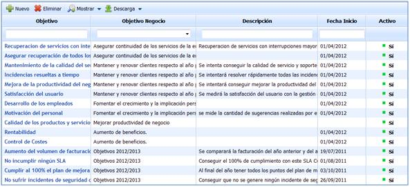
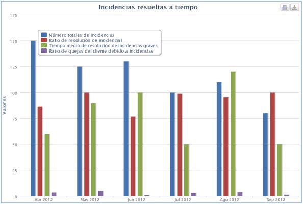
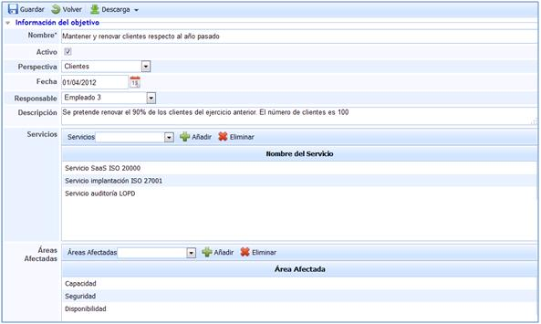
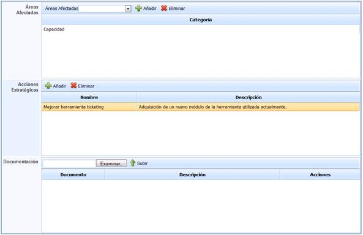
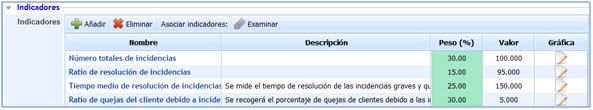
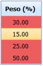
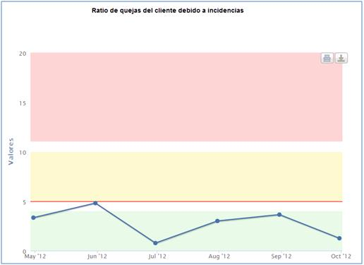
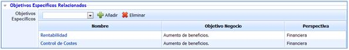
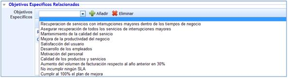
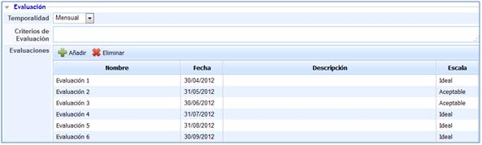

# Objetivos Específicos

A través de la opción de objetivos específicos, GlobalSuite permite establecer todos aquellos objetivos que soportan la consecución del objetivo de negocio fijado previamente.

En la pantalla principal de los objetivos específicos aparece el listado de todos los objetivos que se han definido previamente.

Las opciones proporcionadas por GlobalSuite para la pantalla principal de los Objetivos Específicos son las siguientes:

* **Nuevo:** Permite generar un nuevo objetivo.
* **Eliminar:** Permite eliminar un objetivo que ha sido definido de antemano.
* **Mostrar:** Permite mostrar los objetivos definidos.

GlobalSuite permite mostrar o bien todos los objetivos o tan sólo aquellos que se encuentran activados.

* **Descarga:** Permite realizar la descarga del listado de objetivos definidos.

GlobalSuite permite descargar el listado tanto en formato Excel como en PDF.

**NOTA:** Para realizar el acceso a un objetivo es necesario pulsar sobre el nombre del que se pretenda definir en la columna de objetivos.

Una vez se realiza el acceso a uno de los objetivos específicos, GlobalSuite proporciona la siguiente información que permite definir y realizar el seguimiento de los objetivos definidos. La estructura se organiza a través de apartados o pestañas. Los apartados del formulario se muestran desplegados para que se intente proporcionar toda la información posible en cada uno de ellos.

## Gráficas

El presente apartado permite revisar de forma gráfica el estado del objetivo Específico así como el estado de los indicadores a través de los que se obtiene.

* **Gráfica indicadores:** Muestra el estado de los indicadores que soportan el Objetivo Específico seleccionado en el valor numérico correspondiente para indicador definido.

A su vez GlobalSuite proporciona la opción de representar los objetivos específicos que se consideren oportunos. Para ello basta con pulsar sobre aquellos objetivos que no se tiene intención de representar.

* **Gráfica indicadores escalados:** Muestra el estado de los Indicadores que soportan el Objetivo Específico seleccionado en función de las escalas establecidas.

**NOTA:** Las escalas han sido definidas de forma previa en la opción configuración de GlobalSuite.

* **Gráfica evaluaciones indicadores:** Muestra el resumen del estado de todos los Indicadores que proporcionan la información asociada con el Objetivo Específico en función de las escalas definidas previamente en la configuración de GlobalSuite.

* **Gráfica objetivo específico:** Muestra el estado del Objetivo Específico seleccionado en función de las escalas definidas previamente y los resultados obtenidos de los indicadores que corresponden al mismo.

## Información del objetivo

* **Nombre**: Permite determinar la denominación del objetivo específico definido.

* **Responsable:** Permite establecer el empleado encargado de la gestión, medición y consecución del objetivo en concreto.

* **Objetivo de Negocio:** Establece el objetivo de negocio que se consigue a través del presente objetivo específico entre otros.

* **Fecha de Inicio:** Establece la fecha de inicio de implantación del objetivo.

* **Fecha Fin:** Fija la fecha en la cual deja de ser aplicable el objetivo.

* **Descripción:** Permite determinar cualquier información adicional que pueda resultar útil para aclarar o en su defecto conseguir cumplir con el objetivo definido.

* **Recursos:** Permite determinar qué se precisa para conseguir cumplir con el objetivo fijado.

* **Temporalidad:** Establece cada cuánto tiempo se procederá a evaluar el objetivo.

* **Presupuesto:** Permite determinar de qué cantidad de dinero se dispone para poder conseguir con el objetivo establecido.

* **Prioridad:** Permite designar un determinado orden en la consecución de los diferentes objetivos específicos asociados a un objetivo de negocio.

* **Servicios:** Establece qué servicios se ven afectados o en los que influye el objetivo específico fijado.

* **Áreas Afectadas:** Establece qué áreas se van a ver afectadas o sobre las que influye el objetivo específico fijado.

* **Acciones Estratégicas:** Permite establecer todas aquellas tareas, pasos o acciones que son necesarias para conseguir con el cumplimiento del objetivo específico establecido.

* **Documentación:** Permite asociar cualquier tipo de documentación o registro que pueda ser útil para la consecución del objetivo fijado.

## Indicadores

* **Indicadores:** Permite generar o fijar qué indicadores son los que van a permitir cumplir con el objetivo específico que soportan.

NOTA: Es posible realizar el acceso a cada uno de los objetivos específicos relacionados pulsando sobre el nombre de cada uno de los definidos.

Para fijar los indicadores se nos presentan las siguientes opciones: -*Añadir:* Permite incluir un nuevo indicador que habría que definir a posteriori. -*Eliminar:* Permite eliminar un indicador generado previamente. -*Examinar:* Permite asociar un indicador que ha sido definido directamente en la opción de indicadores.

* Peso: GlobalSuite permite determinar el peso de influencia de cada uno de los indicadores sobre el objetivo específico que soportan.

Es necesario que la suma de los pesos establecidos para cada uno de los indicadores sea 100. Si esta condición no se cumple aparecerán los valores de los pesos identificados en rojo.

* **Gráfica:** A través de esta opción, GlobalSuite abre una ventana emergente donde se representan los valores del indicador que corresponda.

**NOTA:** En la representación gráfica aparecen los colores que corresponden con los estados definidos para los valores obtenidos.

## Objetivos Específicos Relacionados

* **Objetivos Específicos:** A través de la presente opción se permite asociar diferentes objetivos específicos que han sido definidos previamente con el fin de relacionados con el objetivo que está siendo definido.

GlobalSuite permite:

-*Añadir:* Permite asociar el objetivo específico seleccionado.

-*Eliminar:* Permite eliminar el objetivo que ha sido asociado previamente.

## Evaluación

* **Temporalidad:** Establece la periodicidad con la que se realizan evaluaciones del objetivo específico definido.

El rango de frecuencias proporcionado por GlobalSuite oscila entre la posibilidad de fijar evaluaciones diarias a anuales.

* **Criterios de Evaluación:** Permite definir qué criterios se han tenido en cuenta para realizar la evaluación del objetivo específico.

* **Evaluaciones:** Permite dejar registro de las evaluaciones de cumplimiento realizadas sobre el objetivo específico definido.

Para establecer el registro de evaluación del objetivo de negocio, GlobalSuite nos proporciona las siguientes opciones.

-*Añadir:* Permite generar un nuevo registro de evaluación.

-*Eliminar:* Permite eliminar un registro de evaluación generado de forma previa.

**NOTA 1:** Todos los campos representados en las evaluaciones realizadas son editables.

**NOTA 2:** El valor de cada una de las evaluaciones realizadas es fijado en función de los valores de escala definidos.

Tanto en la cabecera de los objetivos específicos como en la parte inferior de la misma, GlobalSuite proporciona las siguientes opciones:

* **Guardar:** Permite realizar el guardado de las modificaciones realizadas del objetivo.

* **Volver:** Permite volver a la pantalla principal donde aparece el listado de los objetivos.

* **Descargar:** Permite realizar la descarga del objetivo específico como informe en formato docx.
