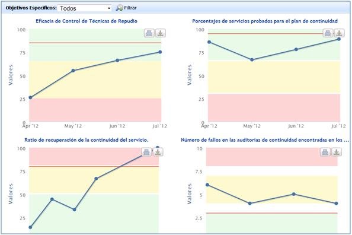
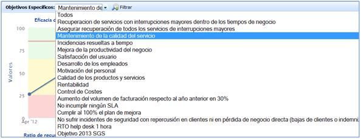

# Todos los Indicadores

La presente opción muestra gráficamente todos los indicadores generados en GlobalSuite.

En la pantalla principal se identifican todos los indicadores que han sido definidos.

* **Objetivos Específicos:** Permite filtrar los indicadores que soportan cada uno de los objetivos específicos definidos en GlobalSuite.

Seleccionando un determinado objetivo específico, se mostrarán tan sólo los indicadores correspondientes con dicho objetivo.
