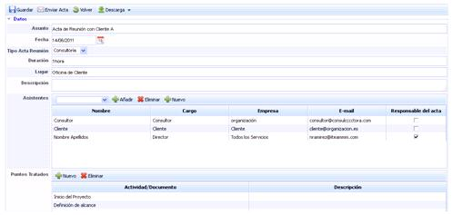
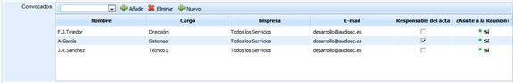

# Actas de reunión

La opción de Actas de Reunión permite gestionar y evidenciar todas las reuniones que se llevan a cabo para la gestión del sistema.

Lo primero que muestra GlobalSuite es una tabla con todas las actas de reunión de la organización. La tabla dispone de filtros para una mejor búsqueda de los campos.

Para crear una nueva acta de reunión deberá pulsar sobre el botón ‘Nueva’, lo que genera una nueva entrada en la tabla. Para acceder y modificar cada una de las actas, se ha de pulsar el enlace que aparece sobre su nombre o sobre la fecha.

Una vez seleccionada el acta aparece el formulario de modificación del Acta de Reunión, donde se pueden especificar todas las características de la misma, además de disponer de opciones para la generación de informes y el envío de las mismas.

En los botones que se encuentran en la parte superior se pueden realizar las siguientes acciones:

* **Guardar:** guardar los cambios realizados sobre el formulario del acta.
* **Enviar acta:** Posibilita en envío del acta mediante correo electrónico a todos los asistentes identificados en el campo ‘Asistentes’. Si se marca un responsable del acta (responsable de la reunión) será la persona a la que se le devolverán los emails con las modificaciones y objeciones del resto de asistentes.
* **Volver:** La herramienta devuelve al usuario a la pantalla de Actas de Reunión
* **Descarga:** Permite la descarga de todos los campos del acta en un formato editable (.docx)

El formulario posee los siguientes campos de definición:

* **Asunto:** Nombre descriptivo de la reunión.
* **Fecha:** Fecha en la que se realizó la reunión.
* **Tipo Acta Reunión:** En el desplegable aparecerán diferentes tipologías de actas. Estos campos se pueden configurar en el apartado ‘Configuración/General’, aunque la herramienta propone por defecto los tipos Comité, Consultoría, Seguimiento y Soporte.
* **Duración:** Campo texto libre para indicar el tiempo que ha durado la reunión.
* **Lugar:** Campo para indicar donde se lleva a cabo la reunión.
* **Descripción:** Resumen de la reunión.
* **Convocados:** En esta tabla se podrán especificar los asistentes a la reunión. Para ellos hay dos opciones:

  * **Empleados:** Se podrá elegir entre los empleados identificados en el apartado ‘Gestión/Empleados’. Para ello se selecciona el empleado en el desplegable y se pulsa el botón ‘Añadir’
  * **Nuevos:** Permite añadir nuevos participantes pulsando el botón ‘Nuevo’, en el que se abrirá una ventana para poder identificar los datos que el usuario requiera.

La información que muestra la tabla de convocados es la siguiente:

* **Nombre:** Identifica el nombre y apellidos del convocado a la reunión.
* **Cargo:** Muestra el cargo asociado al convocado.
* **Empresa:** Ofrece información de la empresa a la que pertenece el convocado.
* **Email:** Muestra el email asociado al convocado.
* **Responsable Acta:** Permite identificar el usuario responsable de generar el acta.
* **Asistente a la reunión:** Ofrece la posibilidad de identificar, de todos los convocados, quienes han asistido a la reunión.
* **Puntos Tratados:** Identifica los puntos a tratar en la reunión, como el índice de los temas y asuntos a tratar. Se pueden añadir y eliminar nuevos puntos mediante los botones ‘Nuevo’ y ‘Eliminar’.
* **Conclusiones:** Al igual que en el apartado anterior se pueden especificar las conclusiones derivadas de la reunión.
* **Asuntos Pendientes:** Los asuntos se refieren a las acciones derivadas de la reunión o los temas que quedan pospuestos. Permite identificar las tareas pendientes, personas encargadas de realizarlas y el plazo.
* **Documentación:** La opción ‘Documentación’ permite subir la documentación entregada y utilizada por los asistentes a la reunión.
