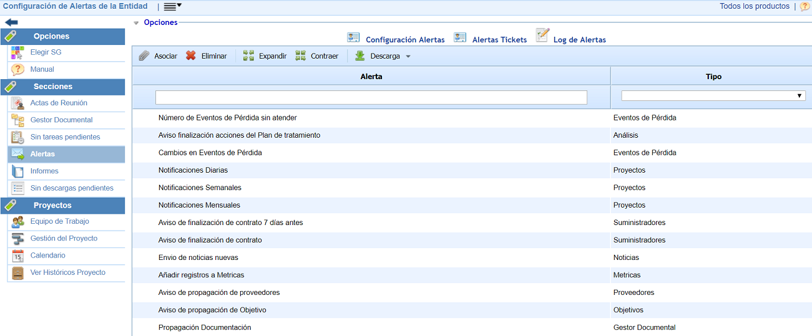

# Alertas

Esta opción permite configurar las distintas alertas disponibles para los roles y empleados de la empresa.

* [Configuración de Alertas](configuracion-de-alertas.md)
* [Alertas Tickets](alertas-tickets.md)
* [Log de Alertas](log-de-alertas.md)
* [Consolidación Alertas](consolidacion-alertas.md)
