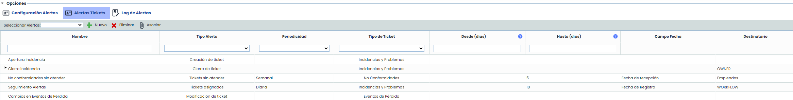
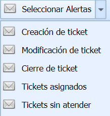

# Alertas Tickets

Esta sección permite definir distintas alertas para las categorías de Tickets configurados.

En esta tabla se configurarán las alertas de distintos tipos para cada categoría de ticket (Peticiones de Servicio, Incidencias y Problemas, Cambios y Entregas, Reclamaciones, No Conformidades, Correctivas y Preventivas, Eventos de Pérdida).

La columna 'Nombre' nos permite asignar un nombre descriptivo. La columna 'Tipo de Alerta' indica qué acción o evento se notificará en la alerta. El tipo de alerta se selecciona al crear la misma.

Las columnas 'Periodicidad', 'Intervalo Días Anterior' e 'Intervalo Días Posterior' sirven para indicar con qué frecuencia se enviarán las alertas periódicas, así como el rango de días anteriores o posteriores al envío de la alerta que utilizará para seleccionar los Tickets que se incluyen en el mensaje. Si no se especifica ninguna fecha en la columna "Campo Fecha", tomará la fecha inicial. Si no, se puede seleccionar una de las fechas de ese tipo de ticket, que será la que considere para el lanzamiento de alertas.

El campo 'Tipo de Ticket' sirve para seleccionar a qué categoría de ticket afecta la alerta, el cual puede ser uno de los tipos que estén configurados en GlobalSUITE, y se selecciona haciendo click en la celda de la tabla. Por último, el campo 'Destinatario' permite indicar qué apartado del ticket utilizará para identificar los destinatarios de la alerta.

Existen cinco tipos de alertas para configurar en cada categoría de ticket:

* **Creación de ticket:** Se notificará a los destinatarios definidos en la alerta cuando se cree un nuevo ticket de ese tipo. Esta alerta es inmediata, por lo que no es necesario definir "Periodicidad" ni "Intervalo Días".
* **Modificación de ticket:** Los destinatarios asociados a la alerta recibirán una notificación por correo electrónico cuando se modifique un ticket en el que están asociados (como Empleados, Propietarios o Gestores). En caso de que se haga un cambio de estado en un Workflow, notifica a los responsables del siguiente estado (esta alerta es adicional al check de Avisar que se puede marcar en el propio ticket). Esta alerta es inmediata, por lo que no es necesario definir "Periodicidad" ni "Intervalo Días".
* **Cierre de ticket:** Permite seleccionar los destinatarios que recibirán una alerta en caso de que se cierre un ticket del tipo definido y el destinatario se encuentre asociado como Empleado o Propietario del mismo.  En caso de que se trate de un Workflow, se enviará una alerta a los responsables y/o destinatarios cuando se cargue un ticket a un estado final del Workflow. Esta alerta es inmediata, por lo que no es necesario definir "Periodicidad" ni "Intervalo Días".
* **Tickets asignados:** Alerta con periodicidad configurable. Mediante esta alerta, se enviará una notificación a los responsables definidos en la misma, que estén asignados como Empleados, Propietario o Responsables de Workflow de los tickets.
* **Tickets sin atender:** Alerta con periodicidad configurable. Se notificará a los destinatarios o responsables asociados a la alerta de que existen tickets sin atender (en estado inicial).

Los tipos de alerta "Tickets asignados" y "Tickets sin atender" se envían de manera periódica, para lo que es necesario definir en la columna Periodicidad (Diaria, Semanal o Mensual) la frecuencia con la que se quiera notificar a los destinatarios. También es necesario indicar, de forma numérica en la columna "Intervalo Días", el intervalo de días anteriores que tomará como base para recopilar los tickets asignados, en función de la "Fecha de Registro" de los mismos. Por ejemplo, si se indica un intervalo de 7 días, el responsable recibirá en la alerta el listado de tickets asignados con Fecha de Registro de los 7 días anteriores al envío de la notificación.

**NOTA:** Si un usuario no esta configurado en la alerta, no la recibirá aunque este asignado al ticket.

Las acciones que permite realizar la tabla son las siguientes:

* **Nuevo:** Posibilita la creación de una nueva alerta, en función del tipo de alerta seleccionado en el desplegable 'Seleccionar Alertas'.
* **Eliminar:** Ofrece la posibilidad de eliminar una alerta ya creada. Para ello se he de seleccionar la alerta deseada y pulsar el botón 'Eliminar'.
* **Asociar:** Permite definir los usuarios que serán alertados. Para ello se ha de pulsar el botón y seleccionar los roles/empleados que va a recibir la notificación.
