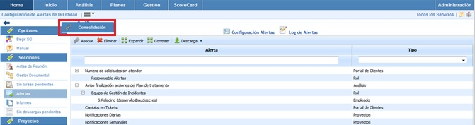

# Consolidación Alertas

La presente opción permite la consolidación de alertas de la empresa matriz a las subentidades que dependen de esta. Esto permite que las alertas asignadas a las subentidades se escalen también a los responsables de la empresa matriz.

Una vez se ha accedido a la opción, se muestran lo siguiente:

* **Tabla Alerta:** Muestra el listado de alertas que se han definido en la empresa matriz. Las opciones que permite la tabla son:

  * **Asociar:** Permite realizar las siguientes acciones:

    * **Asignar Roles:** Permite, una vez seleccionada la alerta deseada, asignar los roles deseados a la alerta. Esta opción es necesaria para poder consolidar posteriormente las alertas.
    * **Asociar Alertas:** Una vez establecidos los Roles, permite asociar las alertas a las subentidades seleccionadas
  * **Eliminar** Ofrece la posibilidad de eliminar los roles asociados a una alerta.
  * **Expandir** Permite desplegar el listado de alertas.
  * **Contraer** Permite contraer el listado de alertas.
* **Tabla Subentidades:** Muestra el listado de subentidades a las que se pueden asociar las alertas de la empresa matriz. Las opciones que permite la tabla son la de expandir o contraer el listado de subentidades.
* **Tabla Alertas:** Una vez seleccionada la subentidad en la tabla superior, muestra el listado de alertas que se han asociado a la misma. La herramienta ofrece la posibilidad de eliminar alertas asociadas, para ello se ha de seleccionar la fila deseada y pulsar sobre el botón 'Eliminar'.
