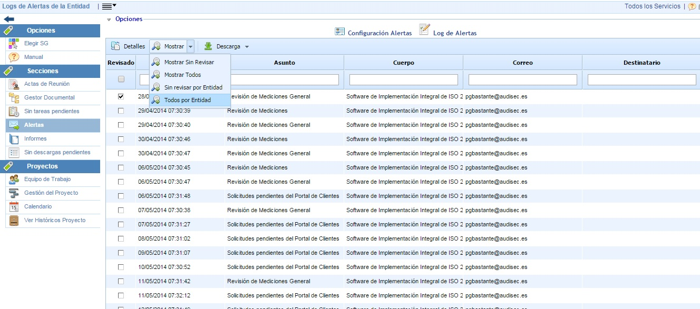

# Log de Alertas

Esta opción permite visualizar las alertas enviadas por GlobalSuite®.

Las opciones disponibles son las siguientes:

* **Detalles:** Al seleccionar una alerta y pulsar sobre este botón, se muestran todos los detalles de la alerta enviada.

* **Mostrar:** Se permiten diferentes filtros para mostrar los logs. Los filtros son:

  * Mostrar Sin Revisar: Muestra los logs de las alertas enviadas al usuario que consulta la opción y que están sin revisar (sin el check de Revisado).
  * Mostrar Todos: Muestra todos los logs de las alertas enviadas al usuario que consulta la opción, tanto revisados como sin revisar.
  * Sin Revisar por Entidad: Muestra los logs de las alertas enviadas a todos los usuarios de la organización que no han sido revisados (sin el check de Revisado).
  * Todos por Entidad: Muestra todos los logs de las alertas enviadas a todos los usuarios de la organización, tanto revisados como sin revisar.

* **Descarga:** Permite generar un informe en formato .xls o .pdf con la información que se muestra en la tabla.
