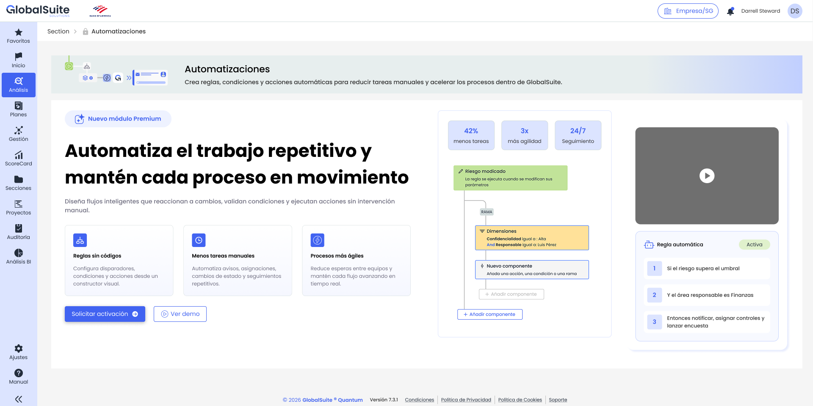

# Automatizaciones

# **Automatizaciones**

|  |
| --- |
| El módulo de Automatizaciones permite crear reglas para que GlobalSuite® ejecute **acciones automáticas** cuando se produzcan **eventos** dentro de la solución. Su objetivo es reducir tareas manuales, estandarizar respuestas recurrentes y facilitar la trazabilidad de los procesos GRC. |

## ¿Qué permite Automatizaciones?

Automatizaciones convierte acciones aisladas en flujos potentes dentro de GlobalSuite®. Una regla puede ejecutarse, por ejemplo, cuando se crea un nuevo elemento, se modifica un riesgo, cambia una dimensión o se actualiza información relacionada con un BIA.

* Crear reglas visuales basadas en disparadores, condiciones, ramas y acciones.
* Enviar avisos o solicitudes cuando se produzcan cambios relevantes.
* Lanzar encuestas, crear tareas o preparar información para análisis posteriores.
* Modificar dimensiones o asociar controles y catálogos cuando se cumplan determinados criterios.
* Consultar la actividad de cada regla para revisar ejecuciones, resultados y errores.

## Conceptos clave

|  |  |
| --- | --- |
| **Concepto** | **Descripción** |
| Regla | Configuración que define qué evento debe detectarse, qué condiciones deben cumplirse y qué acciones debe ejecutar GlobalSuite®. |
| Disparador | Evento que inicia la evaluación de la regla. Por ejemplo, la creación de un elemento o la modificación de un riesgo. |
| Condición | Criterio que limita la ejecución de los siguientes componentes. Si no se cumple, se detiene ese camino del flujo. |
| Acción | Tarea que GlobalSuite® ejecuta cuando la regla cumple los criterios definidos. Por ejemplo, enviar un correo o asociar controles. |
| Rama | División del flujo en varios caminos paralelos o alternativos, útil para representar comportamientos tipo si/entonces. |
| Actividad | Registro de ejecuciones de la regla, incluyendo condiciones evaluadas, acciones ejecutadas, errores y resultado final. |


Incluido con licenciamiento Enterprise o superior

