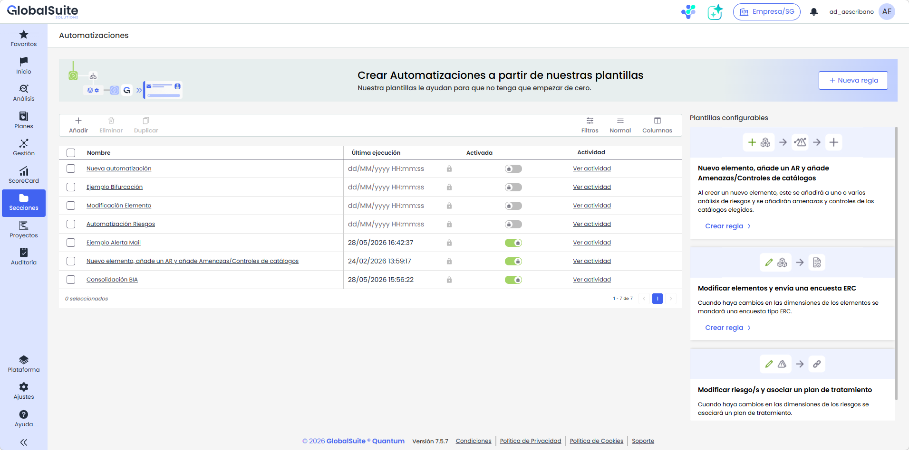
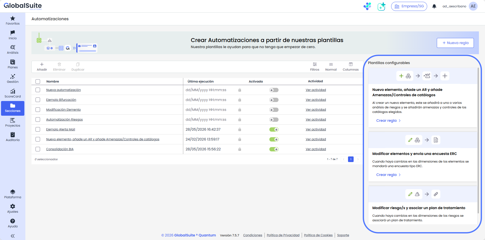

# Automatizaciones: Acceso y vista inicial

# **Acceso y vista inicial de Automatizaciones**

|  |
| --- |
| La pantalla inicial permite presentar el módulo, acceder a la creación de reglas y consultar las automatizaciones disponibles según permisos y licenciamiento. |

## Acceso al módulo

La opción de Automatizaciones está disponible por defecto en el apartado de Secciones > Automatizaciones dentro del panel de gestión.

Cuando se acceda a la opción, en caso de no disponer del módulo habilitado se mostrará una pantalla informativa donde se podrá ver la información y solicitar más información en su caso.

## Listado principal

En caso de tener activado el módulo de Automatizaciones, se dispone de un listado o tabla con todas las reglas existentes, con los siguientes campos:

* Nombre: Es el identificador de la regla, y al pulsar en el detalle se accederá al panel de construcción de la misma.
* Última Ejecución: Muestra la fecha y hora de cuando se disparó la regla por última vez. En caso de que no se haya lanzado nunca el campo estará vacío.
* Activado: Muestra si la regla está activada o no.
* Actividad: Es el enlace para ver el [Registro de actividad](automatizaciones-registro-de-actividad.md) de la regla

## Plantillas preconfiguradas

De manera adicional, en el panel derecho existen una serie de plantillas predefinidas con casos de uso avanzados donde se genera la regla con los disparadores y acciones ya creados, y donde sólo es necesario terminar de configurarlos para tener una regla funcional.

