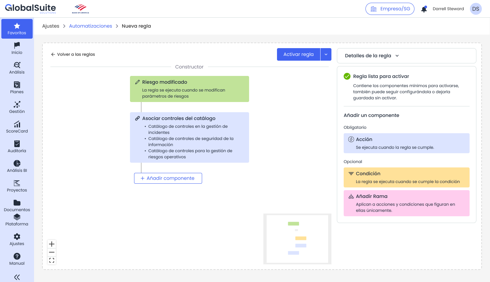
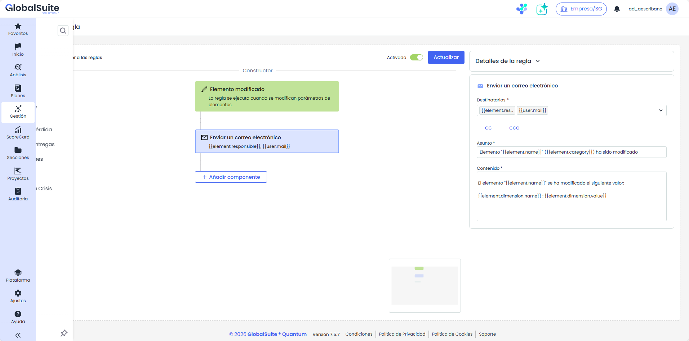
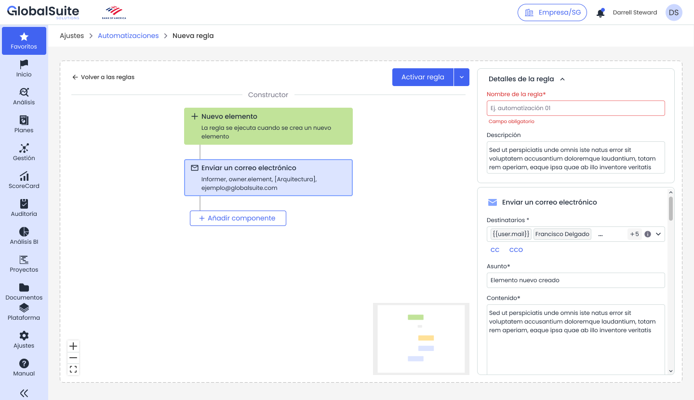

# Automatizaciones: Acciones de una regla

# **Acciones de una regla**

|  |
| --- |
| La acción es la tarea que GlobalSuite® ejecuta cuando la regla se activa y se cumplen las condiciones configuradas. Para que una regla pueda activarse debe existir al menos una acción correctamente configurada. |

## Catálogo inicial de acciones

|  |  |  |
| --- | --- | --- |
| **Acción** | **Descripción** | **Ejemplo de uso** |
| Enviar un correo electrónico | Envía una notificación a uno o varios destinatarios, con asunto y contenido configurables. | Avisar al responsable cuando se crea un nuevo riesgo. |
| Crear un ticket | Genera una tarea o ticket para dar seguimiento operativo. | Crear un ticket cuando la criticidad supere un umbral. |
| Enviar encuesta | Lanza una encuesta a responsables o usuarios definidos. | Solicitar actualización cuando se modifica un elemento crítico. |
| Añadir análisis de riesgo | Asocia un elemento a un análisis de riesgo. | Preparar la evaluación de un nuevo activo. |
| Modificar dimensión | Actualiza una dimensión manual del objeto afectado. | Reclasificar un elemento tras un cambio de categoría. |
| Asociar controles del catálogo | Añade controles definidos en un catálogo. | Proponer controles cuando un riesgo pasa a nivel alto. |
| Añadir amenazas y controles catálogo | Asocia amenazas y controles desde catálogos configurados. | Aplicar una base estándar a nuevos activos. |
| Copiar amenazas y controles | Copia amenazas y controles desde otro contexto configurado. | Reutilizar una configuración ya validada. |
| Copiar datos en BIA consolidado | Copia información del BIA individual hacia el BIA consolidado. | Consolidar información al finalizar una encuesta BIA. |

## Configurar una acción

Al seleccionar una acción en el constructor, el panel lateral muestra los campos necesarios para completarla. Los campos obligatorios deben rellenarse antes de activar la regla.

*Panel de selección de acciones disponibles para el punto seleccionado del flujo.*

## Ejemplo: enviar un correo electrónico

La acción Enviar un correo electrónico permite definir destinatarios, copia, asunto y contenido. Los destinatarios pueden ser usuarios concretos o variables disponibles en el contexto de la regla.

|  |  |  |
| --- | --- | --- |
| **Campo** | **Tipo** | **Descripción** |
| Destinatarios | Selector de usuarios o variables | Usuarios, responsables o valores dinámicos a los que se enviará la notificación. |
| CC / CCO | Selector opcional | Permite añadir destinatarios en copia o copia oculta. |
| Asunto | Campo textual obligatorio | Título del correo que recibirá el destinatario. |
| Contenido | Campo textual obligatorio | Mensaje del correo. Puede explicar el evento ocurrido y la acción esperada. |

Para la configuración del asunto y mensaje de correo electrónico existen una serie de variables disponibles, que se sustituirán y permitirán personalizar el mensaje. Las variables disponibles son:

* {{user.mail}}: Dirección de correo electrónico (campo email) del usuario que realiza la acción que dispara la regla.
* {{element.responsible}}: Dirección de correo (campo email principal) del empleado que está como responsable del elemento afectado por el disparador.
* {{threat.responsible}}: Dirección de correo (campo email principal) del empleado que está como responsable del riesgo/amenaza afectado.
* {{user.name}}: Nombre del usuario que realiza la acción que dispara la regla.
* {{element.name}}: Nombre del elemento afectado por el disparador. Aplica también cuando el disparador es un proceso.
* {{element.category}}: Nombre de la categoría asignada al elemento afectado.
* {{element.dimension.name}}: Nombre de la dimensión modificada para el elemento. Por ej. Confidencialidad, Importancia, etc.
* {{element.dimension.value}}: Valor asignado de la dimensión del elemento afectado. Si es cuantitativa será un valor numérico, si es cualitativa será la etiqueta correspondiente al nivel (Alto, Medio, Bajo…), y si es textual será el texto completo introducido.
* {{analysis.name}}: Nombre del análisis de riesgos al que pertenece la amenaza o riesgo afectado.
* {{threat.name}}: Nombre (Campo Principal) de la amenaza afectada.
* {{threat.dimension.name}}: Nombre de la dimensión modificada para el riesgo. Por ej. Probabilidad, Impacto, etc.
* {{threat.dimension.value}}: Valor asignado de la dimensión del elemento. Si es cuantitativa será un número, si es cualitativa será la etiqueta correspondiente al nivel (Alto, Medio, Bajo…).
* {{bia.name}}: Nombre del BIA sobre el que se ha consolidado la encuesta que ha disparado la regla.
* {{survey.name}}: Nombre de la encuesta de BIA que se ha consolidado
* {{survey.recipient}}: Nombre del destinatario que tenía asignada la encuesta afectada

## Acciones con selección de catálogos o análisis

Algunas acciones requieren seleccionar un análisis de riesgo, un catálogo, controles concretos o dimensiones aplicables. Si no se completa la selección obligatoria, la regla queda pendiente de configuración o muestra una validación en el panel lateral.

*Ejemplo de acción con selección pendiente y validación de campo obligatorio.*
