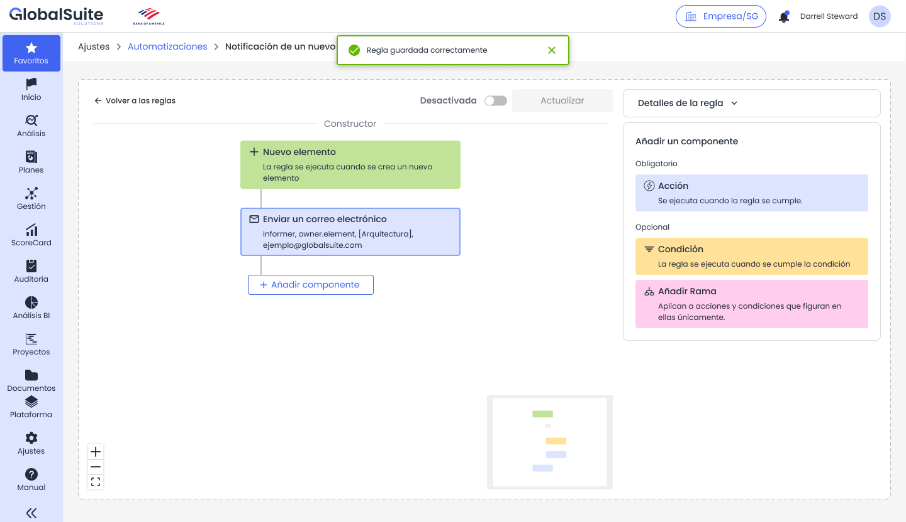
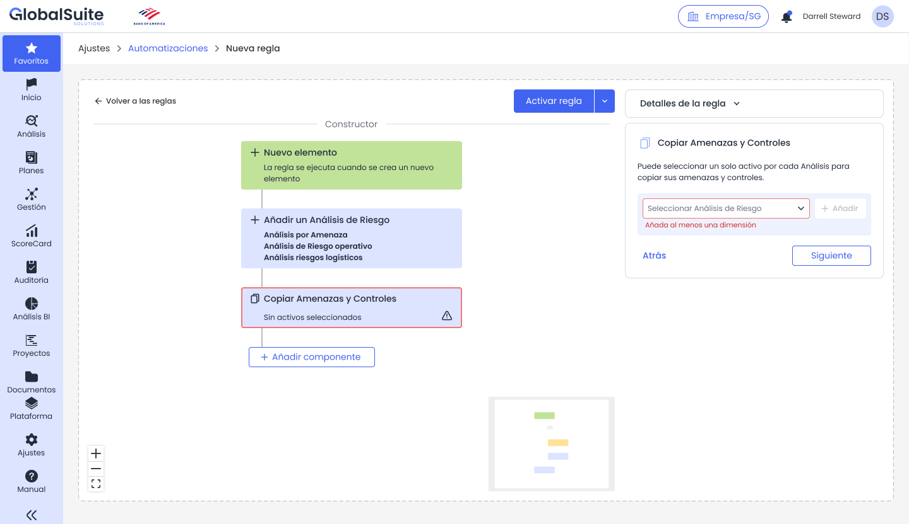

# Automatizaciones: Activación, validación y estados

# **Activación, validaciones y estados**

|  |
| --- |
| Una regla puede guardarse sin activarse. Para que pueda activarse debe disponer, como mínimo, de un disparador y una acción configurados correctamente. |

## Guardar una regla sin activarla

El guardado permite conservar la configuración de una regla aunque todavía no esté preparada para ejecutarse. Esta opción es útil cuando se quiere revisar la regla con otros usuarios, completar campos más adelante o mantenerla como borrador.

*Regla guardada correctamente y mantenida en estado desactivado.*

## Activar una regla

Al activar una regla, GlobalSuite® revisa que se cumplan los requisitos mínimos de configuración. Si la regla es válida, quedará disponible para ejecutarse cuando se produzca el disparador configurado.

* Debe existir un disparador configurado.
* Debe existir al menos una acción configurada.
* Los campos obligatorios de la regla y de sus componentes deben estar completados.
* Los componentes pendientes o incompletos deben resolverse antes de activar.

## Desactivar una regla

Una regla desactivada queda guardada, pero no se ejecuta. Esta opción permite detener temporalmente una automatización sin eliminar su configuración.

## Validaciones habituales

|  |  |  |
| --- | --- | --- |
| **Situación** | **Mensaje o comportamiento esperado** | **Acción recomendada** |
| Nombre de la regla vacío | Se marca el campo como obligatorio en Detalles de la regla. | Completar un nombre descriptivo. |
| Regla sin acción | Se muestra un aviso indicando que es necesario al menos un activador y una acción. | Añadir y configurar una acción. |
| Componente nuevo sin configurar | El flujo queda pendiente y no puede activarse. | Seleccionar el componente y completar su configuración. |
| Campo obligatorio de acción vacío | El campo se marca en rojo o se muestra una validación contextual. | Completar el campo requerido antes de activar. |
| Regla desactivada | La regla se guarda, pero no se ejecuta ante el evento. | Activar la regla cuando esté validada. |

*Ejemplo de validación al intentar activar una regla sin acción configurada.*

## Mensajes de confirmación

Cuando la regla se guarda correctamente, GlobalSuite® muestra un mensaje de confirmación. Si se detecta un error, el sistema muestra el aviso correspondiente y mantiene la regla sin activar hasta que se resuelva la validación.

|  |
| --- |
| **NOTA:** Se recomienda probar las reglas con casos controlados antes de activarlas en procesos críticos o con un alto volumen de objetos. |
