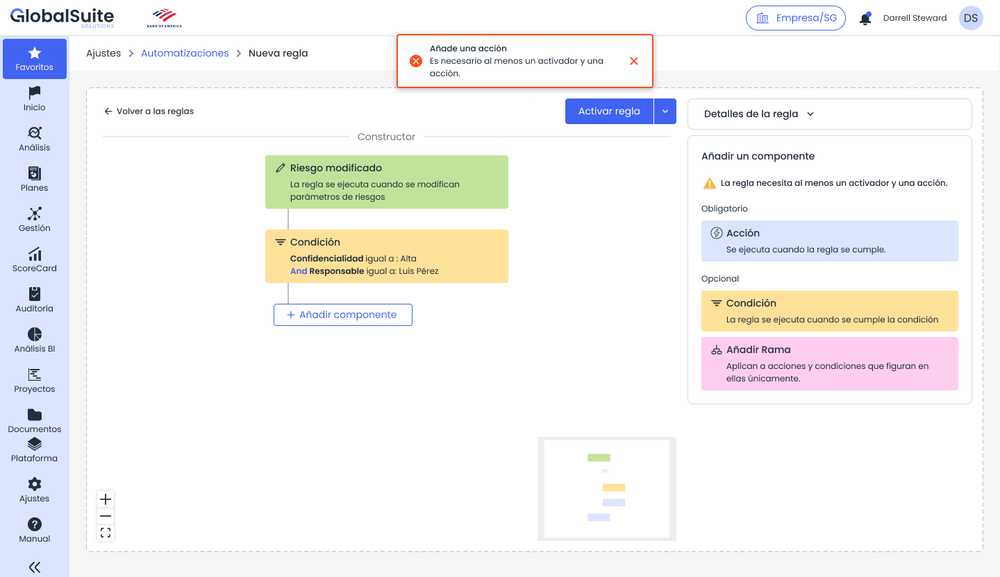
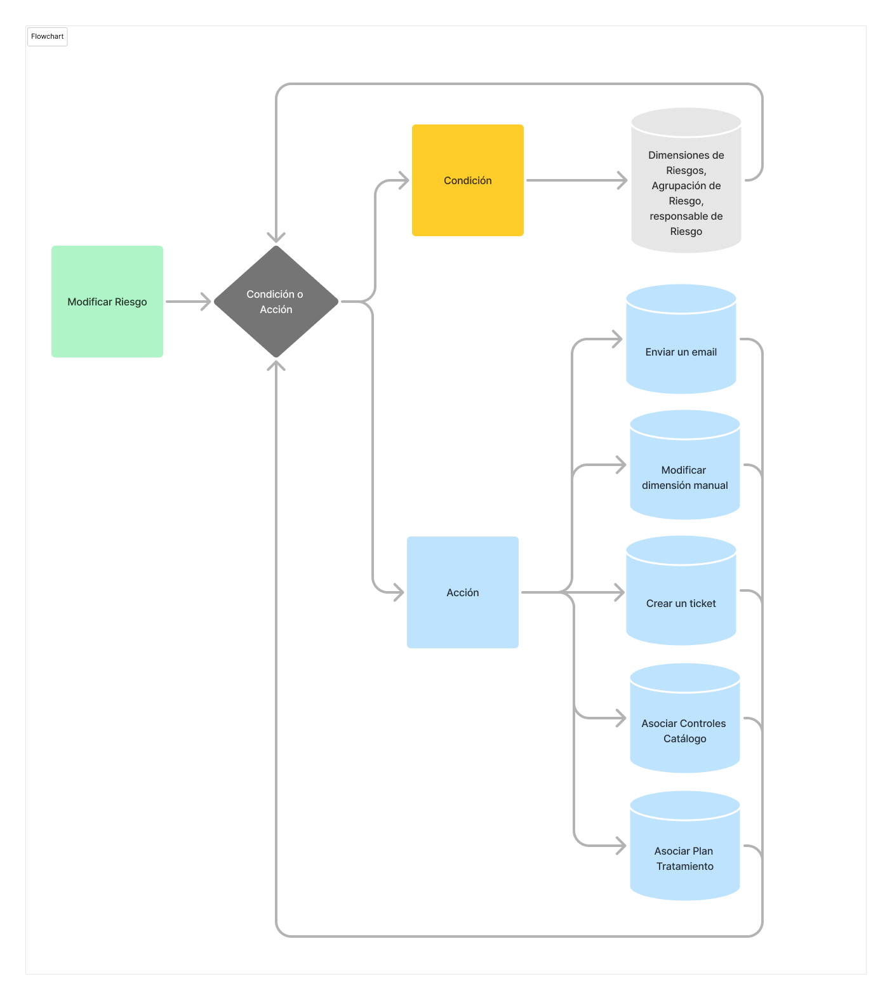

# Automatizaciones: Condiciones y ramas

# **Condiciones y ramas**

|  |
| --- |
| Las condiciones permiten definir en qué casos continúa la ejecución de la regla. Las ramas permiten dividir un mismo flujo en varios caminos, cada uno con sus propias condiciones y acciones. |

## Condiciones

Una condición evalúa si se cumple un criterio antes de continuar con los siguientes componentes. Si la condición se cumple, el flujo continúa. Si no se cumple, se detiene ese camino y no se ejecutan las acciones posteriores asociadas a él.

*Ejemplo de condición configurada sobre dimensiones de un riesgo.*

## Ejemplos de condiciones

* Una dimensión de confidencialidad es igual a Alta.
* El responsable del elemento es una persona concreta o pertenece a un área determinada.
* La criticidad de un riesgo es mayor o igual que un valor definido.
* Una categoría del elemento coincide con una categoría específica.
* El valor nuevo de una dimensión es distinto del valor anterior.

## Ramas

Una rama crea un camino adicional dentro de la regla. Este componente es útil cuando un mismo disparador debe provocar distintas respuestas según el caso. Cada rama puede incluir condiciones y acciones propias.

*Ejemplo conceptual de flujo con disparador, condición, acciones y ramas.*

## Cuándo utilizar ramas

* Cuando el mismo evento debe activar respuestas diferentes para niveles de criticidad distintos.
* Cuando una parte del flujo debe continuar aunque otra rama no cumpla sus condiciones.
* Cuando se quieren separar acciones de notificación, evaluación, asociación de controles o creación de tareas.
* Cuando se necesita representar una lógica tipo si/entonces o varios caminos paralelos.

## Recomendaciones de configuración

* Incluya una condición clara al inicio de cada rama para identificar el criterio de entrada.
* Evite reglas demasiado largas si pueden dividirse en varias automatizaciones más simples.
* Documente en la descripción de la regla qué representa cada rama.
* Revise el registro de actividad para confirmar qué rama se ha ejecutado y qué acciones se han lanzado.

Recuerde que si una condición no se cumple, se detiene el camino asociado, pero no necesariamente otras ramas de la regla.
