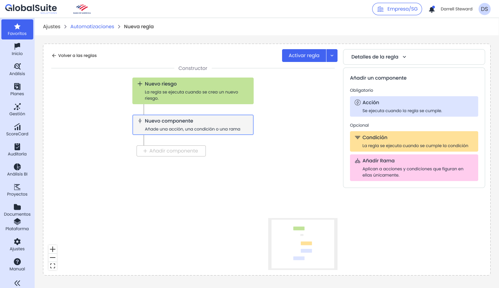
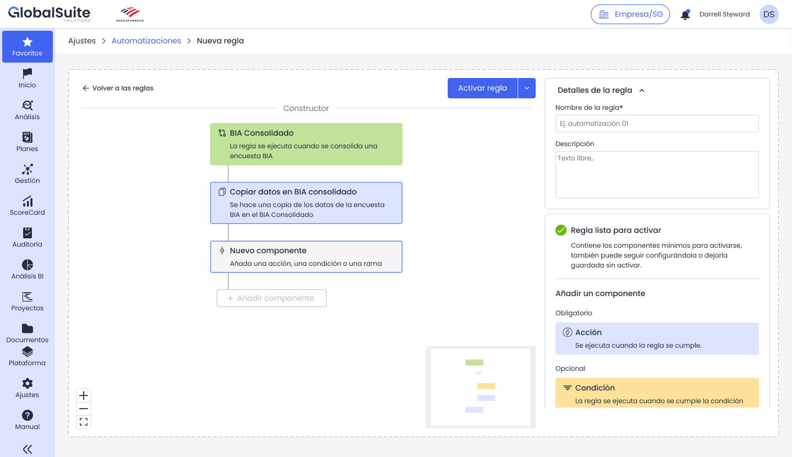
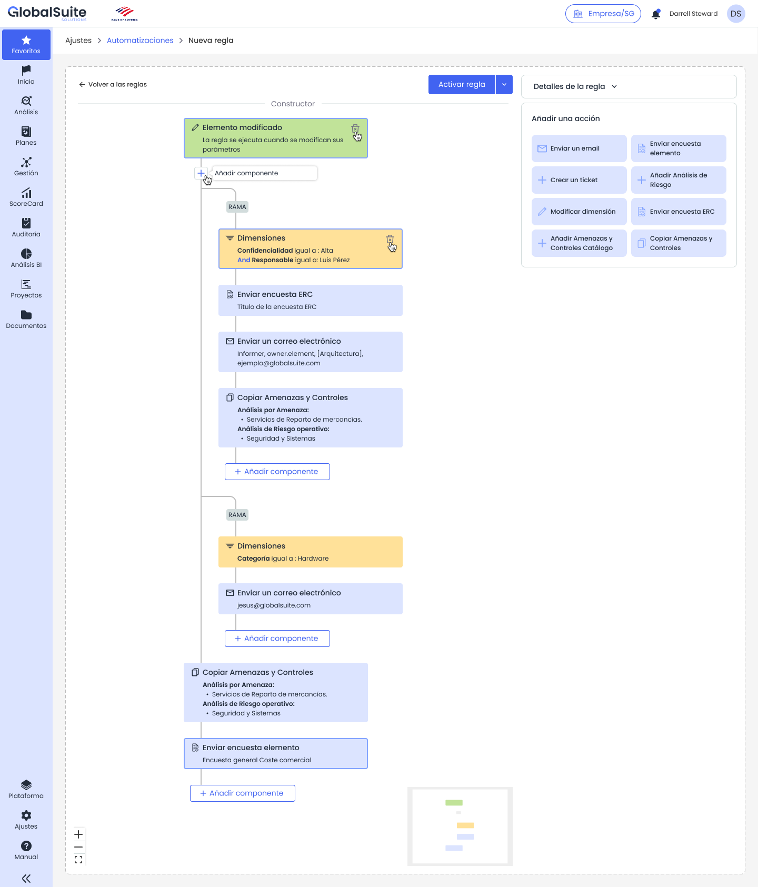
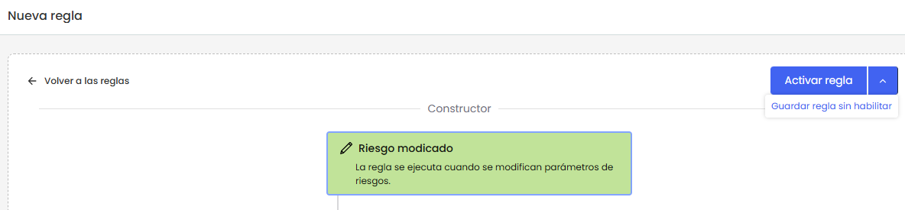
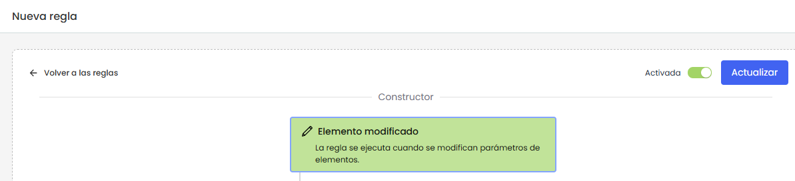

# Automatizaciones: Configurar una regla

## Crear y configurar una regla

|  |
| --- |
| Una regla se construye de forma visual. El usuario define primero el disparador, añade los componentes necesarios y completa los campos de cada acción o condición desde el panel lateral. |

Cuando accedemos a la vista de configuración de una regla tenemos una vista donde poder editar y modelar la regla.

### Estructura de la pantalla de edición

La pantalla de una nueva regla se organiza en tres áreas principales:

* Constructor: Zona central donde se visualiza el flujo de la regla y se añaden los componentes.
* Panel lateral: Área derecha donde se muestran los detalles de la regla o la configuración del componente seleccionado.
* Acciones superiores: Botones para guardar, actualizar, activar la regla.

### Paso 1. Completar los detalles de la regla

En el panel “*Detalles de la regla”* se definen los datos generales. Estos campos ayudan a identificar el propósito de la automatización y facilitan su mantenimiento posterior.

* Nombre de la regla: Debe identificar de forma breve el caso de uso. Ejemplo: Riesgo alto - asociar controles y avisar. Este campo es obligatorio.
* Descripción: Permite explicar el objetivo de la regla, el contexto funcional, los responsables afectados y el resultado esperado.

### Paso 2. Revisar el disparador

El disparador determina cuándo debe evaluarse la regla. La regla siempre parte de un evento inicial, como la creación de un elemento o la modificación de un riesgo. El catálogo de condiciones y acciones disponibles depende del disparador seleccionado.

### Paso 3. Añadir componentes

Para añadir un componente, seleccione el botón “Añadir componente” situado debajo del paso correspondiente del constructor. El panel lateral mostrará los componentes disponibles para ese punto del flujo.

* Acción: componente obligatorio para poder activar la regla. ([ver más](automatizaciones-acciones-de-una-regla.md))
* Condición: componente opcional que permite limitar el flujo a casos concretos. ([ver más](automatizaciones-condiciones-y-ramas.md))
* Añadir rama: componente opcional para crear caminos de ejecución paralelos o alternativos. ([ver más](automatizaciones-condiciones-y-ramas.md))

### Paso 4. Guardar o activar la regla

La regla puede guardarse sin activarse. Esta opción permite dejar la automatización preparada como borrador o pendiente de revisión.

Para activarla, el sistema comprueba que tenga todos los elementos obligatorios, ya que una regla operativa al menos debe incluir un disparador y una acción correctamente configurados.

|  |
| --- |
| **NOTA:** Si una regla se guarda sin activar, no ejecutará acciones aunque se produzca el evento configurado. |

Cuando accedemos a una regla ya activada podremos modificarla en vivo con el botón “Actualizar”, o desactivarla marcando el check correspondiente.

