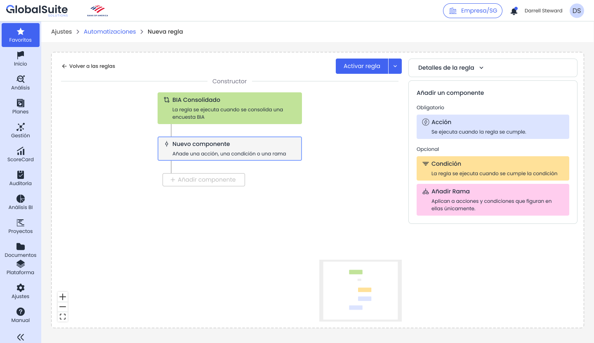

# Automatizaciones: Disparadores

# **Disparadores de automatizaciones**

|  |
| --- |
| El disparador es el evento que inicia la regla. A partir de él, GlobalSuite® evalúa las condiciones configuradas y ejecuta las acciones que correspondan. |

## Qué es un disparador

Un disparador representa un cambio o evento ocurrido en GlobalSuite®. Cuando se produce ese evento, la plataforma revisa si existe alguna regla activa asociada y comienza su evaluación.

*Ejemplo de regla con disparador de BIA consolidado.*

## Catálogo inicial de disparadores

|  |  |  |
| --- | --- | --- |
| **Disparador** | **Cuándo se ejecuta** | **Ejemplo de uso** |
| Nuevo elemento | Cuando se crea un nuevo elemento en el inventario o contexto correspondiente. | Preparar un análisis inicial y avisar al responsable. |
| Elemento modificado | Cuando se modifican parámetros de un elemento. | Reclasificar una dimensión o lanzar una encuesta de actualización. |
| Nuevo riesgo | Cuando se crea un nuevo riesgo. | Notificar al responsable del riesgo o del elemento relacionado. |
| Riesgo modificado | Cuando se modifican parámetros de un riesgo. | Asociar controles de catálogo si la criticidad pasa a alta. |
| Nuevo proceso | Cuando se crea un nuevo proceso. | Activar tareas iniciales o notificaciones de coordinación. |
| Proceso modificado | Cuando se modifican dimensiones o datos relevantes de un proceso. | Crear un BIA o enviar una encuesta si cambia la criticidad. |
| BIA individual actualizado | Cuando una encuesta o actualización afecta a la consolidación del BIA. | Copiar datos al BIA consolidado y avisar al responsable. |

## Contexto disponible para condiciones y acciones

El disparador define qué información puede utilizarse en los siguientes componentes. Según el caso, la regla puede disponer de datos del objeto, valores anteriores y nuevos, responsable, dimensión, categoría o relaciones con otros objetos.

* Datos del objeto afectado: elemento, riesgo, proceso o BIA.
* Datos del evento: creación, modificación o consolidación.
* Campos o dimensiones disponibles en la metodología configurada.
* Relaciones con responsables, análisis de riesgo, catálogos o encuestas, cuando estén disponibles.

|  |
| --- |
| **NOTA:** No todos los disparadores tienen el mismo catálogo de acciones. Las acciones disponibles dependen del contexto funcional y de la información que GlobalSuite® conoce en el momento de ejecutar la regla. |
