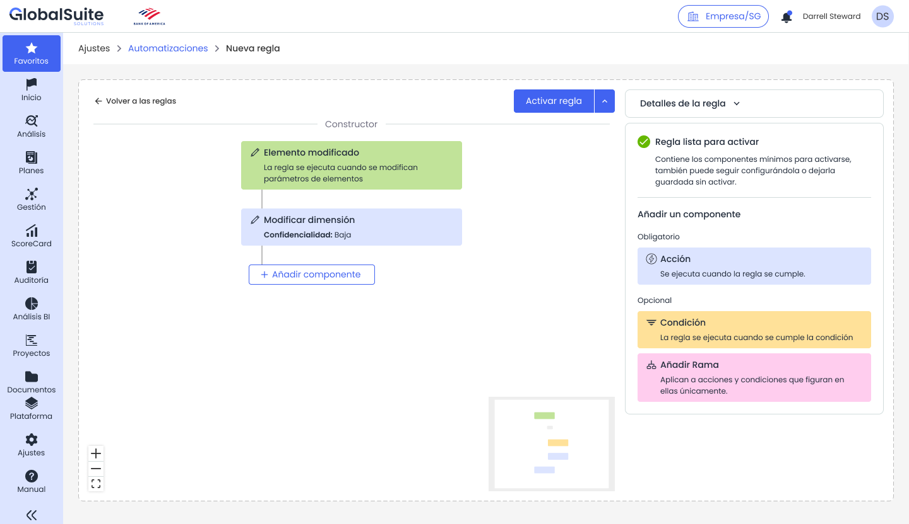

# Automatizaciones: Ejemplos

# **Ejemplos de automatización**

|  |
| --- |
| Los siguientes ejemplos muestran casos de uso habituales para configurar reglas de Automatizaciones en GlobalSuite®. Deben adaptarse a la metodología, catálogos, permisos y datos de cada organización. |

|  |  |  |  |  |
| --- | --- | --- | --- | --- |
| **Caso de uso** | **Disparador** | **Condición** | **Acciones** | **Resultado esperado** |
| Nuevo elemento crítico | Nuevo elemento | Categoría igual a aplicación crítica o confidencialidad alta. | Añadir el elemento a un análisis de riesgo, asociar amenazas y controles del catálogo y enviar un correo al responsable. | El nuevo activo queda preparado para evaluación y el responsable recibe el aviso. |
| Riesgo modificado con criticidad alta | Riesgo modificado | Criticidad residual mayor o igual que alta. | Asociar controles del catálogo, crear un ticket o enviar un correo al responsable. | Se acelera la respuesta ante riesgos que aumentan de criticidad. |
| Proceso modificado con impacto en continuidad | Proceso modificado | La dimensión de criticidad o impacto del proceso cambia a un valor relevante. | Crear BIA o enviar encuesta BIA al responsable del proceso. | El equipo de continuidad recibe la información necesaria para actualizar el análisis. |
| Consolidación de BIA tras encuesta | BIA individual actualizado | La encuesta se ha completado y cumple los criterios definidos para consolidar. | Copiar datos al BIA consolidado y notificar al responsable. | Se reduce el trabajo manual de consolidación y queda trazada la actualización. |
| Reclasificación automática de elementos | Elemento modificado | El valor nuevo de una dimensión implica una nueva clasificación operativa. | Modificar la dimensión correspondiente y avisar al owner. | La clasificación se mantiene alineada con los criterios de la metodología. |

## Ejemplo guiado: riesgo modificado

1. Crear una nueva regla con el disparador Riesgo modificado.
2. Añadir una condición para que la regla continúe únicamente si la criticidad residual pasa a alta.
3. Añadir la acción Asociar controles del catálogo y seleccionar el catálogo aplicable.
4. Añadir la acción Enviar un correo electrónico al responsable del riesgo.
5. Guardar la regla, revisar los campos obligatorios y activarla cuando esté validada.
6. Modificar un riesgo de prueba para comprobar el registro de actividad.

*Ejemplo de flujo con condición y varias acciones configuradas.*

## Recomendaciones antes de pasar a producción

* Aplique nombres claros y consistentes a las reglas.
* Incluya en la descripción el objetivo, alcance, responsable funcional y resultado esperado.
* Pruebe la regla con objetos controlados antes de aplicarla a datos reales de alto volumen.
* Revise el registro de actividad tras las primeras ejecuciones.
* Defina quién puede crear, modificar, activar o desactivar reglas.
