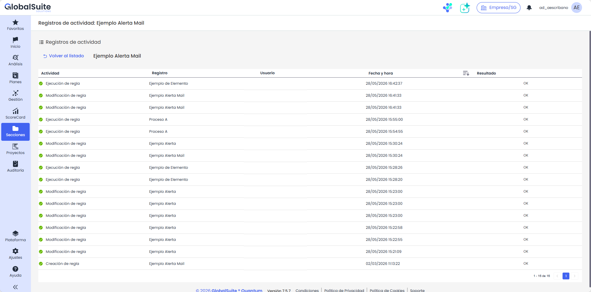

# Automatizaciones: Registro de actividad

## Registro de actividad de una regla

|  |
| --- |
| La actividad permite consultar qué ha ocurrido para cada automatización, desde cuándo se creó o se modificó por última vez, hasta las veces que se ha ejecutado y sobre qué registros y si se produjo alguna incidencia. |

### Registros de actividad

Para acceder al detalle de un registro se tiene que pulsar en el enlace disponible en la vista inicial de activaciones. Dentro del registro de una regla tenemos el listado de todos los logs que se tienen para ella, con los siguientes campos:

* Actividad: Qué acción se ha registrado, bien sea la modificación de la regla o la ejecución de la misma ante un evento.
* Registro: El nombre del item afectado, si es un log de modificación de la regla indica el nombre de la regla, pero si se trata de la ejecución de la regla indica el nombre del registro que provocó el evento (por ejemplo, el nombre del elemento modificado)
* Usuario: Nombre del usuario que realizó la acción
* Fecha y hora: Momento en el que se produjo la acción o la ejecución de la regla.
* Resultado: Indica si la acción finalizó correctamente o se produjo algún error en la misma para poder depurarlo.

