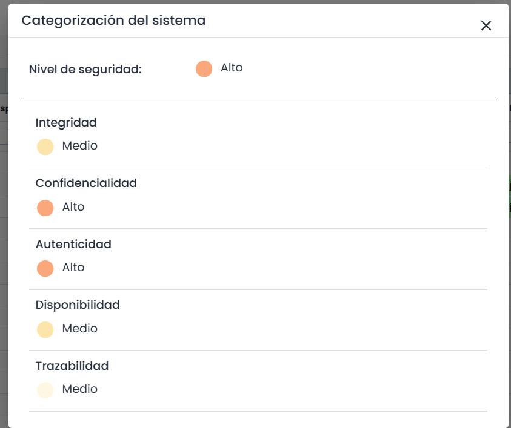

# Categorización del Sistema

Esta opción permite ver cual es el Nivel de Seguridad del Sistema y el de cada una de las dimensiones en función de los elementos valorados en el apartado [Valoración](https://help.globalsuite.es/pages/viewpage.action?pageId=107020358).

La Categorización del Nivel de Seguridad del Sistema se determinará por el nivel de seguridad más elevado alcanzado por alguna de sus dimensiones, que puede ser BAJO, MEDIO o ALTO.

Esta categorización establecerá el nivel de Medidas de Seguridad requerido para cumplir con los estándares de la normativa. 

**NOTA:** Es posible configurar las dimensiones que se deseen visualizar en  Ajustes> Metodologías > [Elementos](https://help.globalsuite.es/pages/viewpage.action?pageId=99975559) en el apartado "Visibilidad Dimensiones en Tablas"> Columna 'ENS'
