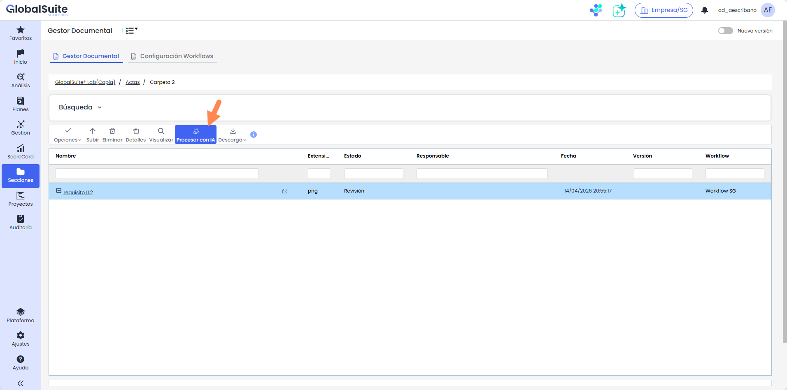
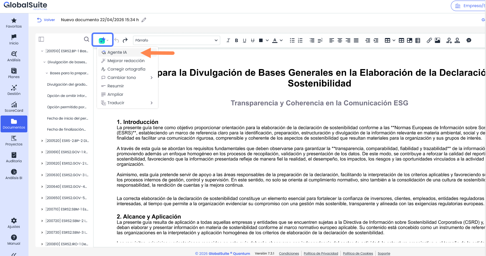
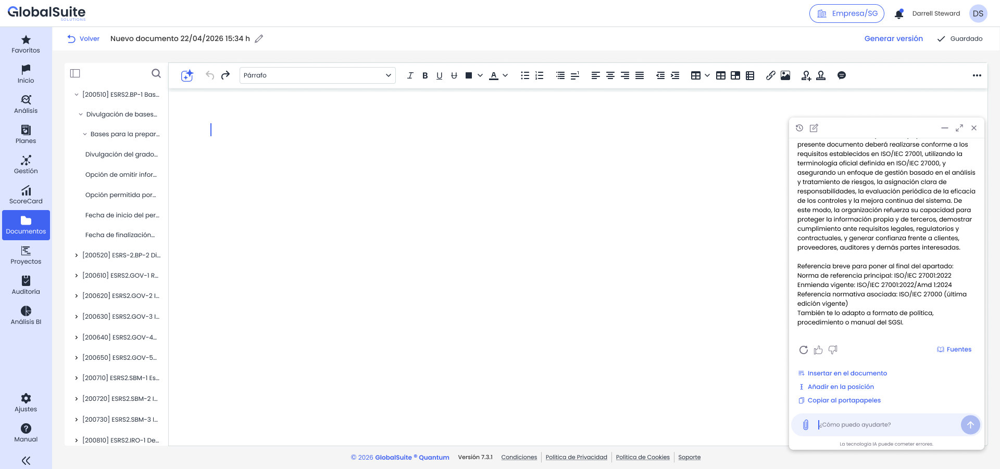
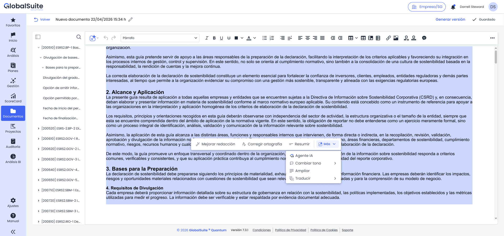
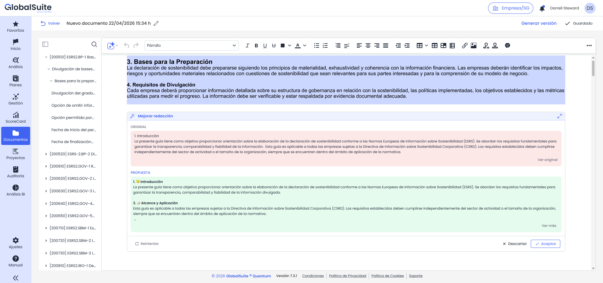

# Asistente de IA en el editor de documentos

## Asistente de IA para redactar y revisar documentos

GlobalSuite® amplía el asistente de IA documental para que trabaje dentro del editor de documentos del Gestor Documental. Además de responder preguntas sobre el contenido del archivo, el asistente puede escribir en el propio documento y aplicar acciones rápidas sobre el texto seleccionado.

El asistente se abre en un panel acoplado que mantiene el documento visible y editable, de manera que la consulta y la redacción se realizan en la misma pantalla. Ninguna propuesta se aplica al documento sin una acción explícita del usuario.

### ¿Para qué sirve?

* Redactar o completar apartados de un documento a partir de indicaciones en lenguaje natural.
* Revisar la redacción, la ortografía y el tono de un texto ya escrito.
* Resumir o ampliar un fragmento y traducirlo a los idiomas activos en la configuración de la empresa.
* Consultar el contenido del documento sin abandonar el editor.

### Características principales

* Panel acoplado junto al documento, que se puede contraer o expandir sin perder la conversación ni el estado del documento.
* Acciones para llevar cada respuesta al documento: insertarla al final, añadirla en la posición del cursor, reemplazar la selección o copiarla al portapapeles.
* Menú contextual con acciones rápidas al seleccionar texto en el editor.
* Ventana de vista previa con el texto original y la propuesta de la IA, editable antes de aplicarla.
* Conservación del formato que admite el editor al aplicar el contenido: encabezados, negritas, cursivas y listas.
* Traducción a los idiomas disponibles en la configuración de la empresa, con detección automática del idioma de origen.

### ¿Dónde se encuentra?

El asistente tiene dos puntos de entrada.

#### Desde el Gestor Documental

Selecciona un documento en el listado y pulsa «Procesar con IA». Esta vía está disponible para todos los tipos de documento admitidos por el asistente documental y abre el asistente en modo consulta.

#### Desde el editor de documentos

Al abrir un documento en el editor, la barra de herramientas incorpora un botón de IA. Su menú da acceso a «Agente IA» y a las acciones rápidas sobre el texto.

Las capacidades de escritura sobre el documento y el menú contextual están disponibles únicamente en documentos `.docx`.

### ¿Cómo funciona?

#### 1. Abrir el Agente IA

Pulsa el botón de IA del editor y selecciona «Agente IA». El asistente se abre en un panel acoplado y el documento se reajusta para compartir el espacio, sin ocultar el contenido editable.

Escribe tu petición en el campo inferior. El asistente utiliza como contexto el documento desde el que se ha invocado y responde en el propio panel. Si hay texto seleccionado en el momento de abrirlo, la selección se traslada como contexto inicial de la conversación.

#### 2. Llevar la respuesta al documento

Cada respuesta del asistente incluye las acciones necesarias para aplicarla al documento. Las acciones de escritura solo se muestran cuando el asistente se ha abierto desde el editor sobre un documento `.docx`.

|  |  |
| --- | --- |
| **Acción** | **Qué hace** |
| **Insertar en el documento** | Añade el contenido completo de la respuesta al final del documento, aunque esté vacío. |
| **Añadir en la posición** | Inserta el contenido en la posición actual del cursor, sin eliminar el texto existente. |
| **Reemplazar selección** | Sustituye el texto seleccionado en el editor por el contenido de la respuesta. Requiere una selección activa. |
| **Copiar al portapapeles** | Copia el contenido de la respuesta para pegarlo donde decidas, dentro o fuera de GlobalSuite®. |

El documento refleja el cambio de inmediato, sin recargar la pantalla, y la conversación se mantiene abierta para seguir trabajando.

#### 3. Usar las acciones rápidas sobre una selección

Selecciona una palabra, una frase, un párrafo o todo el texto del documento. Sobre la selección aparece un menú contextual con las acciones más frecuentes de forma directa y el resto agrupadas en «Más».

|  |  |
| --- | --- |
| **Acción** | **Resultado** |
| **Agente IA** | Abre el asistente utilizando la selección como contexto, para peticiones que no cubren las acciones rápidas. |
| **Mejorar redacción** | Ajusta vocabulario, ortografía, sintaxis, estructura y claridad del texto seleccionado. |
| **Corregir ortografía** | Corrige únicamente los errores léxicos o sintácticos detectados, sin reescribir el contenido. |
| **Cambiar tono** | Reescribe el texto con el tono elegido: «Más profesional», «Más casual» o «Más empático». |
| **Resumir** | Devuelve una versión más breve que conserva las ideas principales. |
| **Ampliar** | Devuelve una versión más desarrollada y detallada del texto de partida. |
| **Traducir** | Detecta el idioma de origen y traduce al idioma de destino elegido. Solo se ofrecen los idiomas activos en la configuración de la empresa. |

#### 4. Revisar la propuesta antes de aplicarla

Todas las acciones rápidas, salvo «Agente IA», abren una ventana de vista previa con dos bloques:

* **Original.** El texto seleccionado, como referencia.
* **Propuesta.** El resultado de la IA. Este bloque es editable, de modo que puedes ajustar el texto antes de aplicarlo.

Desde la propia ventana puedes «Reintentar» para generar una nueva propuesta, «Descartar» para cerrarla sin modificar el documento o «Aceptar» para sustituir la selección original por el contenido final del bloque de propuesta.

#### 5. Cerrar el asistente

Puedes contraer el panel para recuperar espacio de trabajo sin perder la conversación. Si lo cierras por completo, el sistema avisa de que la conversación no se conservará.

### Permisos y disponibilidad

* El acceso al asistente respeta los permisos, la licencia y la modalidad ya vigentes para la capacidad de IA documental de GlobalSuite®.
* Las etiquetas y los mensajes del asistente se muestran en el idioma activo del usuario.
* El asistente trabaja únicamente con el contenido del documento: no realiza búsquedas en internet ni incorpora fuentes externas.

**Ten en cuenta:** el asistente es una ayuda a la redacción y no sustituye la revisión del usuario. Revisa siempre la propuesta antes de aceptarla y comprueba el documento resultante antes de generar una versión.
