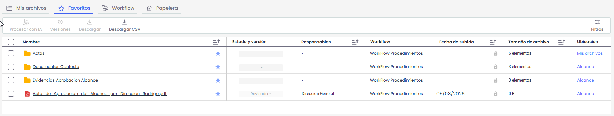

# Carpetas y documentos favoritos

La pestaña **Favoritos** permite consultar rápidamente los **elementos que el usuario ha marcado como favoritos** dentro del gestor documental.

En esta sección se muestran **carpetas y documentos** que han sido marcados como favoritos desde la pestaña **Mis archivos**.

La tabla muestra la misma información que el repositorio principal, incluyendo datos como **nombre del elemento, estado y versión, responsables, workflow, fecha de subida, tamaño y ubicación**.

La columna **Ubicación** indica la carpeta del gestor documental en la que se encuentra almacenado cada elemento. **Al hacer clic sobre esta ubicación, el sistema redirige al usuario a la carpeta original dentro del gestor documental.**

Es posible **navegar por las carpetas y acceder a su contenido** del mismo modo que en la pestaña **Mis archivos**.

Las **acciones disponibles**, tanto en el **menú contextual** de los elementos como en la **barra de acciones superior**, son las mismas que en la pestaña **Mis archivos**.
