# Configuración Workflows

La pestaña **Workflow** del gestor documental permite generar los diferentes estados de aprobación de los documentos almacenados en el Gestor Documental del Sistema de Gestión.

Desde esta pantalla es posible localizar workflows existentes , revisar información resumida de cada uno y acceder a la creación de nuevos flujos.

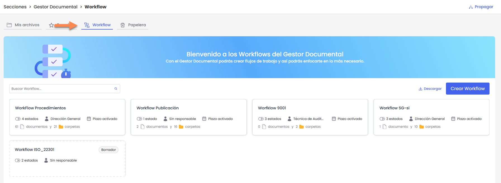

La pantalla muestra un listado de tarjetas, donde cada una corresponde a un workflow.

En cada tarjeta se visualiza información resumida del flujo, como su **nombre**, el **número de estados**, los **responsables**, si tiene **plazo activado** y la cantidad de **documentos** y **carpetas** asociadas.

Además, se indica si el workflow se encuentra **correctamente configurado** o en estado de **borrador**:

* Los workflows en **borrador** son aquellos que no están completamente definidos (por ejemplo, sin responsables u otras configuraciones obligatorias).
* Solo los workflows correctamente configurados podrán utilizarse en el gestor documental.

Al pulsar sobre el nombre de un WF se abre su detalle.

## Configurar WF

### Información general

* **Nombre:** Identifica el nombre del workflow que se mostrara en el listado inicial.
* **Responsable del documento:** Ofrece la posibilidad de identificar el responsable del documento almacenado.
* **Plazos de aprobación en estados:** Permite definir si queremos establecer un plazo de aprobación en los estados documentales.

  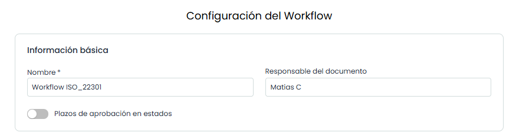

### Estados

Los estados representan las distintas fases del ciclo de vida de un documento.

Cada estado puede tener responsables asociados y condiciones de aprobación. Para que un workflow sea válido, todos los estados deben estar correctamente configurados.

Si un estado no tiene responsables asignados, el workflow se guardará como **borrador** y no podrá utilizarse.

#### Acciones

* **Añadir estado:** Permite crear un nuevo estado dentro del workflow.  
  El estado se inserta al inicio del flujo, siendo el primer estado por el que pasará el documento.

  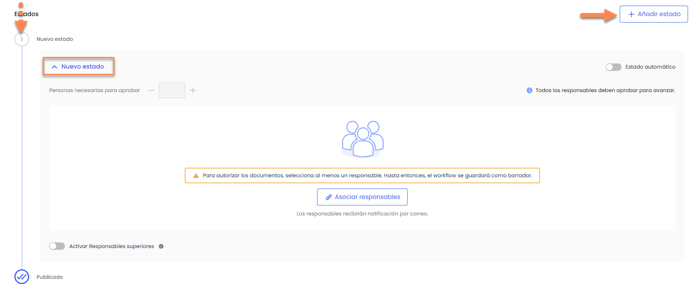
* **Editar Nombre:** Posibilita al usuario definir el nombre del estado. Para realizar el cambio es necesario posicionarnos sobre el nombre y presionar el lápiz.

  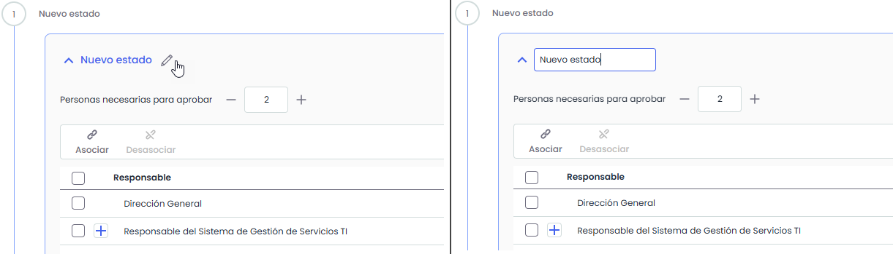
* **Modificar el orden:** Permite definir el orden en el que se ejecutan los estados dentro del workflow.

  El flujo de estados se representa en la parte izquierda en forma de **secuencia vertical numerada**, indicando el orden por el que irá pasando el documento (por ejemplo: 1. Borrador → 2. Revisión → 3. Publicado).

  Al posicionarse sobre un estado, en la parte inferior aparecen las opciones de ordenación:

  * **Subir estado:** permite mover el estado a una posición anterior dentro del flujo.
  * **Bajar estado:** permite mover el estado a una posición posterior dentro del flujo.

    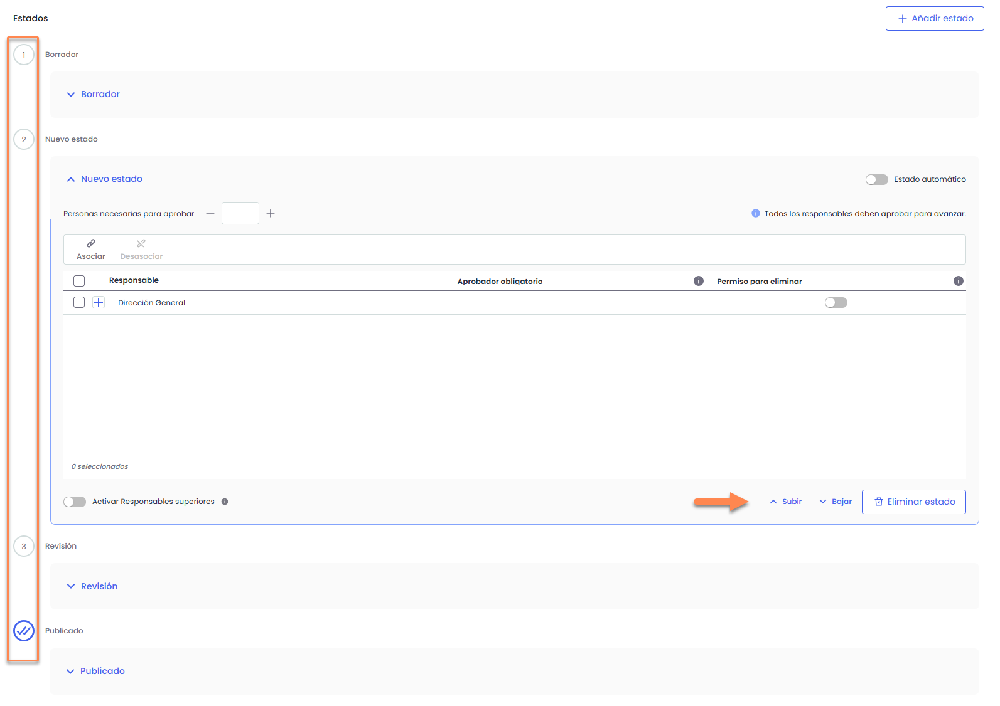
* **Eliminar estado:** Permite eliminar un estado del WF. Para ello se ha de seleccionar la fila o filas deseadas y pulsar sobre el botón ‘Eliminar’.
* **Asociar /desasociar responsables:** Permite definir los responsables encargados de aprobar o rechazar los documentos en ese estado.  
  Se pueden asignar:

  * **Roles**, en cuyo caso los usuarios asociados a ese rol serán los responsables.
  * **Usuarios específicos**, seleccionándolos directamente.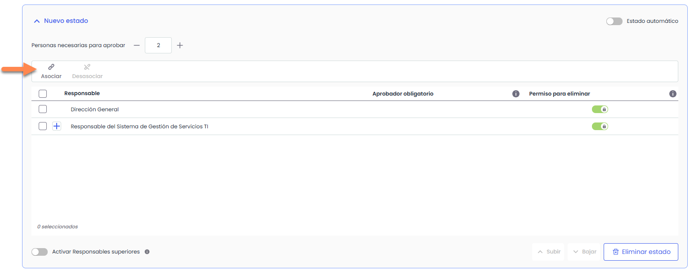
  * **Atributos de Responsables:**

    * **Aprobador obligatorio:** permite indicar qué responsable debe aprobar obligatoriamente el estado. Esta opción no está disponible en estados automáticos ni en el estado final del documento.
    * **Permiso para eliminar:** permite definir qué responsables pueden eliminar el documento en ese estado. Los responsables del primer estado siempre tendrán este permiso activo y no puede desmarcarse.

      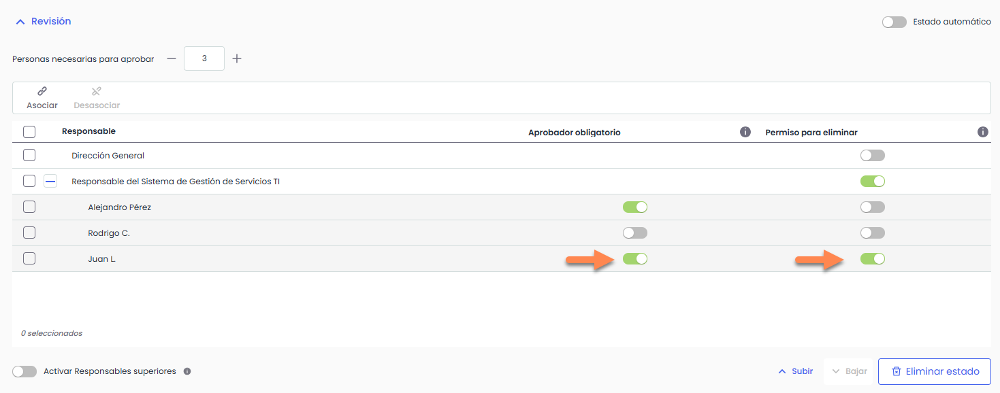
    * **Notificar a todos:** disponible únicamente en el **último estado** del workflow, permite definir si se enviará una notificación a los responsables cuando el documento alcance el estado publicado.

      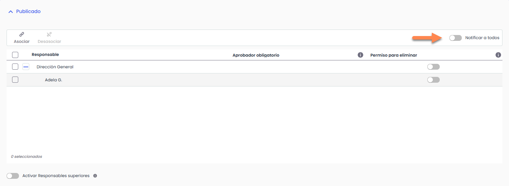

      Las notificaciones del gestor documental incluyen un enlace directo al documento afectado.

      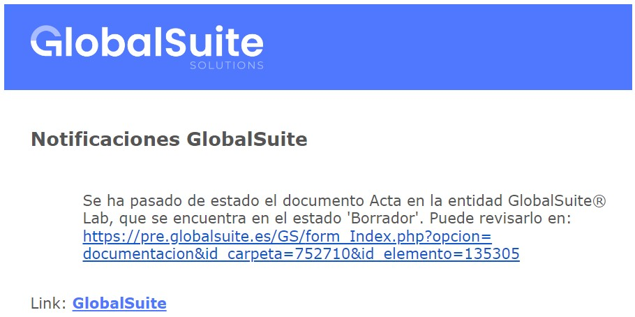
* **Activar responsables superiores:** Permite incluir responsables de entidades superiores en el proceso de aprobación.  
  Esta opción solo está disponible en caso de utilizar **subentidades**. Al activarla, se podrán asignar responsables de entidades superiores para aprobar o rechazar el estado.
* **Estado Automático:** Al pulsar sobre “Estado automático” de un estado, permite pasar al siguiente estado identificado sin necesidad de aprobación por ningún responsable. Esta opción permite dejar trazabilidad de los diferentes estados por los que ha pasado un documento, sin necesidad de que un estado determinado deba ser aprobado por uno o varios responsables.

  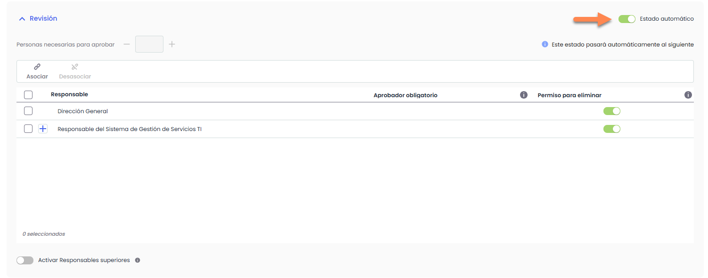
* **Personas necesarias para aprobar:** permite indicar cuántos responsables deben aprobar el estado del documento para que este avance al siguiente estado, siempre que no se trate de un **estado automático**.  
  El valor informado debe ser **igual o inferior** al número de responsables asociados al estado. Si se introduce un valor superior, el sistema lo ajustará automáticamente al máximo permitido.

  Si no se informa ningún valor, se entenderá que **todos los responsables** del estado deben aprobar el documento.
* **Plazo (días):** Si se marca “Plazos de aprobación en estados” en los datos generales, permite identificar el plazo de días necesario para que los distintos responsables aprueben el estado del documento, pudiéndose dar los siguientes casos:

  * **Sin plazo definido:** Si el usuario no ha establecido un plazo de aprobación, el documento no cambiará su estado hasta que todos los responsables aprueben el estado del documento.
  * **Plazo definido:** Si el usuario ha definido un plazo de aprobación pueden darse dos situaciones, que todos los responsables hayan aprobado el documento, por lo que la herramienta no modificará su estado hasta cumplir el plazo definido, o que se haya cumplido el plazo a falta de aprobación por parte de algún responsable, situación en la que el documento volverá al estado anterior identificado en la tabla.
  * **Atrás:** Posibilita una vez pasado el plazo sin que todos los responsables requeridos hayan aprobado la documentación, regresar al estado anterior del documento.

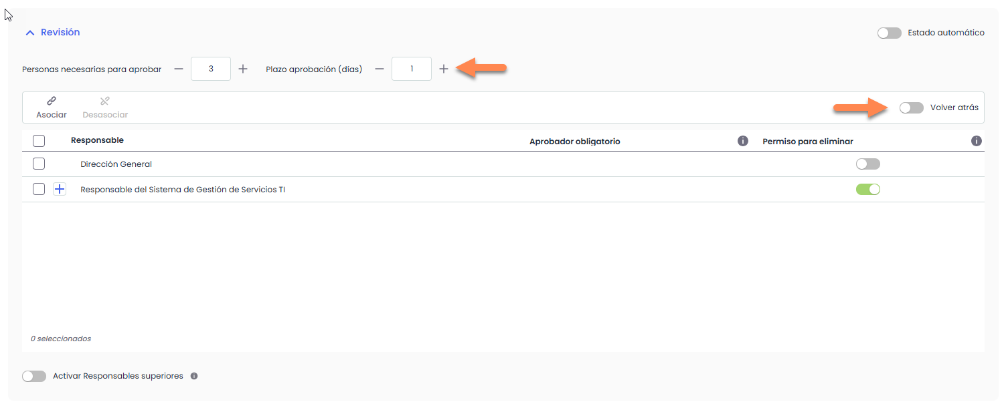
