# Mis Archivos

En la pestaña **Mis archivos** se muestra el repositorio de las carpetas y documentos al que el usuario tiene acceso.

La pantalla se compone de los siguientes elementos:

## Indicadores superiores

Muestran información resumida del contenido almacenado:

* Número de **carpetas**
* Número de **documentos**
* Número de **workflows**
* Número de **elementos eliminados**
* **Espacio ocupado** en el gestor documental

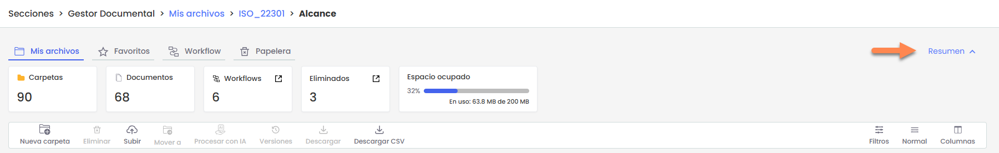

Esta sección puede **mostrarse u ocultarse** haciendo clic en la opción **Resumen**, situada en la parte superior derecha de la pantalla. Cuando se contrae, se ocultan los indicadores para disponer de mayor espacio de visualización en la tabla de archivos.

## Navegación por carpetas

El gestor documental organiza la información mediante una **estructura de carpetas**.

Para acceder al contenido de una carpeta, basta con **hacer clic sobre su nombre** en la tabla. De esta forma se puede navegar entre los distintos niveles de carpetas.

En la parte superior de la pantalla se muestra la **ruta de navegación**, que permite volver a ubicaciones anteriores haciendo clic sobre ellas.

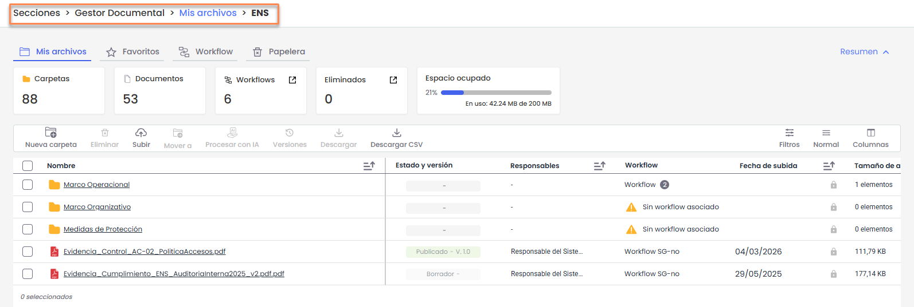

## Acciones

Permite realizar acciones sobre los elementos seleccionados, como:

* **Nueva carpeta**: crear una nueva carpeta.
* **Eliminar**: eliminar los elementos seleccionados.
* **Subir**: cargar archivos desde el equipo del usuario.
* **Mover a**: mover documentos o carpetas a otra ubicación.
* **Procesar con IA**: permite aplicar procesamiento automático al documento.
* **Versiones**: consultar las versiones de un documento.
* **Descargar**: descargar el archivo seleccionado.
* **Descargar CSV**: exportar el listado de elementos en formato CSV.

## Tabla de archivos y carpetas

Muestra el listado de carpetas y documentos almacenados. En esta tabla se pueden visualizar datos como:

* **Nombre**: nombre del archivo o carpeta.
* **Estado y versión**: estado actual del documento y versión correspondiente.
* **Responsables**: usuarios responsables del documento.
* **Workflow**: flujo de aprobación asociado.
* **Fecha de subida**: fecha en la que se ha cargado el documento.
* **Tamaño**: en las carpetas muestra el **número de elementos que contiene** y en los archivos el **tamaño del fichero**.

A continuación se detalla la funcionalidad de cada una de las acciones disponibles en el Gestor documental

## Crear una carpeta

Permite crear una nueva carpeta dentro de la ubicación actual. Esta opción solo estará disponible cuando **no haya carpetas ni documentos seleccionados**.

Al hacer clic en **Nueva carpeta**, se abrirá una ventana en la que será necesario indicar:

**Nombre de la carpeta:** Campo obligatorio donde se debe indicar el nombre de la carpeta. **No puede contener caracteres especiales ni coincidir con el nombre de otra carpeta existente en la misma ubicación.**

**Workflow:** Un **workflow** es el flujo de estados por el que pasa un documento dentro del gestor documental. Define las **etapas del documento (por ejemplo: borrador, revisado o publicado)** y los **usuarios responsables de aprobar o revisar cada estado**. Para más información, consulte [Configuración Workflows | GlobalSuite Solutions](https://help.globalsuitesolutions.com/es/globalsuite/v1/configuracion-workflows)

* **Si el gestor documental tiene workflows activos**, se deberá seleccionar el workflow o los workflows que tendrá la carpeta. Solo se podrán elegir los **workflows heredados de la carpeta superior**.
* **Si no hay workflows activos**, no será necesario seleccionar ninguno.

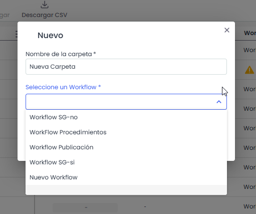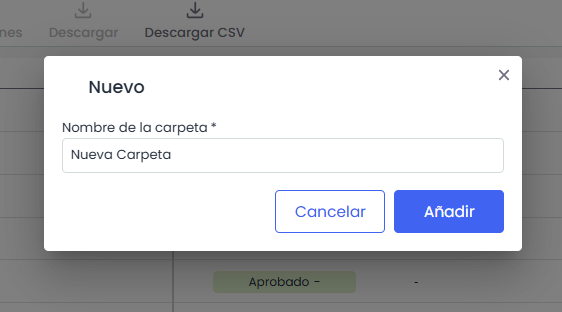

## Subir

Permite **cargar uno o más documentos en la carpeta actual**. Esta opción estará activa cuando **no haya elementos seleccionados**.

Al pulsar **Subir**, se podrán seleccionar **hasta 10 ficheros** desde el equipo a través del explorador de archivos.

Si el gestor documental tiene **workflows activos**, al subir el archivo será necesario **seleccionar el workflow que se aplicará al documento**. Solo se podrán seleccionar los **workflows disponibles en la carpeta en la que se sube el archivo**.

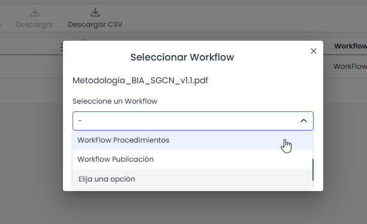

**Formatos de archivo permitidos**

* **Documentos**: PDF, DOC, DOCX, DOT, TXT, RTF
* **Hojas de cálculo**: XLS, XLSX, XLSM, CSV
* **Presentaciones**: PPT, PPS, PPTX, PPSX
* **OpenOffice**: ODT, ODP, ODS, ODG
* **Imágenes**: JPG, JPEG, PNG, BMP, SVG, MGR
* **Modelado y diagramas**: VSD, VST, BPM, BPMC
* **Gestión de proyectos**: MPP, MPT
* **Correos electrónicos**: MSG, EML
* **Archivos comprimidos**: ZIP, RAR, 7Z

## Vincular archivo externo

Permite **enlazar un archivo alojado en un repositorio externo** (Microsoft SharePoint, Microsoft OneDrive, Google Drive u otros) mediante su URL, para utilizarlo dentro del Gestor Documental sin necesidad de subir una copia. El archivo vinculado se comporta como un documento propio del gestor: respeta los permisos de GlobalSuite®, participa en los workflows y puede asociarse a otras partes de la herramienta.


Esta acción solo está disponible si la opción \*\*Permitir vincular archivos externos\*\* está activada en \*\*Ajustes > Configuración General > Configuración Gestor Documental\*\*, y para usuarios con permiso para crear documentos. Igual que \*Subir\*, requiere estar situado \*\*dentro de una carpeta\*\*.


Desde el menú **Nueva** del Gestor Documental, selecciona **Vincular archivo externo**.

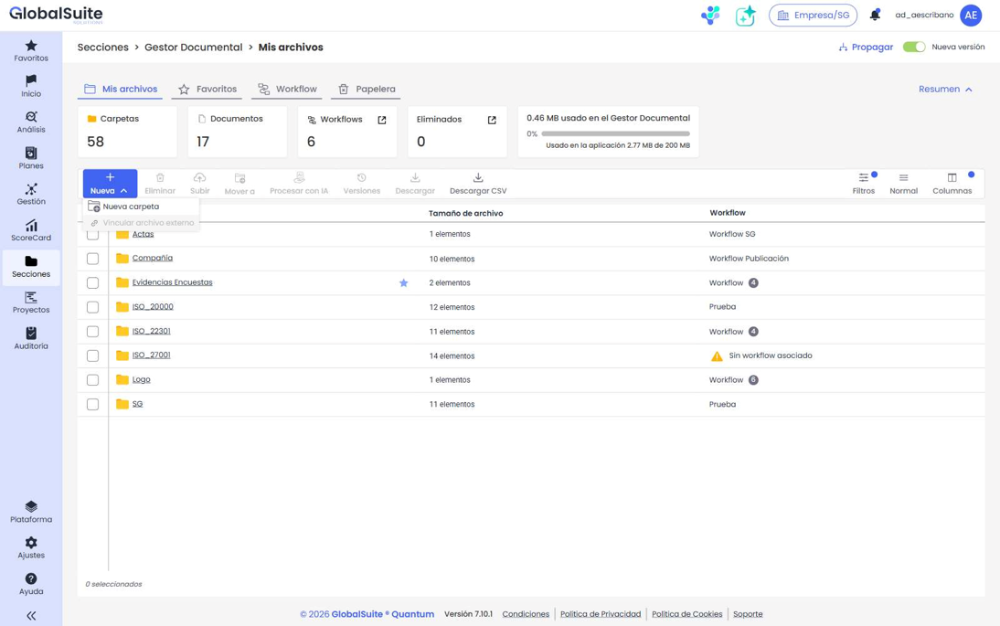

Se abrirá una ventana en la que se deben indicar:

* **URL del archivo** (obligatorio): dirección del archivo en la plataforma externa.
* **Nombre del archivo** (obligatorio): nombre con el que se mostrará en el gestor.
* **Origen**: plataforma de procedencia (SharePoint, OneDrive, Google Drive u Otro).

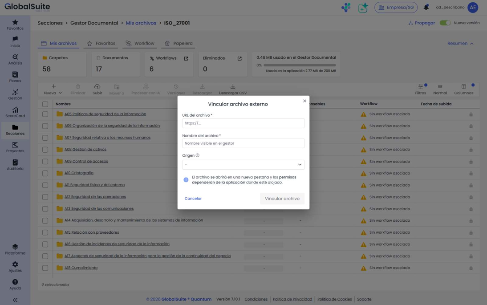

El sistema **valida que la URL corresponda al origen seleccionado** y al conjunto de orígenes habilitados en la configuración. El botón **Vincular archivo** permanece deshabilitado hasta que los campos obligatorios son válidos.

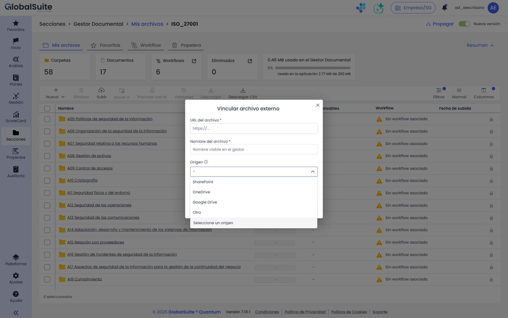

Al confirmar, el archivo externo se crea en la **carpeta actual** y se muestra en el listado junto al resto de documentos, con el **icono del origen** correspondiente.

### Comportamiento del archivo externo

* **Visibilidad y permisos:** se aplican según los permisos de GlobalSuite®, sin consultar los permisos de la plataforma externa.
* **Apertura y vista previa:** al abrir o previsualizar el archivo, la URL se abre en una **nueva pestaña** del navegador. Si el usuario no tiene acceso en la plataforma externa, verá el comportamiento propio de dicha plataforma (p. ej. solicitud de permisos).
* **Workflows:** el archivo externo participa en los workflows documentales activos, pudiendo aprobarse o rechazarse.
* **Asociaciones:** puede asociarse a evidencias, planes u otras partes de GlobalSuite®, igual que un documento propio.
* **Acciones compatibles:** mover, renombrar, etiquetar, marcar como favorito y enviar a la papelera.
* **Descarga:** se intenta descargar el archivo original desde la plataforma remota; si no es posible, se abre la URL externa. En la descarga de una carpeta en ZIP, para los archivos externos se incluye un archivo con el nombre y la URL remota.
* **Versionado:** el historial de versiones y la fecha de modificación del contenido se gestionan en la plataforma externa; GlobalSuite® no los reproduce. La fecha mostrada es la de vinculación.


Al \*\*eliminar\*\* un archivo externo en GlobalSuite® se elimina únicamente el \*\*enlace\*\*: el archivo original en la plataforma externa \*\*no se borra\*\*.


## Mover a

Permite **trasladar uno o varios documentos o carpetas seleccionados** a otra ubicación dentro del gestor documental.

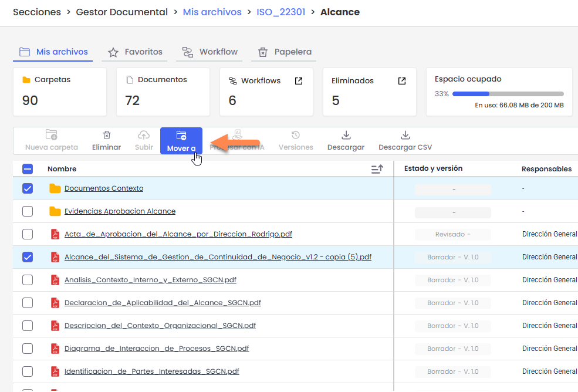

Al seleccionar **Mover**, se abrirá una ventana en la que se deberá **elegir la carpeta de destino**. Para ello, será necesario navegar hasta la ubicación deseada y pulsar **Mover aquí** para confirmar el traslado.

Si el gestor documental tiene **workflows activos**, solo será posible mover elementos a **carpetas que tengan los mismos workflows aplicados**, para mantener la asignación de responsables. Por este motivo, en el selector de destino **solo se mostrarán las carpetas compatibles** con los elementos seleccionados.

Los usuarios de tipo **Enterprise o Entidad** solo podrán realizar esta acción si **tienen permisos para crear ficheros en la carpeta de destino**.

## Procesar con IA

Permite **analizar automáticamente el contenido de un documento mediante el asistente de inteligencia artificial**. A partir del archivo seleccionado, el asistente puede generar resúmenes, extraer información relevante, responder preguntas sobre el contenido o compararlo con modelos normativos.

Esta opción **solo permite procesar un archivo a la vez**.

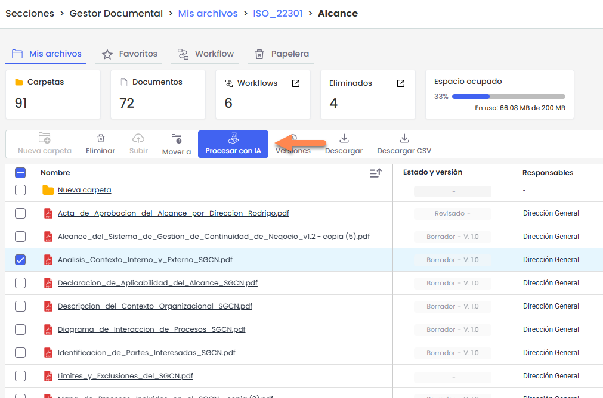

Para más información sobre esta funcionalidad y su uso, consulte el artículo [¿Cómo procesar documentos con IA desde el Gestor Documental de GlobalSuite®? | GlobalSuite Solutions](https://help.globalsuitesolutions.com/es/globalsuite/v1/asistente-documental)

## Versiones

Permite **consultar el historial de versiones de un documento** y acceder a la información de cada una de ellas. Esta opción **solo se habilita cuando se selecciona un fichero**. Mas información en [**Detalles de un documento**](detalle-de-un-documento.md)

## Descargar

Permite **descargar documentos o carpetas seleccionados** desde el gestor documental. Esta opción **se habilita cuando se selecciona al menos un archivo o carpeta**.

Al pulsar **Descargar**, el sistema realizará la descarga según el tipo de selección:

* **Un único archivo**: se descargará directamente ese fichero.
* **Una o varias carpetas**, o una **selección mixta de archivos y carpetas**: se descargará un **archivo comprimido (.zip)** que incluirá todos los elementos seleccionados, manteniendo su estructura interna (subcarpetas y archivos).

También es posible descargar un elemento individual desde el **menú contextual de la fila correspondiente** o desde el **panel Versiones** del documento.

Cuando la descarga genere un **archivo comprimido (.zip)**, este se preparará en segundo plano y estará disponible en **Perfil de usuario > Descargas**.

## Descargar CSV

Permite **exportar la información mostrada en la tabla a un archivo CSV**.

El botón **Descargar CSV** está **siempre disponible**, independientemente de que haya elementos seleccionados.

Al pulsarlo, el sistema generará un archivo CSV que incluirá **los datos visibles en la tabla**, respetando:

* el **orden de las columnas**
* la **visibilidad de los campos**
* los **filtros aplicados**

La generación del archivo se realiza **en segundo plano** y cuando finalice estará disponible en **Perfil de usuario > Descargas**.

## Edición de carpetas y documentos

La información de carpetas y documentos puede gestionarse desde la tabla, el **menú contextual de la tabla** o desde el **panel lateral de detalles**, dependiendo del tipo de elemento.(*Ver mas información* [**Detalle de carpeta**](detalle-de-una-carpeta.md) / [**Detalle de documento**](detalle-de-un-documento.md)).

### Editar la información de una carpeta

En las carpetas es posible:

* **Modificar el nombre** .El nombre de la carpeta no puede contener caracteres especiales ni coincidir con otra carpeta en la misma ubicación.
* **Asignar o modificar workflows**, cuando el gestor documental tenga workflows activos. Solo podrán seleccionarse workflows compatibles con la ubicación, según las reglas de herencia.

### Editar la información de un documento

La información de un documento puede modificarse desde el **menú contextual de la tabla** o desde el **panel lateral de detalles**.

Desde estas ubicaciones es posible:

* **Cambiar el nombre del documento**.
* **Añadir o modificar la descripción**.
* **Consultar la fecha de la versión**.
* **Modificar el workflow**, cuando el gestor documental tenga **workflows activos** y el documento se encuentre en el **primer estado del flujo**.
* **Añadir etiquetas**
* **Ver el estado de las aprobaciones** cuando el gestor documental tenga **workflows activos**
* **Gestionar los seguimientos** asociados a la versión.

Las opciones disponibles dependerán de los **permisos del usuario** y de la **configuración del workflow**.

## Favoritos

Permite **marcar documentos o carpetas como favoritos** para acceder a ellos rápidamente.

Esta acción se realiza desde el **menú contextual del elemento**, utilizando la opción **Marcar como favorito**.

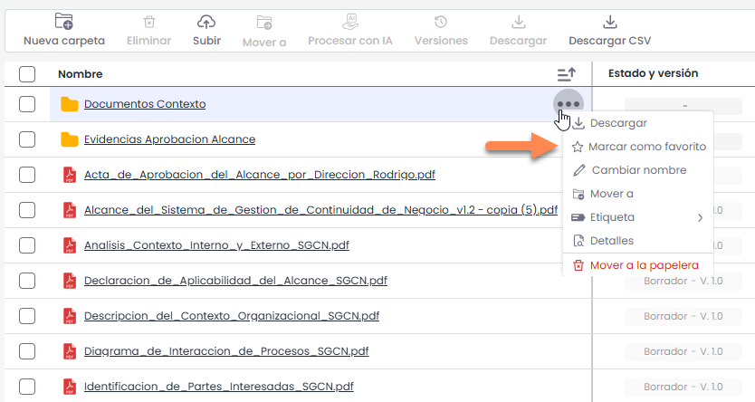

Es posible marcar como favoritos **carpetas, documentos y cualquier otro tipo de elemento** del gestor documental.

Desde esta misma opción también es posible **quitar un elemento de favoritos**.

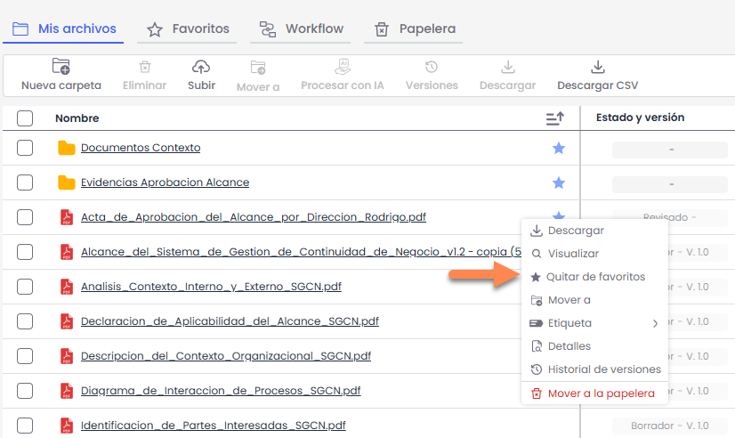

Los elementos marcados como favoritos podrán consultarse posteriormente desde la pestaña **Favoritos** del gestor documental.

Para más información sobre la gestión de favoritos, consulte el apartado [**Favoritos**](../carpetas-y-documentos-favoritos.md).

## Etiquetas

Permiten **clasificar y organizar los documentos** mediante etiquetas.

Las etiquetas pueden **asignarse a los documentos** desde el **menú contextual de la tabla** o desde el **panel lateral de detalles**.

Cada documento puede tener **hasta cinco etiquetas**. El campo de asignación incluye un **buscador** que permite localizar fácilmente las etiquetas disponibles.

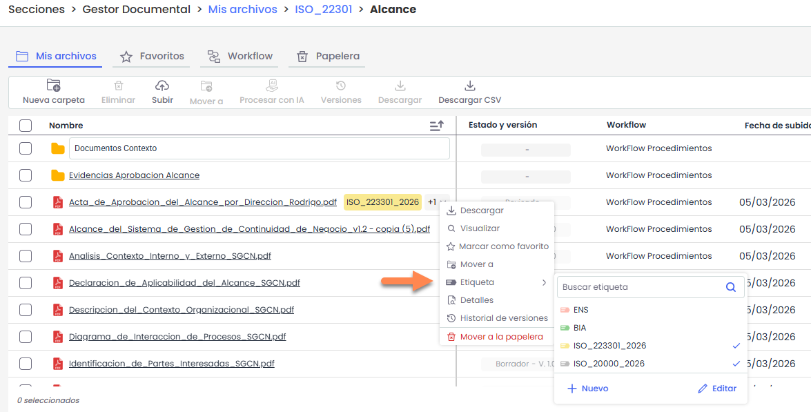

Los usuarios que acceden al repositorio pueden **asignar o quitar etiquetas a un elemento**. Sin embargo, **solo los usuarios administradores pueden crear nuevas etiquetas o eliminar las existentes**.

Las etiquetas pueden crearse desde el **menú contextual** o desde **Ajustes > Configuración general > Configuración Gestor Documental > Etiquetas**.

Las etiquetas también pueden utilizarse posteriormente como **criterio de filtrado** en el gestor documental.

## Eliminar

Permite **eliminar uno o varios documentos o carpetas** del repositorio.

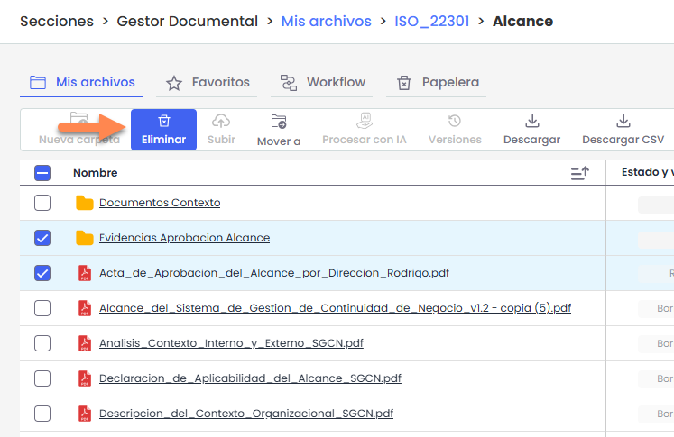

La eliminación puede realizarse de dos formas:

* **De forma general**, seleccionando uno o varios elementos en la tabla y pulsando **Eliminar** en la **barra de acciones**.
* **De forma puntual**, desde el **menú contextual** del elemento.

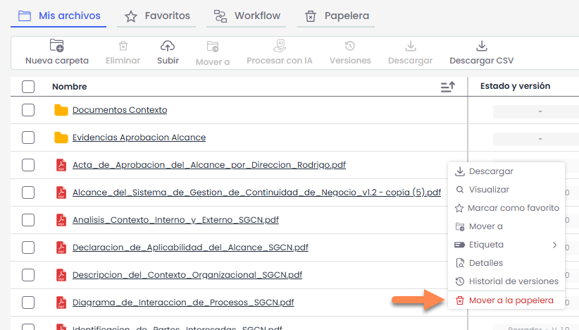

Al eliminar un elemento, este **no se elimina definitivamente**, sino que se **traslada a la pestaña Papelera**, desde donde podrá **restaurarse o eliminarse de forma permanente**.

Para más información sobre la gestión de elementos eliminados, consulte el apartado **Papelera**.

### Eliminación de versiones

Cuando se envía un documento a la papelera, se traslada la **versión activa junto con todas sus versiones asociadas**.

No es posible enviar a la papelera versiones intermedias de forma individual.  
Si se elimina una versión concreta desde el **Historial de versiones**, esta se elimina de forma definitiva y no pasa por la papelera.

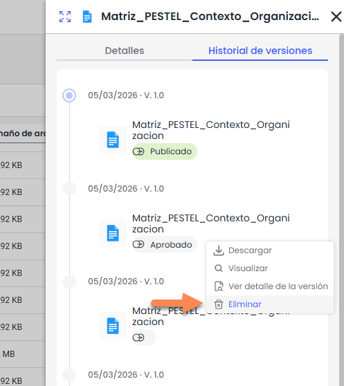

## Filtros y búsqueda

El Gestor Documental permite filtrar la información mostrada en la tabla mediante distintos criterios.

Por defecto, se muestran los siguientes campos de filtrado:

* **Responsables**
* **Workflow**
* **Etiquetas**

Al pulsar el botón **“+”**, se desplegarán todos los campos adicionales disponibles para filtrar (por ejemplo, versión, fecha de subida u otros campos configurados).

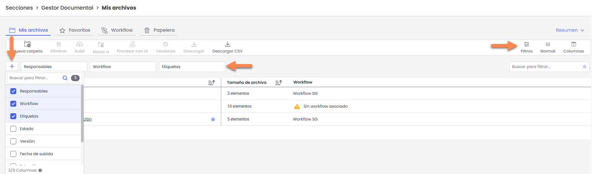

Dependiendo del tipo de campo seleccionado, el sistema mostrará diferentes opciones de filtrado. Por ejemplo:

* En campos tipo lista (como **Etiquetas o Estados**), se mostrarán los valores disponibles para su selección.

  
* En campos de fecha (como **Fecha de subida**), se habilitará la opción de filtrar por una **fecha puntual** o por un **rango de fechas**.  
  El rango puede seleccionarse manualmente mediante el calendario o mediante rangos predefinidos mostrados a la izquierda (por ejemplo: *Esta semana*, *Mes actual*, *Últimos 3 meses*, etc.).

  
* En campos de texto, se permitirá introducir valores manualmente.

#### Búsqueda rápida por nombre

En la parte derecha se encuentra el campo **“Buscar para filtrar…”**, que permite realizar una búsqueda rápida por nombre de carpeta o fichero.

Al introducir las primeras letras, el sistema mostrará automáticamente las coincidencias encontradas.

En los resultados desplegados:

* Al situar el cursor sobre un elemento, se mostrará la opción **“Ver ubicación”**, que permite acceder directamente a la carpeta donde se encuentra el archivo.
* Al hacer clic sobre el nombre del fichero, el sistema abrirá el documento si el formato es compatible con visualización. En caso contrario, se procederá a su descarga automática.
* Al presionar **Enter**, se mostrarán todas las coincidencias en la tabla.

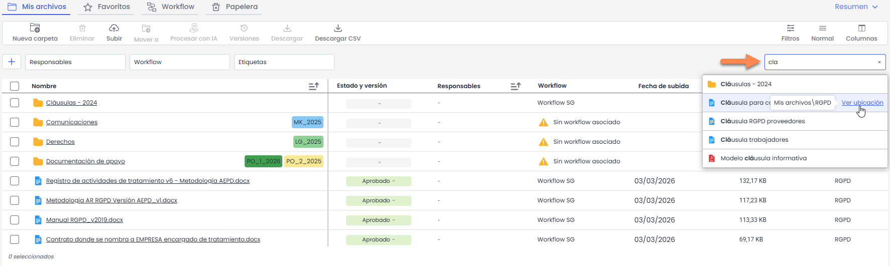

#### Alcance de los filtros y búsquedas

Los filtros y búsquedas se aplican desde la ubicación en la que el usuario se encuentra posicionado, incluyendo sus subcarpetas.  
No se realizan búsquedas en carpetas superiores.

Cuando se aplican filtros o búsquedas, la tabla añade automáticamente la columna **“Ubicación”**, que indica la carpeta en la que se encuentra cada archivo o carpeta que coincide con los criterios aplicados.

Para volver a la vista original, será necesario limpiar los filtros activos.
