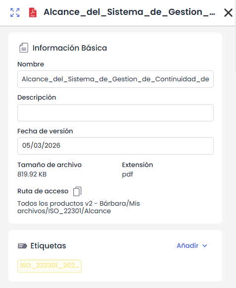
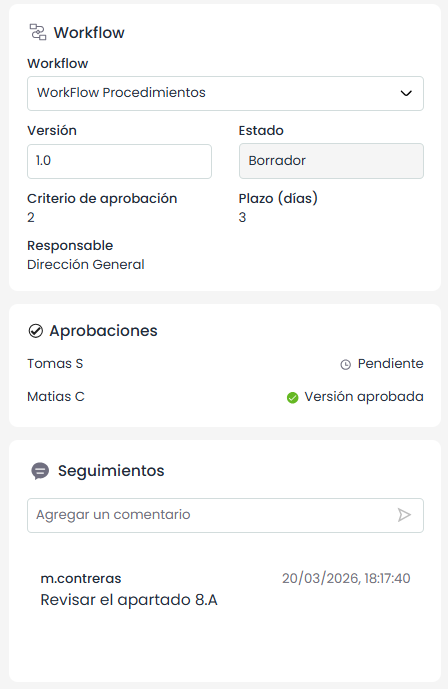
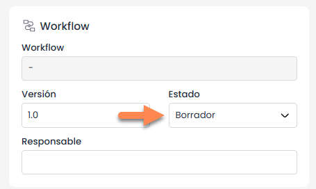
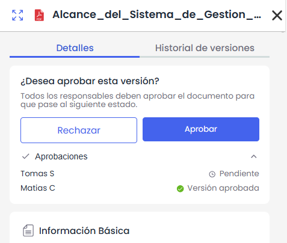
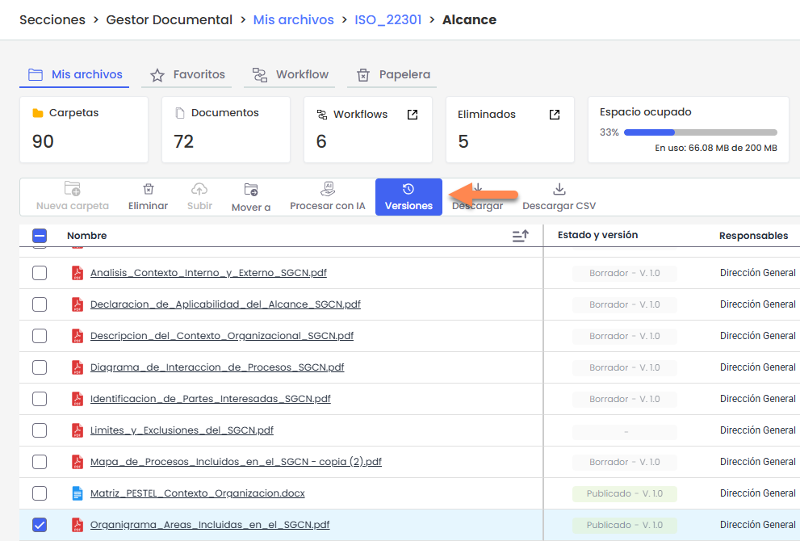
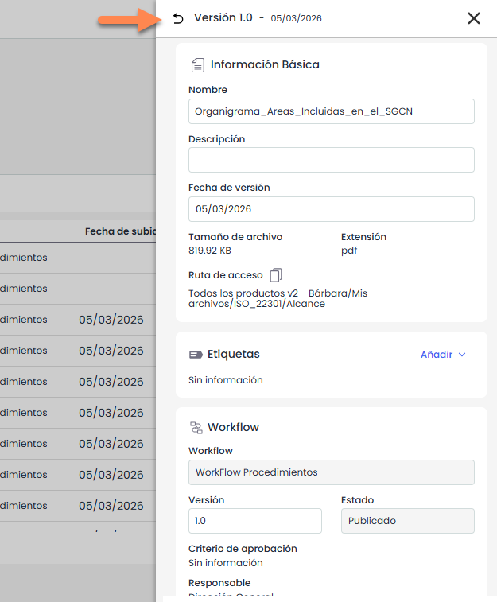

# Detalle de un documento

El **detalle de documento** permite consultar y gestionar la información de un documento dentro del gestor documental, así como el control de sus versiones.

Se accede desde el menú contextual del documento (icono de tres puntos), mediante las opciones **Detalles o Historial de versiones**, abriendo un panel lateral con ambas pestañas.

Desde este panel es posible no solo consultar la información del documento, sino también gestionar su workflow y aprobar o rechazar versiones.

## Detalles de un documento

En esta pestaña se muestra la información del documento y su estado actual.

Se visualizan datos como el **nombre**, **descripción**, **fecha de versión**, **tamaño**, **extensión** y **ruta de acceso**.

Le sigue el apartado de **Etiquetas** desde donde se puede añadir nuevas etiquetas. En caso de los administradores, desde aquí también se podrán crear nuevas etiquetas

También se muestra la información del **workflow (en caso de estar activado el uso de WF en el**

**gestor documental)**, incluyendo el estado, versión, criterio de aprobación, plazo y responsable, en caso de estar configurado.

El bloque de **Aprobaciones** permite muestra el estado actual de las aprobaciones del documento de cada uno de los responsables.

El bloque de **Seguimiento** permite registrar comentarios sobre la versión en curso, quedando trazabilidad con fecha, hora y usuario.

### Acciones

* **Modificar información:** permite editar el nombre, la descripción y la fecha de versión.
* **Asignar workflow:** permite asociar o modificar el workflow del documento. Solo disponible cuando el documento se encuentra en el primer estado.
* **Cambiar Estado del documento:** En caso de que el uso de WF este desactivado, se pueden realizar cambios de estado desde aquí.

  
* **Aprobar / Rechazar versión:** permite gestionar la aprobación del documento dentro del workflow. Aparecerá la opción en el caso de que el usuario logueado sea el responsable del estado actual del documento.

  

En caso de Rechazar la versión, el documento volverá al estado previo del documento.

* **Añadir etiquetas:** permite asignar etiquetas al documento. *(Ver apartado “Etiquetas”)*
* **Añadir comentarios:** permite registrar comentarios en el seguimiento.

## Historial de Versiones

Permite **consultar el historial de versiones de un documento** y acceder a la información de cada una de ellas. Esta opción **solo se habilita cuando se selecciona un fichero**.

Al pulsar **Versiones**, se abrirá un **panel lateral** donde se muestran todas las versiones del documento, ordenadas **de la más reciente a la más antigua**. Este panel puede **expandirse para visualizar más información**.

Desde este panel es posible realizar diferentes acciones sobre cada versión, como **descargar**, **visualizar**, **ver detalles de la versión** o **subir una nueva versión del documento**.

### Ver detalles de una versión

El comportamiento depende de la versión seleccionada:

* **Si se selecciona la versión vigente**, el panel mostrará directamente la información del documento en la pestaña **Detalles**.
* **Si se selecciona una versión anterior**, se abrirá la vista de detalles de esa versión desde el listado de versiones.   
  Para volver al listado de versiones, se debe hacer clic en el **icono de retorno** situado en la parte superior del panel.

  

La información disponible para cada versión incluye:

* **Información básica**
* **Etiquetas**
* **Workflow**
* **Aprobaciones**
* **Seguimiento de la versión**

> El apartado **Aprobaciones** solo se mostrará cuando el documento tenga un **workflow activo**.

### Permisos y visibilidad de versiones

Las **versiones visibles** y las **acciones disponibles** sobre ellas dependen de los **permisos del usuario y de la configuración del workflow del documento**.

En función de estos permisos:

* El usuario podrá **ver solo las versiones en las que tenga participación o visibilidad según el workflow**.
* Algunos **campos podrán ser editables o solo de consulta**.
* Los **usuarios administradores** podrán acceder a todas las versiones del documento.

### Subir una nueva versión

Desde el panel de versiones también es posible **subir una nueva versión del documento**.

Para ello, se debe pulsar **Nueva versión**, lo que abrirá el **explorador de archivos del equipo** para seleccionar el fichero que se desea cargar. En este caso **solo se puede seleccionar un archivo**.

El nuevo fichero se registrará como **una nueva versión del documento existente**.

### Eliminación de versiones

La eliminación de documentos desde el **Historial de versiones** depende de la versión sobre la que se actúe.

Si se selecciona la **versión actual (activa)**, estará disponible la opción **Mover a la papelera**.  
Al ejecutarla, se envía a la papelera el documento completo, incluyendo la versión activa y todas sus versiones asociadas.

Si se selecciona una **versión intermedia**, estará disponible la opción **Eliminar**.  
En este caso, se elimina únicamente esa versión concreta del documento, sin afectar al resto de versiones.

Las versiones intermedias eliminadas **no pasan por la papelera**, sino que se eliminan de forma definitiva.

## Actividad

La pestaña **Actividad** permite consultar el historial de acciones registradas sobre el documento desde su panel de detalle, sin salir de la vista principal.

La información se muestra en formato timeline, ordenada de forma descendente, con los eventos más recientes en primer lugar. Cada registro incluye:

* **Fecha**
* **Hora**
* **Usuario**
* **Descripción de la acción**

Esta sección es de solo lectura y los eventos se generan automáticamente a medida que se realizan acciones sobre el documento.

En esta pestaña se registran los siguientes eventos:

* **Documento subido**: se muestra el texto “Se subió el documento.”
* **Documento renombrado**: se muestra el texto “Se modificó el nombre del documento.”
* **Documento aprobado**: se muestra el texto “El documento fue aprobado.”
* **Documento rechazado**: se muestra el texto “El documento fue rechazado.”
* **Workflow asociado**: se muestra el texto “Se añadió el workflow `<nombre_workflow>`.”
* **Workflow modificado**: se muestra el texto “Se modificó el workflow del documento.”
* **Workflow eliminado**: se muestra el texto “Se eliminó el workflow `<nombre_workflow>`.”
* **Etiqueta añadida**: se muestra el texto “Se añadió la etiqueta `<nombre_etiqueta>`.”
* **Etiqueta eliminada**: se muestra el texto “Se eliminó la etiqueta `<nombre_etiqueta>`.”
* **Comentario añadido en seguimiento**: se muestra el texto “Se añadió un comentario en el seguimiento del documento.”
* **Nueva versión creada**: se muestra el texto “Se creó una nueva versión del documento llamada `<nombre_documento>`.”
* **Documento descargado**: se muestra el texto “Se descargó el documento.”
* **Documento procesado con IA**: se muestra el texto “El documento fue procesado con IA.”

En los documentos existentes antes de la entrada en producción de esta funcionalidad, la pestaña Actividad mostrará únicamente los eventos registrados desde ese momento. La actividad anterior deberá consultarse en el apartado de **Logs**.
