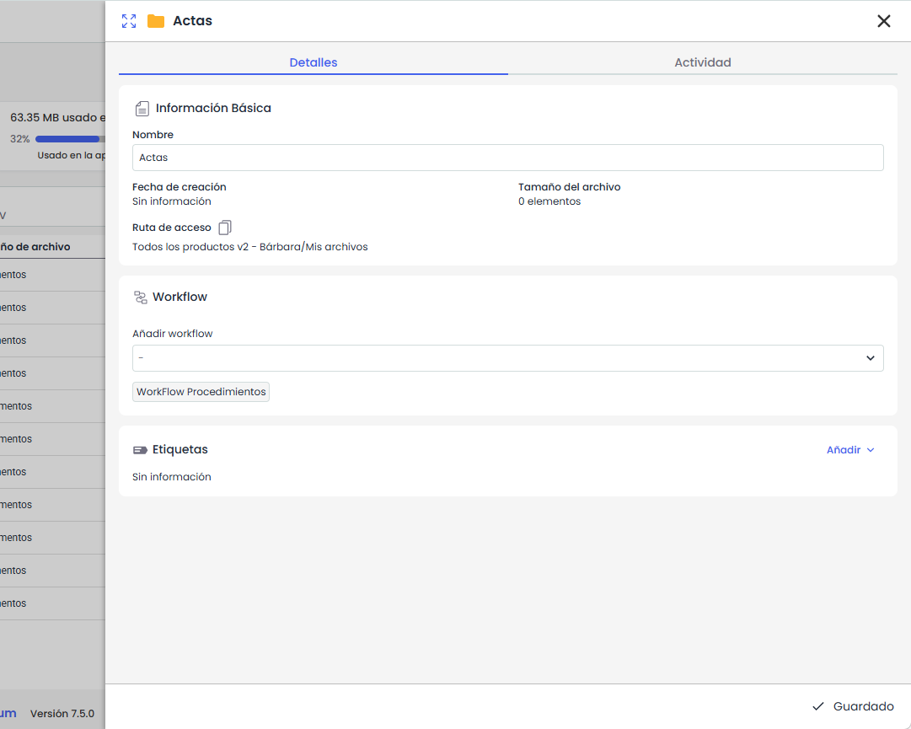

# Detalle de una carpeta

El detalle de carpeta permite consultar y gestionar la información de una carpeta dentro del gestor documental.

Se accede desde el menú contextual de la carpeta (icono de tres puntos), mediante la opción Detalles, lo que abre un panel lateral con la información asociada.

## Detalle de la carpeta

En este panel se muestra la información general de la carpeta:

* **Nombre**
* **Fecha de creación**
* **Número de elementos**
* **Ruta de acceso**

También se visualiza el **workflow** asociado a la carpeta y las **etiquetas**.

### Acciones

* **Modificar nombre:** permite editar el nombre de la carpeta.  
  El nombre de la carpeta **no puede contener caracteres especiales ni coincidir con el de otra carpeta existente en la misma ubicación**.
* **Asignar workflow:** permite asociar o modificar el workflow de la carpeta (según permisos y si existe configuración disponible).
* **Añadir etiquetas:** permite asignar etiquetas a la carpeta. *Mas Información en* [***Etiquetas***](README.md#Etiquetas)

## Actividad

La pestaña **Actividad** permite consultar el historial de acciones registradas sobre la carpeta desde su panel de detalle, sin salir de la vista principal.

La información se muestra en formato timeline, ordenada de forma descendente, con los eventos más recientes en primer lugar. Cada registro incluye:

* **Fecha**
* **Hora**
* **Usuario**
* **Descripción de la acción**

Esta sección es de solo lectura y los eventos se generan automáticamente a medida que se realizan acciones sobre la carpeta.

En esta pestaña se registran los siguientes eventos:

* **Carpeta creada**: se muestra el texto “Se creó la carpeta.”
* **Nombre de carpeta editado**: se muestra el texto “Se modificó el nombre de la carpeta.”
* **Etiqueta añadida**: se muestra el texto “Se añadió la etiqueta `<nombre_etiqueta>`.”
* **Etiqueta eliminada**: se muestra el texto “Se eliminó la etiqueta `<nombre_etiqueta>`.”
* **Workflow asociado**: se muestra el texto “Se añadió el workflow `<nombre_workflow>`.”
* **Workflow eliminado**: se muestra el texto “Se eliminó el workflow `<nombre_workflow>`.”
* **Subcarpeta creada**: se muestra el texto “Se creó la subcarpeta `<nombre_carpeta>`.”
* **Archivo añadido**: se muestra el texto “Se añadió el archivo `<nombre_archivo>`.”
* **Archivo movido dentro de la carpeta**: se muestra el texto “Se movió el archivo `<nombre_archivo>` dentro de la carpeta.”
* **Archivo movido fuera de la carpeta**: se muestra el texto “Se movió el archivo `<nombre_archivo>` fuera de la carpeta.”
* **Archivo renombrado**: se muestra el texto “Se modificó el nombre del archivo `<nombre_archivo>`.”
* **Descarga de la carpeta**: se muestra el texto “Se descargó la carpeta.”

En las carpetas existentes antes de la entrada en producción de esta funcionalidad, la pestaña Actividad mostrará únicamente los eventos registrados desde ese momento. La actividad anterior deberá consultarse en el apartado de **Logs**.
