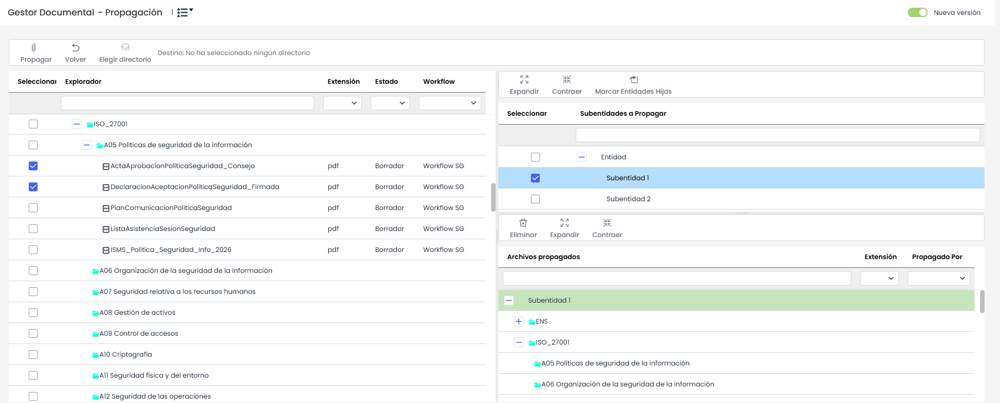

# Propagación Documentos

La presente opción permite la propagar los documentos almacenados en el gestor documental de la empresa matriz a las subentidades que dependen de esta.

Una vez se ha accedido a la opción, se muestran las siguientes tablas:

**Tabla izquierda:** Muestra el listado de documentación almacenada en la empresa matriz. Las opciones que permite la tabla son:

* **Propagar:** Una vez seleccionados los documentos deseados permite propagar los mismos a las subentidades seleccionadas.
* **Volver:** Ofrece la posibilidad de volver a la pantalla inicial del gestor documental.
* **Elegir directorio:** Permite seleccionar la carpeta de destino de los documentos propagados. Para ello se ha de seleccionar la carpeta deseada y pulsar sobre el botón 'Aceptar'.


\*\*NOTA:\*\* Es necesario elegir la carpeta de destino para propagar los documentos a las subentidades.


**Tabla superior derecha:** Muestra el listado de subentidades a las que se pueden asociar documentación de la empresa matriz. Las opciones que permite la tabla son la de expandir o contraer el listado de subentidades.

**Tabla inferior derecha:** Una vez seleccionada la subentidad en la tabla superior, muestra los documentos que se han asociado a la misma. La herramienta ofrece la posibilidad de elminiar un documento asociado, para ello se ha de seleccionar la fila deseada y pulsar sobre el botón 'Eliminar'. Por otro lado se ofrece la posibilidad de expandir o contraer el directorio de carpetas y documentos.
